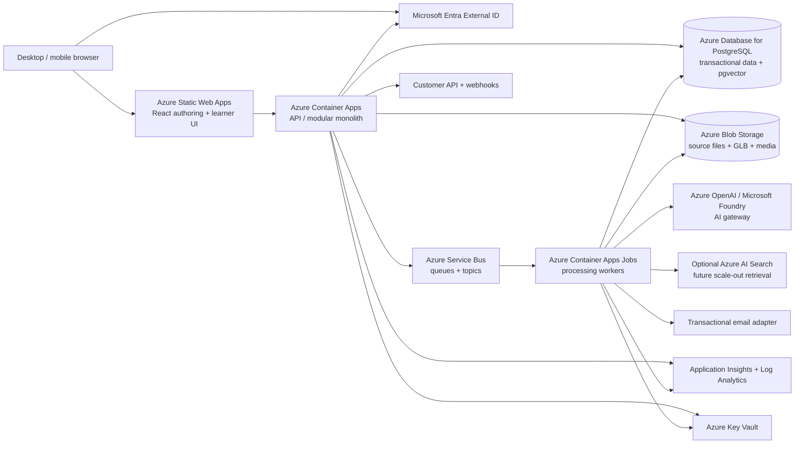
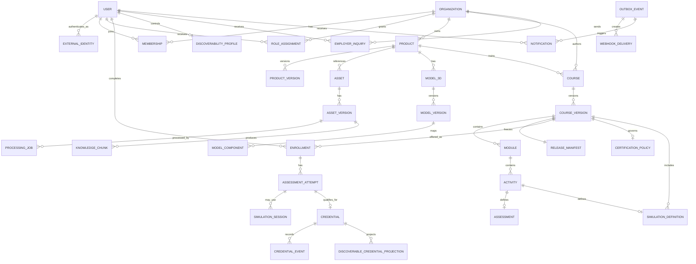
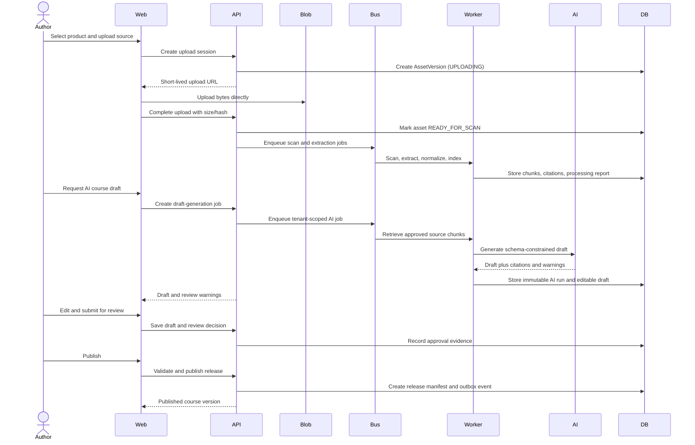
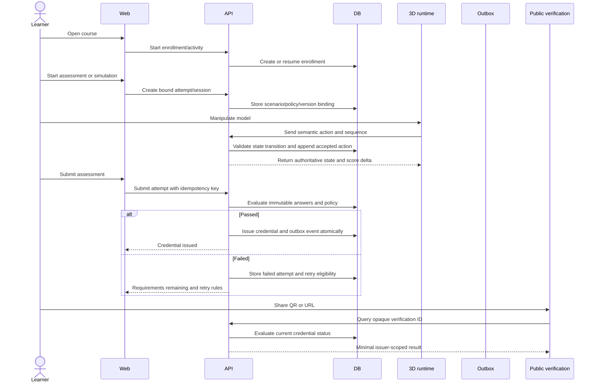

# Medical Device Training and Certification Platform

## Technical Solution Design

**Document status:** Draft for implementation planning  
**Version:** 0.31
**Date:** 2026-10-22
**Scope:** MVP architecture and phased evolution  
**Primary deployment target:** Microsoft Azure  
**Initial pilot target:** Approximately five medical-device training organizations; this is a pilot-sizing assumption, not a product or architectural cap.

---

## 1. Executive summary

This document defines an MVP for a multi-tenant, Azure-first web platform that lets organizations turn product knowledge into interactive training and issuer-controlled certifications.

Organizations will be able to upload product documentation and media, including PDFs, handbooks, images, video, and existing 3D models. A core MVP capability is an approved LLM workflow that converts PDF and handbook knowledge into source-grounded draft course content, assessments, procedural scenarios, and simulation configurations. A no-code authoring environment will let subject-matter experts revise those drafts. AI-generated content will never become active training without explicit review and approval by an authorized organization user.

Learners will use a responsive desktop and mobile web experience to complete courses, interact with product models, perform simulated procedures, respond to injected faults, and complete assessments. The platform will issue an organization-controlled certification record when the learner satisfies the issuer’s configured rules. Records will be version-aware, revocable, expirable, and accessible through a public online verification URL and QR code; portable cryptographic credentials are future scope.

The initial platform will also support an opt-in talent-discovery experience. A learner may choose to be discoverable by organizations seeking people with specific certifications in a geographic area. Employers can view limited verified profile information and send consent-based contact requests without receiving private contact details automatically.

LLM-assisted conversion and browser-based 3D modeling/interaction are central MVP pillars, not optional enhancements. The first thin slice must prove PDF/handbook-to-training conversion and interactive use of one approved 3D model; image/video reconstruction remains a required, evidence-gated MVP ingestion path.

The MVP is intentionally focused on certification based on activity performed inside the platform. It does not manage onsite scheduling, attendance, practical sign-off, patient data, full recruiting workflows, or claims that a credential automatically satisfies a regulator or professional licensing body.

### Recommendation in one sentence

Build a modular monolith with asynchronous processing on Azure: React/TypeScript web applications, Azure Static Web Apps, Azure Container Apps, Azure Database for PostgreSQL, Azure Blob Storage, Azure Service Bus, Microsoft Entra External ID, Azure OpenAI/Microsoft Foundry, and an open-source web 3D runtime—preferably Babylon.js—using glTF/GLB as the canonical model format.

---

## 2. Confirmed product intent

### 2.1 Outcome

Provide a platform that allows organizations to create product-specific, story-based training and certifications from product assets and documentation, with interactive 3D simulation and AI-assisted authoring.

### 2.2 Initial users

| User | Primary needs |
|---|---|
| Organization administrator | Configure the organization, users, roles, products, visibility, and certification policies. |
| Content author | Create and edit courses, modules, procedures, questions, scenarios, and learner instructions. |
| Subject-matter expert/reviewer | Verify source grounding, model accuracy, procedure correctness, scoring, and safety before publication. |
| Instructor/evaluator | Review learner performance where the course configuration requires human review; not required for the MVP’s certification decision. |
| Learner | Discover or receive a course, complete training, pass assessments, and manage credentials. |
| Employer/organization recruiter | Search for opt-in learners with relevant certifications and send consent-based contact requests. |
| Platform operator | Operate the service, manage support, monitor jobs, and handle security or data requests. |

### 2.3 Why now

The current onboarding process is live, one-to-one, and onsite in front of clients. The platform’s value is to move repeatable product knowledge, simulated practice, and competency assessment into a reusable digital experience while allowing organizations to define their own certification standards.

### 2.4 Success definition

The MVP is successful when a pilot organization can:

1. Create a tenant and invite users.
2. Upload all required source types: PDF/manual, existing 3D model, images, and video.
3. Generate a reviewable course and simulation draft with AI assistance.
4. Validate and publish a versioned course without engineering support.
5. Enroll a learner and track course activity.
6. Assess the learner using interactive simulation and configured assessments.
7. Issue, verify, expire, revoke, and display a credential.
8. Allow an opt-in learner to be discovered by an organization and receive a contact request.

### 2.5 Hard constraints

- Azure is the preferred cloud platform.
- Approximately five organizations are expected in the initial pilot deployment, but organization count is not a product limit or a reason to hard-code a fixed scaling ceiling.
- The first domain is medical-device training.
- The application must not process patient-identifiable information or protected health information.
- The initial experience is English-only and online-only.
- The initial learner experience is a web browser on desktop and mobile.
- Modern Chrome, Edge, Safari, and Firefox are the supported browser baseline.
- The MVP must support PDF/manual, existing 3D, image, and video ingestion paths for a defined set of supported input profiles. Each path must produce a usable reviewable output for its acceptance fixtures; arbitrary unsupported inputs must be rejected explicitly rather than silently treated as successful.
- LLM conversion of PDF/handbook knowledge into training content is a core MVP workflow; its output is always a draft until human approval.
- 3D model preparation and learner interaction are core MVP workflows, with an equivalent path for certification-critical activities when a device or accessibility constraint prevents full 3D interaction.
- Certification is based only on activity and assessment inside the platform.
- Learners have persistent personal accounts and retain credentials across organizations.
- Public learners are free initially; organizations are the eventual paying customer.

### 2.6 Explicitly out of scope for the MVP

- Offline course delivery.
- Onsite-session scheduling, attendance management, or physical-device sign-off.
- Patient records, patient simulations containing real PHI, or clinical case management.
- Full applicant-tracking, job-posting, interview, or hiring workflows.
- Automatic claims of regulatory or professional-licensing recognition.
- Multilingual content and localization workflows.
- Enterprise SSO/SAML as a required first-release feature.
- Automatic publication of AI-generated content.
- A general-purpose 3D modeling desktop application.
- A guarantee that arbitrary images or video can produce a publication-ready model without review. The supported image/video profile, quality threshold, and fallback behavior are part of the MVP acceptance contract.

---

## 3. Capability map and build order

The product contains several independently testable capabilities. The capability boundaries below should remain stable during implementation.

| Module ID | Responsibility | Depends on |
|---|---|---|
| `identity-access` | Personal accounts, authentication, sessions, organization membership, roles | — |
| `tenant-management` | Organization isolation, organization settings, branding, product ownership | `identity-access` |
| `asset-ingestion` | Uploads, source versions, PDF/image/video/model processing, object storage | `tenant-management` |
| `ai-authoring` | Extraction, retrieval, draft generation, source citations, AI review metadata | `asset-ingestion` |
| `model-runtime` | 3D model normalization, component metadata, browser rendering, simulation state | `asset-ingestion` |
| `course-authoring` | Courses, modules, activities, scenarios, assessments, versioning, approval | `ai-authoring`, `model-runtime` |
| `learning-delivery` | Catalog, enrollment, learner progress, course playback, activity events | `course-authoring`, `identity-access` |
| `assessment-certification` | Attempts, scoring, pass/fail, retries, credential lifecycle, verification | `learning-delivery` |
| `discovery-contact` | Opt-in visibility, certification search, employer inquiries | `assessment-certification`, `identity-access` |
| `reporting-integrations` | Organization dashboards, core API, webhooks, exports | `learning-delivery`, `assessment-certification` |
| `platform-operations` | Jobs, observability, security operations, deployment, support tools | all modules |

### Recommended build order

1. `identity-access` and `tenant-management`
2. `asset-ingestion` and `platform-operations` foundations
3. `model-runtime` vertical slice using one validated product model
4. `ai-authoring` PDF-to-course vertical slice
5. `course-authoring` and publication workflow
6. `learning-delivery` and `assessment-certification`
7. Image/video-to-3D adapters and advanced simulation behaviors, using the acceptance fixtures defined in the 3D spike
8. `discovery-contact` and `reporting-integrations`
9. Hardening, pilot rollout, and future-phase extensions

The four ingestion paths are MVP requirements and all must be implemented and evidenced before pilot admission. They need not all block the first end-to-end thin slice: that slice should prove that one product can move from an existing model and PDF/handbook through LLM-assisted training conversion and interactive 3D use to an approved course, learner completion, and credential issuance. Image-to-3D and video-to-3D then enter the same pipeline through interchangeable asynchronous adapters. Before the MVP is accepted, each adapter must pass at least one representative input fixture and produce a candidate model that a reviewer can approve against the documented quality threshold; “job completed” or “failure reported” alone is not success.

---

## 4. Architecture principles

1. **Tenant isolation by construction.** Every tenant-owned record, object, search document, job, event, and audit record carries an organization boundary. Database row-level security or an equivalent database-enforced boundary is enabled in the first production migration, not deferred until later.
2. **Human approval for consequential content.** AI can accelerate drafting but cannot publish training, simulation, scoring, or credential rules.
3. **Version everything that affects certification.** A learner’s credential points to immutable course, model, assessment, and policy versions.
4. **Separate the 3D concerns.** Rendering, asset reconstruction, model metadata, and simulation behavior are different components and must not be coupled to one vendor or one file format.
5. **Asynchronous for heavy work.** File processing, OCR, embeddings, model reconstruction, optimization, and AI generation are jobs—not synchronous HTTP requests.
6. **Portable AI boundary.** The application depends on an internal AI gateway contract, not directly on one model provider’s API shape.
7. **Structured authoring.** AI and no-code tools produce a validated course and simulation schema, not arbitrary HTML or executable code.
8. **Evidence over claims.** Every generated instruction, assessment item, and scenario rule should retain source references or an explicit author rationale.
9. **Cost-aware Azure adoption.** Use managed Azure services where they reduce operational burden; avoid adding a service merely because it exists.
10. **Pilot-scale simplicity.** Start with a modular monolith and worker processes. Split services only when load, team ownership, or isolation requirements justify it.
11. **No provider fallback across privacy boundaries in the MVP.** All customer-content AI processing uses approved Azure model deployments in approved regions. A future provider fallback requires a separate data-processing and contract review.

---

## 5. Target solution architecture



### 5.1 Frontend

Use a React and TypeScript application hosted on Azure Static Web Apps. The frontend should be split into two route families within one deployable application:

- **Organization workspace:** administration, content ingestion, authoring, review, publishing, reporting, and discovery.
- **Learner experience:** catalog, course playback, 3D activities, assessments, credentials, public verification, and privacy controls.

Azure Static Web Apps is appropriate for the static web application, custom domains, TLS, preview deployments, and integration with a separately hosted API. See the [Azure Static Web Apps overview](https://learn.microsoft.com/en-us/azure/static-web-apps/overview/).

The 3D runtime should be loaded as a dedicated React feature boundary so a learner who is viewing a text-only module does not pay the cost of loading the full 3D bundle.

### 5.2 API and application services

Use a TypeScript API deployed to Azure Container Apps. The initial API is a modular monolith with clear internal module boundaries rather than a collection of networked microservices.

The API owns:

- Authentication token validation and authorization decisions.
- Organization and membership management.
- Course and asset metadata.
- Publishing and version transitions.
- Learner enrollment and progress.
- Assessment and credential transactions.
- Public credential verification.
- Search and employer inquiry APIs.
- Core customer API and webhook management.

Container Apps supports containerized APIs, event-driven processing, revisions, internal service discovery, and autoscaling. See the [Azure Container Apps overview](https://learn.microsoft.com/en-us/azure/container-apps/overview).

### 5.3 Database

Use Azure Database for PostgreSQL Flexible Server as the system of record. PostgreSQL is a good fit because the domain is relational, versioned, and audit-heavy. It also supports structured JSON for extensible activity configuration and vector extensions for the MVP retrieval implementation.

Use one logical database with tenant-scoped tables for the MVP. Do not create one database per organization at this stage. Apply two layers of tenant enforcement from the first production migration:

1. Application authorization checks in every repository/service method.
2. PostgreSQL row-level security for tenant-owned tables. Each request or job establishes a trusted transaction-local tenant context before accessing tenant tables. An equivalent boundary is not the MVP default and would require an explicit architecture decision.

Intentional cross-organization discovery does not bypass this boundary. It reads from a separate privacy-safe projection containing only opt-in profile fields and currently active credential summaries. It never queries source content, private course data, or raw tenant tables without an explicit issuer/discovery policy.

The database stores metadata, not large media or 3D binaries. See the [Azure Database for PostgreSQL Flexible Server overview](https://learn.microsoft.com/en-us/azure/postgresql/overview).

### 5.4 Object storage

Use Azure Blob Storage for:

- Uploaded PDFs, images, videos, CAD/model files, and source archives.
- Normalized GLB/glTF models and textures.
- Processed previews and thumbnails.
- AI extraction artifacts and generated draft packages.
- Exported certificate files if downloadable PDFs are later added.

Files must be private by default. The API issues short-lived, scoped upload/download URLs. Public credential verification pages may expose credential metadata but must not expose source files or private learner data.

Blob Storage is intended for unstructured data and browser delivery, including documents, images, video, and audio. See the [Azure Blob Storage introduction](https://learn.microsoft.com/en-us/azure/storage/blobs/storage-blobs-introduction).

### 5.5 Job processing and messaging

Use Azure Service Bus queues for long-running work and topics for internal domain events. Use Container Apps Jobs or worker containers for processing.

Example queues:

- `asset-scan`
- `document-extract`
- `media-extract`
- `model-normalize`
- `model-reconstruct`
- `model-quality-check`
- `knowledge-index`
- `ai-draft-generate`
- `thumbnail-generate`
- `notification-create`
- `email-delivery`
- `webhook-delivery`

Jobs must be idempotent, retryable, observable, and safe to resume. Every job has a durable record in PostgreSQL and a correlation ID. Service Bus is appropriate for decoupling producers and workers and for reliable enterprise messaging. See the [Azure Service Bus overview](https://learn.microsoft.com/en-us/azure/service-bus-messaging/service-bus-messaging-overview).

Use a default bounded retry policy of three attempts with exponential backoff and jitter, for example approximately 1 minute, 5 minutes, and 30 minutes, unless a job type has a documented alternative. Do not retry deterministic validation, rights, malware, or unsupported-input failures. Those transition directly to a reviewable failure state. Transient provider, network, or capacity failures may retry. Every job type defines a timeout, maximum input size, concurrency limit, and dead-letter operator action.

### 5.6 Identity

Use Microsoft Entra External ID as the identity provider for personal learners and organization users. The first release should support email/password and invitation-based membership. The domain model must not assume that a person belongs to only one organization.

Entra External ID is designed for consumer and business-customer identity and supports external app users, custom sign-in experiences, and self-service registration. See the [Microsoft Entra External ID overview](https://learn.microsoft.com/en-us/azure/active-directory/external-identities/external-identities-overview).

The platform’s own database remains the source of truth for application profile, membership, roles, discovery preferences, and credential ownership. Entra is the source of truth for authentication identity, not product authorization.

MVP identity behavior is explicit:

- Users verify their email before joining an organization or receiving a credential.
- Password recovery is handled by the identity provider.
- Invitations are hashed at rest, single-use, scoped to one organization and role, and expire after a configured interval.
- A user can accept an invitation only after authenticating or creating the matching personal account; duplicate email identities are linked through a controlled account-linking flow, never by silently merging records.
- Organization switching changes the active authorization context and is recorded for administrative actions.
- The API validates issuer, audience, signature, expiry, and nonce/token requirements using the provider’s supported library.
- Platform operators use stronger administrative controls, including MFA where available; enterprise SSO is future scope, not a reason to weaken the first-release identity boundary.

### 5.7 AI platform

Use approved Azure OpenAI/Microsoft Foundry model deployments behind an internal AI gateway. The MVP does not send customer content to an unapproved fallback provider. The gateway should expose application-level operations such as:

- `extract_document`
- `summarize_source`
- `generate_course_draft`
- `generate_assessment_draft`
- `generate_simulation_draft`
- `suggest_component_metadata`
- `answer_author_question`
- `generate_source_citations`

The gateway owns prompt templates, model routing within approved Azure deployments, schema validation, safety checks, token budgets, tenant context, evaluation logging, and provider-specific data handling. Customer source documents should be grounded through retrieval rather than used as undifferentiated prompt text.

Azure documents that prompts, completions, embeddings, and training data for Models sold by Azure are not available to other customers and are not used to train foundation models without permission or instruction. The same documentation describes geography-aware processing and encrypted stored data, with caveats for certain preview features. The implementation must record the exact deployment type, region, model, retention behavior, and applicable terms; “Azure” alone is not a sufficient data-processing specification. See the [Microsoft Foundry data, privacy, and security documentation](https://learn.microsoft.com/en-us/azure/foundry/responsible-ai/openai/data-privacy).

### 5.8 Retrieval

For the five-organization MVP, use PostgreSQL full-text search plus `pgvector` unless early evaluation shows that hybrid retrieval quality or corpus scale requires Azure AI Search. This keeps the MVP’s service count and cost lower.

Move retrieval to Azure AI Search when one or more of these conditions occur:

- Large document collections make database retrieval slow.
- Hybrid keyword/vector ranking materially improves authoring quality.
- Search filters and permission trimming become complex.
- Image or multimodal vector search becomes a primary capability.
- Multiple independent AI experiences need a shared search layer.

Azure AI Search supports vector search, hybrid keyword/vector search, metadata filters, and RAG-oriented knowledge retrieval. See the [Azure AI Search vector search overview](https://learn.microsoft.com/en-us/azure/search/vector-search-overview).

### 5.9 Secrets and monitoring

- Store secrets, signing keys, provider credentials, and webhook secrets in Azure Key Vault.
- Use managed identities between Azure resources where supported.
- Use Application Insights and Log Analytics for application logs, traces, metrics, job telemetry, and alerts.
- Never log source document contents, full prompts, learner answers, or credential private data by default.
- Use structured logs with `tenant_id`, `user_id`, `request_id`, `job_id`, `course_version_id`, and `correlation_id` where safe.

### 5.10 Notifications and user communications

The platform needs a small transactional communications capability for identity, asynchronous processing, learning, certification, and employer-consent workflows. Use an internal notification module with a provider adapter. Azure Communication Services Email is the preferred Azure-native candidate; an approved transactional email provider can be substituted without changing domain events.

The MVP should support:

- Account verification and platform security messages through the identity provider.
- Organization invitation emails.
- Processing-complete, processing-failed, and review-request notifications.
- Course assignment and enrollment messages.
- Credential issuance, impending expiration, revocation, and supersession messages.
- Employer inquiry received, accepted, declined, expired, or blocked messages.
- In-app notification history for organization users and learners.

Messages must be generated from durable domain events or an outbox, not sent directly inside the database transaction. Email delivery is at-least-once and may be duplicated; templates must carry an idempotent event ID and a safe link back to the application. Do not put source content, assessment answers, private contact details, or sensitive credential evidence in email bodies.

The deployment must configure a verified sending domain, SPF, DKIM, DMARC, bounce handling, suppression handling, rate limits, template versioning, and an unsubscribe/preference policy for non-security messages. Security, invitation, credential, and consent messages are transactional and cannot be silently disabled; frequency preferences may control non-critical reminders.

---

## 6. 3D strategy and asset pipeline

### 6.1 Important architectural distinction

The platform needs four separate 3D capabilities:

1. **Rendering engine:** draws and interacts with a model in a browser.
2. **Asset normalization:** converts incoming model formats into a controlled runtime format.
3. **Reconstruction:** attempts to create a candidate 3D model from images or video.
4. **Simulation behavior:** defines states, components, interactions, procedures, faults, scoring, and transitions.

No single “free 3D modeling engine” should be assumed to solve all four problems. The design must use adapters so each capability can evolve independently.

### 6.2 Recommended browser runtime

Use Babylon.js as the first rendering/runtime candidate. It is open source, supports WebGL and WebGPU, supports glTF loading, and is designed for browser-based 3D applications. Its repository identifies an Apache-2.0 license. See the [Babylon.js documentation](https://doc.babylonjs.com/), [Babylon.js repository](https://github.com/BabylonJS/Babylon.js), and [Babylon.js WebGPU documentation](https://github.com/BabylonJS/Documentation/blob/master/content/setup/support/webGPU.md).

WebGL2 is the MVP compatibility baseline. WebGPU is an optional acceleration path, never a required capability. The runtime must detect capabilities, fall back to WebGL2, handle context loss, and show a usable non-3D or reduced-complexity path when the device cannot render the required scene.

Three.js is a credible alternative with an MIT license, but Babylon.js is the better initial fit for a product that needs more engine-level features, scene management, asset loading, and physics integration rather than a minimal rendering library. See the [Three.js license](https://threejs.org/license/).

Godot is also permissively licensed and supports web export, but it is better treated as a candidate for specialized simulation prototypes than the default embedded runtime for a React web product. See the [Godot FAQ](https://docs.godotengine.org/en/stable/about/faq.html).

The choice must be confirmed through a technical spike using representative medical-device assets and real target mobile devices.

### 6.3 Canonical model format

Use glTF 2.0 and GLB as the canonical runtime format:

- GLB for a self-contained deployable package.
- glTF plus external resources where streaming or modularity is useful.
- External platform metadata for component identities, instructional semantics, and permissions.
- Stable platform component IDs stored in a separate manifest. Re-exporting or optimizing a model is not assumed to preserve identity automatically; every regenerated model must pass node mapping validation, and any changed mapping requires reviewer confirmation before publication.

Normalize every approved model to one documented runtime convention: meters as the internal unit, a named up-axis and handedness, a predictable origin and bounding-box center, normalized transform scale, and an explicit forward direction for camera and procedure playback. Preserve the original source units and conversion report for audit. The browser runtime must apply the same convention to hit testing, component transforms, collision volumes, camera framing, and recorded action coordinates; a model that renders correctly but uses inconsistent units must not be publishable for scored manipulation.

Babylon.js has an official glTF loader package and supports glTF extensions. See the [Babylon.js glTF loader documentation](https://github.com/BabylonJS/Documentation/blob/master/content/features/featuresDeepDive/importers/glTF.md).

### 6.4 Asset ingestion states

Every uploaded or generated asset moves through explicit states:

```text
UPLOADED
  -> SCANNING
  -> PROCESSING
  -> DRAFT_READY
  -> HUMAN_REVIEW
  -> APPROVED
  -> PUBLISHED
  -> SUPERSEDED / REJECTED / FAILED
```

No asset in `DRAFT_READY` or `HUMAN_REVIEW` may be used by a published course version.

At upload, the organization must attest that it owns or is licensed to use the source and any generated derivative for training. The attestation records the actor, timestamp, scope, source, and any restrictions. The platform must support quarantine/takedown, stop future publication, and identify affected drafts, release manifests, and credentials when a rights dispute is reported. Rights attestation is not a substitute for legal review.

### 6.5 Input paths

#### Existing 3D model

1. Upload source file.
2. Detect type and metadata.
3. Convert or import supported formats.
4. Normalize orientation, units, coordinate system, materials, textures, and scene hierarchy.
5. Generate GLB preview and thumbnails.
6. Extract candidate component names and hierarchy.
7. Run model quality checks.
8. Let an author map model nodes to stable component IDs.
9. Approve for authoring.

#### PDF/manual

1. Upload PDF.
2. Extract text, tables, headings, images, page references, and document metadata.
3. OCR pages that do not contain machine-readable text.
4. Chunk content with page and section references.
5. Index chunks for retrieval.
6. Generate a source-grounded course draft.

#### Image-to-3D

1. Upload one or more images with optional product metadata.
2. Detect image quality, duplicates, coverage, and likely viewpoints.
3. Send to a reconstruction adapter.
4. Produce candidate geometry, textures, component proposals, confidence information, and missing-view warnings.
5. Normalize to GLB and generate a quality report.
6. Require human validation against the physical device. The input is considered supported only when the representative fixture meets the approved coverage, component-identification, and visual-quality thresholds.

#### Video-to-3D

1. Upload video.
2. Extract metadata, frames, camera movement, audio transcript, and key events.
3. Estimate view coverage and identify stable product views.
4. Send frames or sequences to a reconstruction adapter.
5. Produce candidate geometry plus a review report and coverage warnings.
6. Preserve the transcript and timestamps as source evidence for AI authoring.
7. Require human validation before use. A video job that merely produces a file without meeting the supported-profile quality threshold is not an MVP success.

### 6.6 Model metadata

The platform must not rely on mesh names alone. Store a separate model manifest:

```json
{
  "modelVersionId": "modelv_123",
  "format": "glb",
  "unitSystem": "millimeter",
  "components": [
    {
      "componentId": "component_pump_head",
      "nodePath": "Root/PumpHead",
      "displayName": "Pump head",
      "aliases": ["pump assembly"],
      "interactionCapabilities": ["select", "rotate", "remove"],
      "sourceReferences": ["assetref_44:page:12"]
    }
  ]
}
```

The manifest is versioned independently but included in the immutable course release snapshot. Model-node mappings are validated whenever a model is regenerated. A model cannot be published only because a GLB file exists.

### 6.7 Simulation schema

Simulation behavior should be declarative and validated, not arbitrary JavaScript authored by an AI. A scenario contains:

- Initial model state.
- Available components and interaction affordances.
- Allowed actions.
- Preconditions.
- State transitions.
- Procedure steps.
- Fault injections.
- Expected learner actions.
- Scoring rules.
- Hints and feedback.
- Completion and failure conditions.
- Source references and reviewer notes.

Example conceptual state transition:

```json
{
  "action": "attach_component",
  "actor": "learner",
  "targetComponent": "component_tubing",
  "preconditions": ["machine.state == 'setup'"],
  "effects": ["tubing.state = 'attached'"],
  "score": {"correct": 10, "incorrect": 0},
  "feedback": "Confirm the tubing is fully seated before continuing."
}
```

The MVP should prefer kinematic transforms and explicit interaction volumes over full rigid-body physics. A physics engine is justified only for a scenario that cannot be represented accurately with constrained transforms, collision checks, and state transitions. This keeps behavior deterministic across browsers and reduces mobile CPU cost. If physics is introduced, the release manifest must record the physics implementation and configuration, and the scoring rules must not depend on nondeterministic floating-point outcomes.

### 6.8 Performance requirements

Proposed pilot targets to validate during the 3D spike:

- Initial course shell loads without the 3D bundle.
- A standard model preview becomes interactive within 5 seconds on a supported desktop connection after asset download begins.
- Mobile devices receive an optimized model variant with reduced texture resolution and mesh complexity.
- The runtime maintains at least 30 FPS on each defined minimum device for the MVP interaction set. The support matrix must name exact browser versions, operating systems, device models, viewport sizes, memory budgets, and scene budgets; “current browser” is not a sufficient support policy.
- Large models are streamed or progressively loaded where practical.
- The platform records semantic learner actions, not raw frame-by-frame motion telemetry.
- WebGL context loss, asset download failure, unsupported capability, and out-of-memory conditions have tested recovery or a clear learner-safe fallback.

Use provisional scene budgets until the representative model spike produces measured limits:

- Standard mobile scene: 25 MB or less compressed GLB, 250,000 or fewer triangles, textures at or below 2K per material set, and no more than 100 interactive component targets.
- Complex scene: 75 MB or less compressed GLB, 750,000 or fewer triangles, streamed or level-of-detail loaded, and explicitly marked as unsupported on lower-end devices until tested.
- Any scene above those budgets requires an optimization report, a named supported device class, and a reviewer acknowledgment that the additional complexity is necessary for the competency being assessed.
- Certification-critical actions must remain usable at the minimum tested frame rate; visual fidelity never overrides a reliable accessible or reduced-complexity path.

### 6.9 Recommended open-source reconstruction strategy

The reconstruction requirement should use two adapter classes rather than one “AI 3D” implementation:

| Adapter | Recommended use | Strength | Limitation and control |
|---|---|---|---|
| AliceVision engine with Meshroom graph/CLI | Primary multi-view image and video reconstruction candidate | Photogrammetry-oriented pipeline for camera tracking, structure-from-motion, and mesh reconstruction; can be automated headlessly through the AliceVision engine | MPL-2.0 and third-party notices must be reviewed; requires controlled capture and likely GPU-capable worker capacity |
| COLMAP | Benchmark and alternative multi-view pipeline | Mature structure-from-motion and multi-view stereo implementation with a BSD license | Requires an explicit meshing, normalization, component-mapping, and GLB-export layer; its output is not automatically a training-ready asset |
| TripoSR | Optional single-image draft or missing-view hypothesis | Fast candidate geometry from one image and MIT-licensed code/model according to its official repository | Single-image ambiguity, hidden geometry, scale uncertainty, and hallucinated structure make it unsuitable as authoritative scored-device geometry without human validation |
| Nerfstudio | Future visual-capture/NeRF or Gaussian-splat experience | Useful for view synthesis and research experimentation with an Apache-2.0 codebase | NeRF/splat output is not the canonical editable GLB/component model required for deterministic manipulation and scoring |

The recommended first implementation is a headless AliceVision/Meshroom pipeline for supported multi-view photos and video frames, with COLMAP retained as a benchmark and fallback candidate. The pipeline should be packaged as a versioned worker image and invoked only through the `model-reconstruct` job contract. Meshroom’s desktop UI is useful for fixture investigation and operator debugging; it should not be embedded in the learner or authoring web application.

The conversion pipeline is:

```text
images/video
  -> safe media validation and frame selection
  -> camera/view coverage analysis
  -> AliceVision/Meshroom or COLMAP reconstruction
  -> mesh/texture cleanup and scale/orientation normalization
  -> component proposal and stable-manifest mapping
  -> GLB optimization and device-budget validation
  -> reviewer quality report
  -> approved model version or explicit rejection
```

No reconstruction adapter may silently replace a component with a generated approximation when the course uses that component for scored manipulation. If the geometry is visually plausible but component identity, scale, occlusion, or surface boundaries are uncertain, the output remains a draft candidate and the author must use an existing model or correct the model before publication.

“Open source” does not mean zero cost or unrestricted commercial use. The implementation must record the exact repository commit, model-weight source, build dependencies, GPU/CPU requirements, license notices, and any patent or dataset restrictions for each adapter version. Code and pretrained weights must be reviewed separately before customer content is processed.

### 6.10 Reconstruction quality report and acceptance gates

Every reconstruction job must produce a machine-readable quality report before a reviewer sees the candidate. The report should include:

- Input hash, adapter name/version, source frame/image count, and capture-profile result.
- Registered camera/view count and percentage of source frames successfully used.
- Camera-registration or reprojection error where the pipeline exposes it.
- Estimated scale, scale-reference source, and scale-confidence classification.
- Mesh triangle/vertex count, bounding-box dimensions, non-manifold or degenerate geometry counts, and texture/material coverage.
- Missing-view, occlusion, reflective-surface, transparency, and background warnings.
- Component proposal count, stable-node mapping coverage, unmapped required components, and mapping confidence.
- GLB size, texture memory estimate, scene-load result, target-device frame-rate result, and optimization report.
- Human reviewer checklist, decision, comments, and release-blocking warnings.

Use a three-level outcome:

```text
REJECTED
  Input or output fails a hard safety, rights, integrity, or supported-profile gate.

REVIEW_REQUIRED
  Candidate is technically usable for inspection but has warnings or uncertainty that require an authorized reviewer.

APPROVED_FOR_AUTHORING
  Candidate passes configured thresholds and reviewer checks, but is still not available to certification learners until included in an approved course release.
```

The initial thresholds should be calibrated from the five-organization fixture set. At minimum, hard gates should cover successful source/view registration, known or explicitly approximate scale, required-component mapping, acceptable geometry integrity, model-size/device budgets, and absence of unresolved rights or safety warnings. A numeric score is advisory until it has been calibrated against reviewer decisions; it must not replace the reviewer or hide which requirement failed.

### 6.11 MVP media compatibility and mobile-upload contract

The authoring UI and API must publish the supported media contract before upload begins. Initial formats should be deliberately narrow:

| Asset | MVP accepted format | Initial limits and behavior |
|---|---|---|
| Still images | JPEG, PNG, or WebP | Up to 25 MB per file and a bounded batch size; preserve original hash and EXIF-derived capture metadata only when needed for processing |
| Video | MP4 with H.264 video and AAC audio | Up to 500 MB and a bounded duration, initially five minutes; reject unsupported codecs instead of silently transcoding unbounded input |
| Existing model | GLB/glTF 2.0 | GLB preferred; external textures must be resolved through the upload package, never fetched from arbitrary URLs |
| Document | PDF | Page count, file size, OCR, and decompression limits enforced before extraction |

The exact limits are pilot configuration, not permanent product limits. A fixture that requires HEIC, HEVC, RAW, MOV, CAD, or another format must trigger an explicit “unsupported format” response and a documented conversion path. Do not add broad codec support until licensing, parser isolation, storage cost, and browser/device behavior are evaluated.

Mobile authoring must support file picker and camera/gallery selection through the browser, resumable multipart upload with progress, cancel/retry, checksum completion, and a clear transition to asynchronous processing. The browser must not keep large media in application memory or assume the upload can continue offline. If a mobile browser suspends or interrupts the upload, the API must preserve the upload-session state and allow the author to resume or safely abandon it.

The upload contract must distinguish:

- `UPLOAD_SESSION_CREATED`: private destination and expiry returned.
- `UPLOADING`: client may retry parts.
- `UPLOAD_VERIFICATION_PENDING`: final size/hash/MIME verification running.
- `READY_FOR_SCAN`: accepted bytes awaiting security processing.
- `REJECTED`: unsupported, oversized, corrupt, unauthorized, or unsafe input with a safe reason.

No file becomes available to OCR, reconstruction, retrieval, or learner delivery before the server verifies the completed upload and the security gate passes.

---

## 7. AI-assisted authoring and content governance

### 7.1 AI responsibilities

The AI may generate:

- Course objectives and module outlines.
- Explanatory text and summaries.
- Product/component descriptions.
- Guided procedure steps.
- Knowledge-check questions.
- Scenario branches.
- Fault-injection suggestions.
- Expected actions and feedback.
- Candidate simulation configuration.
- Source citations and confidence indicators.

The AI may not:

- Publish content directly.
- Change a published course version.
- Change certification policy without human approval.
- Invent an unsupported product procedure without clearly labeling it.
- Access another organization’s source material.
- Execute arbitrary code in the 3D runtime.
- Use learner answers as cross-tenant training data.

For any course containing medical-device procedures, simulation rules, or certification requirements, the author cannot be the sole approver. The MVP requires a recorded reviewer approval and a separate publisher confirmation. A small pilot organization may assign both roles to one person only for non-safety-sensitive, informational content; that exception must be explicit in the approval record and must not apply to certification-critical procedure or scoring changes.

### 7.2 AI draft lifecycle

```text
SOURCE ASSETS
  -> EXTRACTED KNOWLEDGE
  -> RETRIEVAL INDEX
  -> AI DRAFT
  -> SCHEMA VALIDATION
  -> SOURCE/CITATION CHECK
  -> SME REVIEW
  -> SIMULATION TEST
  -> APPROVAL
  -> PUBLISHED COURSE VERSION
```

Every AI generation must persist:

- Prompt/template version.
- Model deployment identifier.
- Generation timestamp.
- Organization and user context.
- Source asset/version IDs.
- Retrieved passages.
- Output schema version.
- Validation results.
- Reviewer actions.

The review record must also capture the reviewer identity, approval timestamp in UTC, source versions reviewed, unresolved warnings, and the exact release snapshot approved. A confidence score is advisory only; it is not a publication gate unless it has been calibrated against a documented evaluation set.

### 7.3 Prompt and retrieval security

Uploaded manuals, videos, images, and generated text are untrusted content. They must be treated as data, not as instructions to the AI system. The AI gateway should:

- Separate system instructions from retrieved source content.
- Label every retrieved chunk with source metadata.
- Reject or quarantine prompt-injection-like instructions inside source documents.
- Enforce organization filters before retrieval results enter a prompt.
- Limit output to a validated JSON schema where structured output is expected.
- Run deterministic checks for missing citations, unsupported claims, and prohibited PHI.
- Require human review for safety-sensitive content.

When source documents conflict, the authoring workflow must require the reviewer to select an authoritative source or record an explicit organization decision. When a source is superseded or withdrawn, derived drafts are marked stale and cannot be published without re-review.

### 7.4 Model strategy

Do not train a foundation model from scratch for the MVP. Use managed models with RAG and structured generation. Fine-tuning can be evaluated later for stable formatting or authoring style after the platform has a curated dataset and an evaluation suite.

Customer source material must remain tenant-scoped. There must be no cross-customer model training using raw source content by default.

### 7.5 AI quality evaluation

Create a versioned evaluation set containing representative:

- Product terminology.
- Procedural steps.
- Component mappings.
- Fault scenarios.
- Assessment questions.
- Deliberately ambiguous or conflicting source passages.
- Prompt injection examples.

Minimum release gate for a model or prompt change:

- Structured output schema pass rate meets the agreed threshold.
- No critical unsupported procedural instruction in the evaluation set.
- Source citation coverage meets the agreed threshold.
- Tenant-isolation tests pass.
- Human reviewers can identify and correct errors without editing raw generated JSON.

### 7.6 AI evaluation metrics and production controls

Use separate hard safety gates and business-value targets:

| Metric | MVP hard gate or target | Measurement |
|---|---|---|
| Schema validity | 100% of evaluation outputs must parse into the expected schema; invalid production output is rejected | Automated validator over the versioned evaluation set and every production result |
| Critical procedural support | Zero critical unsupported or contradictory procedural instructions in the evaluation set | SME rubric with severity classification; any critical failure blocks release |
| Required-claim citation support | 100% of procedure, scoring, safety, and product-compatibility claims must cite a supporting source or explicit author rationale | Claim-level citation checker plus reviewer sample |
| General citation coverage | Initial target ≥95% for generated factual blocks, calibrated against reviewer judgments | Claim extraction and source-support review |
| Conflict handling | 100% of known conflict fixtures produce a visible conflict warning and no automatic publication | Evaluation fixture assertions |
| Tenant isolation | Zero cross-tenant retrieval, prompt, output, or log exposure | Automated adversarial tests and red-team cases |
| Unsafe tool/code generation | Zero executable-code paths accepted by the gateway or simulation validator | Schema/tool allowlist tests |
| Reviewer correction effort | Target that authors can correct generated drafts through structured UI without raw JSON editing | Timed usability test and edit-diff telemetry |
| Authoring acceleration | Measure acceptance, minor-edit, major-edit, rejection, and regeneration rates; do not set a safety threshold from this metric | Per-block review outcome and minutes-to-publish dashboard |
| Cost and latency | Per-operation token, time, and retry budgets configured before pilot | AI run usage record, queue age, provider metrics, and quota alerts |

Safety gates are evaluated before business-value metrics. A model that is fast or inexpensive but produces unsupported procedure content does not qualify for production. The evaluation set must be versioned with the prompt/template and model deployment, and a failed evaluation must prevent promotion unless an authorized architecture decision records the exception and scope.

Production AI controls:

- Pin the model deployment, API version, prompt version, retrieval configuration, and output schema for each release.
- Use bounded context windows and per-operation output limits; do not send an entire tenant corpus to the model.
- Cache deterministic extraction and embeddings by source hash and configuration version, but never reuse a cached result across tenants or incompatible source versions.
- Require explicit author action to regenerate; do not repeatedly regenerate failed output automatically without a cost and retry limit.
- Store claim-level citations and warnings with the draft so reviewers do not need to reconstruct the prompt from logs.
- Retain a redacted AI-run record sufficient to reproduce the review decision without logging sensitive raw content by default.

---

## 8. Course authoring and publication

### 8.1 Course hierarchy

```text
Organization
  Product
    Course
      Course Version
        Module
          Activity
            Content block
            3D interaction
            Simulation scenario
            Assessment
```

### 8.2 MVP activity types

- Rich text and source-linked instructions.
- Image, video, and transcript blocks.
- 3D model viewer.
- Component hotspot.
- Guided procedure.
- Interactive component manipulation.
- Assembly/disassembly step.
- Injected-fault troubleshooting scenario.
- Multiple-choice knowledge check.
- Multi-select knowledge check.
- Ordered-step assessment.
- Simulation outcome assessment.

### 8.3 Authoring workflow

1. Author creates a product workspace.
2. Author uploads or selects source assets.
3. Processing jobs complete and produce source records.
4. Author asks the AI to generate a course or starts from a template.
5. AI produces a draft with citations and warnings.
6. Author edits the draft in the no-code editor.
7. Reviewer tests the course and simulation in preview mode.
8. Reviewer resolves validation warnings.
9. Authorized approver publishes a new immutable course version.
10. New enrollments use the active version; existing learners remain associated with their assigned version unless an issuer migration policy is applied.

Draft authoring behavior:

- Drafts autosave after a short debounce and expose the last-saved timestamp.
- Every mutable draft has a revision number and optimistic-concurrency token.
- A save with a stale token returns a conflict containing the current revision; the client must offer compare, reload, or create a separate draft rather than silently overwriting another author’s work.
- The MVP does not require real-time collaborative editing. A course can have multiple authorized authors, but each save is serialized and review history identifies the actor and revision.
- Preview uses the draft snapshot and cannot issue credentials. Only a published release can be used for certification-critical enrollment.
- AI regeneration creates a proposed revision or block-level diff; it never overwrites author edits without an explicit action.

### 8.4 Publication rules

A course version may be published only when:

- Required metadata exists.
- All referenced assets are approved.
- The model manifest is valid.
- All activities have valid schemas.
- All assessment rules have a pass/fail result.
- All AI-generated blocks have reviewer approval.
- No blocking safety or source-grounding warnings remain.
- The publisher has the required organization permission.
- The release manifest is complete, hash-verified, and stored before the published status is committed.
- For safety-sensitive or certification-critical content, the author cannot be the sole reviewer and publisher unless the explicit non-safety exception applies; the approval record records all actors and the exception decision.
- A published version can be retired or superseded, but its content, manifest, audit trail, and credential references cannot be edited in place.

Publication creates an immutable snapshot. Editing creates a new draft/version.

### 8.5 Release snapshot and reproducibility

Publishing first creates a release manifest containing the exact IDs and SHA-256 hashes of:

- Source asset versions used for the course.
- Extracted knowledge chunks and citation records.
- Model binary, model manifest, and component mappings.
- Simulation definitions and behavior schema.
- Activity content and assessment definitions.
- Certification policy.
- AI-generated blocks, prompt/template versions, and reviewer decisions.

The release manifest is stored in PostgreSQL and as an immutable JSON artifact in Blob Storage. Referenced binaries are versioned or copied into a release-owned prefix so that deleting a draft asset cannot break a historical course or credential. The database transaction marks the release published only after all referenced artifacts are present and hash-verified. A transactional outbox event is written in the same database transaction for downstream webhooks and derived projections.

---

## 9. Learning delivery and certification

### 9.1 Course access modes

- **Private:** visible only to assigned or invited learners within the issuing organization or authorized partner scope.
- **Public:** visible in the public catalog and available for learner enrollment under issuer-defined rules.
- **Unlisted:** accessible by direct link or invitation but not searchable.

### 9.1.1 Candidate-directed certification journey

The MVP must support the case where an organization tells a candidate, “Complete this certification before or during consideration,” without requiring the platform to become an applicant-tracking system:

1. The organization creates and publishes a public or unlisted course with a clear product scope, intended audience, prerequisites, assessment requirements, a `free-in-MVP` cost designation, and issuer statement.
2. The organization shares the course URL or catalog listing with candidates through its existing recruiting or onboarding process.
3. The candidate creates or signs into a persistent personal account, accepts the course’s issuer and platform notices, and enrolls.
4. The candidate completes the course, at least one scored assessment or server-authoritative simulation, and any issuer-defined requirements.
5. The platform issues an organization-controlled online-verifiable certification record if the policy passes.
6. The candidate may share the credential URL/QR directly with the organization or opt into discoverability; neither is enabled implicitly by enrollment.
7. The organization verifies the current credential status through the issuer page. The platform does not expose private learner contact details or application status unless a separate consent workflow is completed.

The course and credential model must not require the candidate to join the issuing organization as an employee. A candidate may remain an independent learner and may later hold credentials from multiple issuers. Candidate conversion metrics—course visit, account creation, enrollment, completion, pass, credential share, and discovery opt-in—should be measured without exposing individual recruiting decisions to unauthorized parties.

### 9.2 Learner progress

Track semantic activity rather than raw UI events. For certification-critical activities, semantic events are commands to a server-authoritative session, not assertions that the browser is trusted to award a result:

- Activity opened.
- Activity completed.
- Video viewed to completion threshold.
- Component selected.
- Procedure step attempted.
- Procedure step completed.
- Fault identified.
- Assessment submitted.
- Hint used.
- Attempt started/completed.
- Course completed.

Progress events should be append-only and aggregated into current progress records for fast reads.

Not all progress is equivalent evidence. The platform should classify learner evidence as:

| Evidence level | Examples | Certification use |
|---|---|---|
| Informational | Opening a module, reading a page, reaching a video progress threshold | Progress display and reminders; not sufficient as the sole passing requirement |
| Interaction observed | Selecting a component, ordering steps, answering a knowledge check | May contribute to a policy when the action/result is validated server-side |
| Scored assessment | Submitted answers evaluated against an immutable assessment version | Eligible as a certification requirement |
| Server-authoritative simulation | Validated state transitions, procedure actions, fault diagnosis, and score | Eligible as a certification requirement |
| Human review | Instructor or evaluator decision | Future/optional; requires a separate workflow and reviewer evidence |

The MVP certification policy must require at least one scored assessment or server-authoritative simulation. A learner cannot receive a certification solely because the browser reported that text or video content was opened or watched. Passive activity events may still support onboarding analytics and prerequisite progress, but the product must not present them as proof of competency.

### 9.2.1 Server-authoritative simulation sessions

Before a certification-critical simulation, the API creates a `SimulationSession` bound to the learner, enrollment, course release, scenario version, attempt, and expiration time. The session has a server-generated nonce and monotonic action sequence.

The browser sends semantic action commands such as `select_component`, `attach_component`, `complete_step`, or `resolve_fault`. The server loads the authoritative scenario state, validates preconditions and sequence numbers, applies the transition, records the accepted action, and returns the resulting state and score delta. The browser may optimistically render a prediction, but only server-accepted transitions affect progress or certification.

The MVP does not claim to prove that a human rather than a browser automation tool performed an action. It does ensure that a client cannot simply submit `passed=true`, fabricate arbitrary completed steps, replay a prior action stream, or change the scenario or policy version used for scoring.

### 9.3 Certification policy

An issuer can configure:

- Required modules and activities.
- At least one scored assessment or server-authoritative simulation as a mandatory competency gate.
- Required simulation scenarios.
- Pass thresholds.
- Required score per assessment.
- Attempt limits.
- Cooldown period after failure.
- Whether best or latest score is used.
- Required content review after repeated failure.
- Credential duration and expiration.
- Requalification requirements after a course version changes.
- Visibility and discoverability defaults.

### 9.4 Assessment and retake behavior

Every attempt is retained. The current result is derived from immutable attempt records and the policy version that governed the attempt.

The platform must support:

- Pass, fail, in-progress, abandoned, and invalidated states.
- Limited or unlimited retries.
- Cooldown timers.
- Manual reset by an authorized reviewer.
- Attempt invalidation when cheating or technical corruption is detected.
- A clear learner explanation of remaining requirements.

### 9.5 Credential lifecycle

For the MVP, `AssessmentAttempt` is the in-progress evaluation state. A credential is created atomically only after the policy evaluator returns a passing result. Credential states are:

```text
ISSUED
  -> EXPIRED
  -> REVOKED
  -> SUPERSEDED
```

Each credential stores:

- Credential ID.
- Learner identity reference.
- Issuing organization.
- Course and course version.
- Product and product version.
- Certification policy version.
- Issue timestamp.
- Expiration timestamp, if any.
- Status.
- Verification token or public identifier.
- Issuance event and revocation history.

`ISSUED` means the credential is currently valid unless its expiration time has passed or a later revocation/supersession event exists. All timestamps are stored in UTC. A credential is uniquely tied to one learner, one course release, one product/model release, one assessment result, and one certification policy version. Concurrent completion requests are serialized by a database uniqueness constraint and transaction.

Transition rules are explicit: expiration is derived from the stored UTC expiration timestamp; revocation requires an authorized issuer action and reason; supersession requires a new credential or replacement release; and revoked or superseded credentials are not reactivated. A correction creates a new credential with lineage to the old one rather than rewriting history. A scheduled job marks expired records for reporting, while verification also evaluates expiration at read time so a missed job cannot show an expired credential as active.

The public verification page should reveal only the minimum information required to validate the platform record, such as learner display name subject to privacy settings, issuer, certification title, product scope, issue date, expiration, version, and current status.

The MVP’s QR code contains an unguessable, non-sequential public verification identifier and resolves to the platform’s online verification page. This is an online issuer lookup, not a portable cryptographic credential and not an offline proof. The product must use “platform-issued certification” or “online-verifiable credential record” in MVP claims until a later phase adds signed artifacts, issuer key management, revocation proofs, and a portable credential standard.

### 9.6 Version and requalification behavior

Published course versions are immutable. A credential points to the exact version completed. When a new version is published, the issuer chooses whether:

- Existing credentials remain valid.
- Learners must complete an update module.
- Learners must retake the entire course.
- Existing credentials are superseded.
- Only future learners use the new version.

The platform must not silently invalidate credentials because an author edited a draft.

### 9.7 Certification intended-use boundary

The MVP credential is an organization-issued record that the learner completed the named on-platform course release and satisfied its configured assessment policy. It is not a professional license, an independent clinical competency determination, a regulator-issued credential, or evidence that the learner may operate a device outside the issuer’s stated scope.

The issuing organization is responsible for defining the certification scope, selecting authoritative source material, approving the assessment, and deciding whether the record satisfies its internal training or quality process. The platform must display the issuer, scope, release, policy, issue time, expiration, and current status so that the credential cannot be detached from its context.

The approval record must capture the author, reviewer, publisher, timestamps, release manifest hash, source versions, and decision. The platform must support an evidence export containing the release manifest, completion summary, assessment result, credential events, and audit trail. Retention duration is an organization/legal policy decision that must be configured before production pilot use; the platform must not silently delete evidence needed by an active policy.

---

## 10. Opt-in certification discovery and contact

### 10.1 Learner privacy model

Discoverability is off by default. A learner must explicitly opt in and may turn it off at any time.

The discoverable profile should support:

- Display name or preferred professional name.
- Approximate geographic area, not exact address.
- Verified certifications and expiration status.
- Relevant skills and product experience.
- Optional availability and profile summary.
- Privacy settings controlling which organizations may discover the profile.

Do not expose private email address or phone number in search results.

Store only a coarse, normalized area for discovery—such as a country/region, metropolitan area, or intentionally broad geohash bucket. Do not store or query exact latitude/longitude for this feature. The search API must apply a minimum-result policy or suppress an area filter that would make a learner readily identifiable, and it must not reveal whether a specific individual holds a credential through error messages or timing differences.

### 10.2 Employer workflow

1. An employer must authenticate as a member of an organization permitted to use discovery. Anonymous bulk search is not supported in the MVP.
2. Employer searches by certification, product, competency, and approximate location.
3. Platform returns only opt-in learners with active matching credentials, with a bounded result count and rate limits.
4. Employer views the learner’s limited public profile.
5. Employer sends a contact request with a short message.
6. Learner accepts, declines, blocks, or ignores the request.
7. Only after acceptance does the platform expose the permitted contact or messaging channel.

The MVP must include request expiration, learner withdrawal, employer blocking/reporting, anti-scraping rate limits, no bulk export, and a re-check of credential status at contact-request creation and acceptance. If a credential is revoked or discoverability is withdrawn, the profile is removed from future results and pending requests are marked unavailable.

The MVP should not include job postings, applications, interviews, or applicant tracking.

### 10.3 Search consistency

Credential status must be checked at query time or through a reliable index update. Expired and revoked credentials must not remain discoverable as active qualifications.

---

## 11. Roles and authorization

### 11.1 Platform roles

| Role | Scope | Capabilities |
|---|---|---|
| Platform operator | Global | Support, job recovery, abuse/security operations, no routine access to private source contents. |
| Organization owner | Organization | Billing/settings later, membership, roles, publication authority. |
| Organization admin | Organization | Users, products, visibility, reporting, configuration. |
| Author | Product/course | Create and edit drafts, initiate AI generation, cannot publish unless granted. |
| Reviewer | Product/course | Review sources, models, drafts, simulations, and assessments. |
| Publisher | Organization/product | Publish and retire course versions; issue policy changes. |
| Instructor/evaluator | Course | Review permitted learner activity; optional future workflow. |
| Learner | Personal + memberships | Enroll, learn, assess, manage credentials and discovery consent. |
| Employer viewer | Public/discovery | Search opt-in profiles and send contact requests. |

### 11.2 Authorization rules

- Authorization is evaluated against the organization, product, course, and resource scope.
- A user’s membership in one organization does not grant access to another organization’s content.
- A learner’s personal credential profile may contain credentials from several organizations, but issuers can only manage credentials they issued.
- Public verification is read-only and token-scoped.
- Organization data must not be exposed through predictable IDs without authorization.
- All administrative mutations create audit events.

Critical authorization matrix:

| Operation | Owner/admin | Author | Reviewer | Publisher | Learner | Platform operator |
|---|---:|---:|---:|---:|---:|---:|
| Manage organization members and roles | Yes | No | No | No | No | Support-only, audited |
| Upload and process source assets | Yes | Yes | Yes | Optional | No | Retry/support-only |
| Edit course drafts | Yes | Yes | Comment/limited edit | Optional | No | No routine access |
| Approve source/model/content review | No sole approval for safety-sensitive content | No | Yes | May confirm publication readiness | No | No content approval |
| Publish or retire course version | Yes if granted | No by default | No | Yes | No | No |
| Configure certification policy | Yes | Draft suggestion only | Review | Yes | No | No |
| View learner progress within issuer scope | Yes | Scoped | Scoped | Scoped | Own only | Support metadata only |
| Issue/revoke issuer credential | Yes if granted | No | No | Yes | No self-issue | No |
| Search discoverable learners | Authorized organization members | Optional | Optional | Optional | Own profile | No recruitment access |
| Send employer inquiry | Authorized organization members | Optional | Optional | Optional | No | No |

“Yes” means the role may perform the operation only within its organization and resource scope. The API must implement permission checks as named policy actions such as `course.publish`, `credential.revoke`, and `discovery.search`, not as scattered role-name conditionals. A deny decision should include a safe error code and an audit event for sensitive operations without revealing private resource existence.

---

## 12. Data model

### 12.1 Core entities

| Entity | Purpose |
|---|---|
| `User` | Persistent personal account and profile. |
| `ExternalIdentity` | Link to Entra External ID subject. |
| `Organization` | Tenant boundary and issuer identity. |
| `Membership` | User-to-organization relationship. |
| `RoleAssignment` | Scoped permissions. |
| `Product` | Product/device being trained. |
| `ProductVersion` | Product-specific revision reference. |
| `Asset` | Logical uploaded or generated source asset. |
| `AssetVersion` | Immutable source file or processing output. |
| `AssetRightsAttestation` | Organization/user assertion of ownership or license scope, source, and takedown status. |
| `ProcessingJob` | Durable asynchronous job record. |
| `KnowledgeChunk` | Extracted searchable source segment with citation metadata. |
| `Model3D` | Logical 3D model. |
| `ModelVersion` | Immutable GLB/glTF plus manifest and quality results. |
| `ModelComponent` | Stable component identity and mapping. |
| `SimulationDefinition` | Declarative behavior and scoring rules. |
| `SimulationSession` | Server-authoritative scenario state, nonce, sequence, and accepted action stream. |
| `Course` | Logical training program. |
| `CourseVersion` | Immutable published or draft version. |
| `ReleaseManifest` | Hash-addressed snapshot of every artifact and policy used by a published course. |
| `Module` | Course section. |
| `Activity` | Learner-facing activity. |
| `Assessment` | Assessment definition and scoring. |
| `CertificationPolicy` | Rules for issuing a credential. |
| `Enrollment` | Learner assignment or self-enrollment. |
| `ProgressEvent` | Append-only semantic activity event. |
| `AssessmentAttempt` | Immutable attempt and result. |
| `Credential` | Issued certification record. |
| `CredentialEvent` | Issue, expire, revoke, supersede history. |
| `DiscoverabilityProfile` | Learner-controlled employer visibility. |
| `DiscoverableCredentialProjection` | Privacy-safe cross-organization search projection. |
| `EmployerInquiry` | Consent-based contact request. |
| `WebhookSubscription` | Customer event endpoint configuration. |
| `WebhookDelivery` | Delivery attempt and status. |
| `Notification` | In-app notification addressed to a user or organization. |
| `EmailDelivery` | Provider-independent transactional email request and delivery history. |
| `UsageMeterEvent` | Billable or quota-relevant usage record for AI, reconstruction, storage, or delivery. |
| `OutboxEvent` | Transactionally recorded event awaiting projection or webhook delivery. |
| `AuditEvent` | Administrative and security audit record. |

### 12.2 Tenant fields

Every tenant-owned table should include:

- `organization_id`.
- `created_at` and `updated_at`.
- `created_by` and `updated_by` where applicable.
- Soft-delete or lifecycle status where recovery is required.
- Version or revision identifier where mutable records affect published output.

### 12.3 Immutable record rules

The following must be immutable after publication or issuance:

- Published `CourseVersion`.
- Published `ModelVersion`.
- Published `SimulationDefinition` referenced by a course version.
- `CertificationPolicy` used for a completed attempt.
- `AssessmentAttempt` after submission.
- Credential issuance and revocation events.

### 12.4 Domain relationship diagram

The following relationship model is conceptual. Physical table names may differ, but the ownership and version boundaries must remain equivalent:



Important relationship rules:

- `Organization` owns issuer content, but `User` owns the personal account and can have memberships in multiple organizations.
- `CourseVersion`, `ModelVersion`, `SimulationDefinition`, `CertificationPolicy`, `AssessmentAttempt`, and `CredentialEvent` are version/evidence boundaries, not ordinary mutable settings.
- `ReleaseManifest` is the reproducibility boundary that joins exact source, model, simulation, activity, assessment, policy, AI, and reviewer artifacts.
- `DiscoverableCredentialProjection` is derived and privacy-filtered; it is not a second source of truth for credentials.
- `OutboxEvent`, `Notification`, and `WebhookDelivery` are downstream effects of committed domain changes and must not become the source of certification truth.

---

## 13. API and webhook design

### 13.1 API style

Use versioned REST/JSON endpoints under `/v1`. Use OpenAPI as the source of truth. Use opaque IDs, cursor pagination, consistent errors, idempotency keys for mutations, and correlation IDs.

Mutation handlers must enforce lifecycle state on the server. `PATCH` operations may update only draft records and must require the current revision token; published course, model, simulation, assessment, and policy versions return a conflict instructing the caller to create a new draft. The API must not infer permission from UI route visibility or accept an organization ID that is not derived from the authenticated resource scope.

Invitation acceptance uses a `POST` body containing the single-use token and never places the raw token in a URL, query string, log field, analytics event, or referrer. The API hashes the presented token for lookup, verifies expiry and intended organization/role, records the acceptance, and returns a generic failure for invalid, expired, or already-used tokens.

### 13.2 Core API surface

The MVP should expose a small, stable API focused on core data.

#### Identity and organizations

```text
GET    /v1/me
GET    /v1/organizations
POST   /v1/organizations
POST   /v1/organizations/{organizationId}/members
PATCH  /v1/organizations/{organizationId}/members/{memberId}
POST   /v1/organizations/{organizationId}/invitations
GET    /v1/organizations/{organizationId}/invitations
POST   /v1/invitations/accept
```

#### Products and assets

```text
GET    /v1/organizations/{organizationId}/products
POST   /v1/organizations/{organizationId}/products
POST   /v1/organizations/{organizationId}/assets/upload-sessions
POST   /v1/upload-sessions/{uploadSessionId}/complete
DELETE /v1/upload-sessions/{uploadSessionId}
GET    /v1/organizations/{organizationId}/assets/{assetId}
POST   /v1/organizations/{organizationId}/assets/{assetId}/process
POST   /v1/organizations/{organizationId}/assets/{assetId}/takedown
GET    /v1/processing-jobs/{jobId}
PATCH  /v1/model-versions/{modelVersionId}
POST   /v1/model-versions/{modelVersionId}/review-decisions
```

#### Courses and publishing

```text
GET    /v1/organizations/{organizationId}/courses
POST   /v1/organizations/{organizationId}/courses
GET    /v1/courses/{courseId}/versions
PATCH  /v1/course-versions/{courseVersionId}
POST   /v1/course-versions/{courseVersionId}/generate-draft
POST   /v1/course-versions/{courseVersionId}/review-decisions
POST   /v1/course-versions/{courseVersionId}/validate
POST   /v1/course-versions/{courseVersionId}/publish
POST   /v1/course-versions/{courseVersionId}/retire
POST   /v1/course-versions/{courseVersionId}/authoring-sessions
POST   /v1/authoring-sessions/{authoringSessionId}/messages
POST   /v1/authoring-proposals/{proposalId}/apply
POST   /v1/authoring-proposals/{proposalId}/reject
PATCH  /v1/simulation-definitions/{simulationDefinitionId}
PATCH  /v1/certification-policies/{policyId}
GET    /v1/catalog/courses
GET    /v1/courses/{courseId}/access
```

Conversational authoring messages may return `202 Accepted` with a durable message/job identifier because retrieval and generation are asynchronous. The response must identify the bound draft revision and never imply that a proposed patch has been applied. Applying a proposal is a separate idempotent mutation that rechecks the expected revision, author permission, citations, schema, and publication-impact rules.

#### Learning and certification

```text
POST   /v1/courses/{courseId}/enrollments
POST   /v1/course-versions/{courseVersionId}/enrollments
GET    /v1/enrollments/{enrollmentId}
PATCH  /v1/enrollments/{enrollmentId}
POST   /v1/activities/{activityId}/events
POST   /v1/simulation-sessions
POST   /v1/simulation-sessions/{sessionId}/actions
POST   /v1/simulation-sessions/{sessionId}/complete
POST   /v1/assessments/{assessmentId}/attempts
POST   /v1/assessment-attempts/{attemptId}/submit
GET    /v1/learners/me/credentials
GET    /v1/credentials/{credentialId}
POST   /v1/credentials/{credentialId}/revoke
GET    /v1/verify/{publicCredentialId}
GET    /v1/notifications
POST   /v1/notifications/{notificationId}/read
```

#### Discovery and contact

```text
GET    /v1/discovery/learners?certificationId=...&area=...
POST   /v1/discovery/inquiries
PATCH  /v1/discovery/inquiries/{inquiryId}
PATCH  /v1/me/discoverability
GET    /v1/discovery/inquiries
POST   /v1/me/deletion-requests
GET    /v1/me/deletion-requests/{requestId}
```

#### Integrations

```text
POST   /v1/webhook-subscriptions
GET    /v1/webhook-subscriptions
PATCH  /v1/webhook-subscriptions/{subscriptionId}
DELETE /v1/webhook-subscriptions/{subscriptionId}
GET    /v1/webhook-deliveries
POST   /v1/organizations/{organizationId}/exports
GET    /v1/exports/{exportId}
GET    /v1/organizations/{organizationId}/audit-events
GET    /v1/organizations/{organizationId}/usage
POST   /v1/processing-jobs/{jobId}/retry
```

All activity, simulation, assessment, and credential mutation endpoints require an enrollment/attempt/session context and an idempotency key where a retry could create a duplicate result. Non-critical telemetry may be accepted as an activity event, but certification-critical actions must use the server-authoritative simulation-session endpoints. The API must reject events whose course release, scenario version, or policy version does not match the server-side attempt.

`POST /v1/simulation-sessions/{sessionId}/complete` is a request to evaluate the server-held session, not a client assertion that the scenario passed. The API derives completion, score, and policy evidence from accepted state transitions and returns the authoritative result.

Export, deletion, takedown, audit, usage, and job-retry endpoints are asynchronous or operator-sensitive where appropriate. They must return a durable request/job ID, enforce the caller’s organization or platform-operator scope, and expose progress and terminal failure state. A job-retry endpoint may retry only a classified retryable failure after recording the operator, reason, original input hash, and requested job version; it must not bypass quarantine, rights, tenant, or publication checks.

### 13.3 Webhook events

Initial event set:

```text
learner.created
learner.updated
organization.membership.created
organization.membership.removed
enrollment.created
enrollment.completed
assessment.attempt.completed
credential.issued
credential.expired
credential.revoked
credential.superseded
```

Webhook requirements:

- HMAC-SHA-256 signature over the exact UTF-8 request body, with a documented signature version.
- Timestamp and unique event ID included in the signed envelope; receivers reject stale or replayed deliveries.
- Event ID and delivery ID.
- Schema version.
- At-least-once delivery.
- Exponential retry with dead-letter state.
- Customer-visible delivery history.
- No raw source files or sensitive learner answers in payloads.
- Idempotent consumer guidance in documentation.
- Secret rotation with overlapping active secrets.
- HTTPS-only destination validation and SSRF controls; do not allow private-network destinations from a public webhook worker.
- Transactional outbox: credential and other source-of-truth changes write an outbox row in the same PostgreSQL transaction, and a worker delivers the row later.

Example event:

```json
{
  "id": "evt_123",
  "type": "credential.issued",
  "schemaVersion": "1",
  "occurredAt": "2026-10-20T18:20:00Z",
  "organizationId": "org_123",
  "data": {
    "credentialId": "cred_123",
    "learnerId": "usr_123",
    "courseVersionId": "coursev_123",
    "status": "ISSUED",
    "issuedAt": "2026-10-20T18:20:00Z",
    "expiresAt": "2027-10-20T18:20:00Z"
  }
}
```

### 13.4 Critical API contract examples

The following examples are illustrative contracts for the certification-critical path. The OpenAPI document is authoritative once implementation begins, but it must preserve these invariants.

#### Start a server-authoritative simulation session

```http
POST /v1/simulation-sessions
Authorization: Bearer <access-token>
Idempotency-Key: idem_123
Content-Type: application/json

{
  "enrollmentId": "enr_123",
  "activityId": "activity_456",
  "attemptId": "attempt_789"
}
```

```json
{
  "sessionId": "sim_123",
  "attemptId": "attempt_789",
  "courseVersionId": "coursev_123",
  "simulationDefinitionId": "simdef_123",
  "modelVersionId": "modelv_123",
  "state": "assembled",
  "nextSequence": 1,
  "expiresAt": "2026-10-20T19:00:00Z",
  "allowedActions": ["select_component", "remove_component"]
}
```

The response never returns a secret that permits the client to sign or manufacture actions. The session ID is opaque, expires, and is bound server-side to the learner, enrollment, attempt, course release, simulation definition, model version, and policy context.

#### Submit a semantic simulation action

```http
POST /v1/simulation-sessions/sim_123/actions
Authorization: Bearer <access-token>
Idempotency-Key: action_123
Content-Type: application/json

{
  "sequence": 1,
  "clientActionId": "client_action_123",
  "type": "remove_component",
  "componentId": "component_cover"
}
```

Accepted action:

```json
{
  "accepted": true,
  "sessionId": "sim_123",
  "acceptedSequence": 1,
  "nextSequence": 2,
  "state": "cover_removed",
  "scoreDelta": 10,
  "progress": { "requiredActionsCompleted": 1, "requiredActionsTotal": 3 },
  "feedback": "Cover removed. Inspect the filter before continuing."
}
```

Rejected action:

```json
{
  "accepted": false,
  "code": "INVALID_PRECONDITION",
  "sessionId": "sim_123",
  "expectedSequence": 2,
  "state": "cover_removed",
  "feedback": "That action is not available in the current procedure state."
}
```

The server records only accepted actions as competency evidence. A duplicate `clientActionId` or idempotency key returns the original result. A stale sequence, wrong attempt, expired session, unknown component, invalid transition, or policy/version mismatch fails without changing authoritative state.

#### Submit an assessment attempt

```http
POST /v1/assessment-attempts/attempt_789/submit
Authorization: Bearer <access-token>
Idempotency-Key: submit_123
Content-Type: application/json

{
  "answers": [
    { "questionId": "q_1", "answer": "choice_b" },
    { "questionId": "q_2", "answer": ["step_1", "step_2", "step_3"] }
  ],
  "clientCompletedAt": "2026-10-20T18:45:00Z"
}
```

```json
{
  "attemptId": "attempt_789",
  "status": "PASSED",
  "score": 92,
  "policyVersionId": "policyv_123",
  "courseVersionId": "coursev_123",
  "credential": {
    "credentialId": "cred_123",
    "status": "ISSUED",
    "publicVerificationId": "verify_opaque_123"
  }
}
```

The server ignores any client-supplied score, pass flag, credential ID, completion timestamp, or course/policy version. It evaluates the immutable attempt against the server-bound release and policy. A repeated submission returns the original terminal result and cannot issue a second credential.

#### Public credential verification

```http
GET /v1/verify/verify_opaque_123
```

```json
{
  "status": "ISSUED",
  "issuer": { "name": "Example Training Organization" },
  "certification": "Dialysis Machine Operator Training",
  "productScope": "Device family and release stated by issuer",
  "learnerDisplayName": "Optional display name",
  "issuedAt": "2026-10-20T18:46:00Z",
  "expiresAt": "2027-10-20T18:46:00Z",
  "verificationCheckedAt": "2026-10-20T18:50:00Z",
  "intendedUse": "Organization-issued platform certification; online verification only"
}
```

Verification evaluates expiration, revocation, and supersession at read time. It does not return assessment answers, source documents, private contact information, internal IDs, or tenant data unrelated to the credential.

---

## 14. Security, privacy, and trust

### 14.1 Data classification

| Data | Classification | Handling |
|---|---|---|
| Public credential status | Public/minimal | Expose only through scoped verification page. |
| Learner profile | Private by default | Expose only according to learner discovery consent. |
| Organization content | Confidential | Tenant-scoped, private object storage, access-controlled retrieval. |
| Product manuals and media | Confidential | Never public by default; preserve source ownership metadata. |
| Assessment answers | Sensitive | Restrict to learner and authorized organization roles. |
| Audit events | Sensitive | Append-only, restricted access, retention policy. |
| Patient data | Prohibited in MVP | Customer attestation, upload warning, automated screening, quarantine on uncertainty, and no product claim that the system is PHI-ready. |

### 14.2 Tenant isolation

- Require authenticated tenant context for all private operations.
- Derive tenant context from authorized membership, not a client-supplied header.
- Validate tenant scope at API, service, repository, storage, search, and job layers.
- Include tenant ID in every job payload and search filter.
- Use automated cross-tenant access tests in CI.
- Do not use shared public URLs for private objects.

### 14.3 File security

- Limit allowed file types and file sizes.
- Scan uploads before processing.
- Store originals as immutable versions.
- Process files in isolated workers.
- Never execute uploaded files.
- Strip active content where applicable.
- Validate archives against zip bombs and path traversal.
- Apply malware scanning and quarantine states before indexing.
- Disable or reject external references from parsers and model files to prevent SSRF.
- Enforce per-file byte, decompressed-size, page, frame, duration, polygon, texture, CPU, memory, and wall-clock limits.
- Run parsers with least privilege, no access to tenant databases, and only the minimum required outbound network access.
- Fail closed when a parser, detector, or content classifier cannot determine whether processing is safe.

### 14.4 AI security

- Do not send content classified as PHI or prohibited data to an AI provider. Because automated detection cannot guarantee absence, the MVP relies on an explicit customer prohibition and attestation, automated screening, quarantine on uncertainty, and a no-PHI product contract; it does not claim HIPAA compliance.
- Screen and quarantine suspected PHI before OCR, transcription, reconstruction, indexing, retrieval, or model processing where technically possible.
- Do not log raw uploads, prompts, or completions by default.
- Log model metadata and citations, not full sensitive prompts by default.
- Enforce tenant filters before retrieval.
- Validate structured output.
- Use allowlisted tools only; no arbitrary code execution.
- Rate-limit authoring operations.
- Keep human approval mandatory for publication.

### 14.5 Credential integrity

- Use server-side transaction boundaries for assessment completion and credential issuance.
- Prevent client-side score submission from being trusted directly.
- Store assessment answers and scoring inputs server-side.
- Make issuance idempotent.
- Record revocation reasons and actor.
- Make public verification status reflect the current credential event stream.
- Use high-entropy opaque verification identifiers, never sequential credential IDs; rate-limit verification requests and do not reveal whether nearby identifiers exist.
- Store the QR payload as a URL plus opaque identifier only; never embed learner email, assessment answers, or private organization data.

### 14.6 Privacy controls

- Learners can turn discoverability off.
- Learners can see and manage active contact requests.
- Learners can disable discoverability and request a support review of their account, but the MVP does not expose destructive deletion of retained platform records.
- Organizations can export their tenant data.
- Source assets have retention, archival, quarantine, and suppression policies; normal product flows do not physically delete them.
- Credential verification and release evidence remain available for the issuer-configured retention period; learner-facing verification exposes only the minimum issuer-approved public fields.
- Archive, disable, quarantine, suppression, and tombstone are lifecycle states, not destructive deletion. Historical releases, attempts, credentials, audit records, and evidence remain addressable and internally auditable.
- Any exceptional legal or security purge is operator-only, requires an approved policy and hold review, records the decision, and is outside normal MVP product behavior.
- Backups inherit the system’s retention policy and restore procedures must reapply lifecycle state and any approved exceptional purge instructions before the restored environment is returned to service.

### 14.7 Threat model summary

| Threat | Primary assets at risk | MVP controls | Detection/evidence |
|---|---|---|---|
| Cross-tenant data access | Manuals, models, drafts, learner results | Entra authentication, scoped authorization, PostgreSQL RLS, tenant-filtered jobs/retrieval, private Blob access | Adversarial authorization tests, denial anomalies, audit events |
| Forged certification | Credential trust and issuer reputation | Server-side scoring, immutable release/policy bindings, idempotent issuance, opaque verification IDs | Attempt/credential audit trail, duplicate-submission alerts |
| Unsafe generated instruction | Learner safety and organization liability | Source grounding, citations, schema validation, reviewer/publisher separation, release warnings | AI evaluation suite, approval records, content incident reports |
| Malicious upload | Worker and data-service integrity | Quarantine, malware scanning, parser sandboxing, file/mesh/time limits, no external references | Scan results, job failures, security alerts |
| Prompt injection | AI output and tenant boundaries | Treat source text as data, allowlisted tools, tenant-scoped retrieval, no arbitrary code execution | Red-team cases, prompt/output metadata, rejected validation |
| Discovery scraping or harassment | Learner privacy and trust | Opt-in, coarse area, bounded results, rate limits, no bulk export, block/report, inquiry consent | Search/inquiry audit, abuse reports, throttling metrics |
| Cost exhaustion | Platform availability and pilot budget | Quotas, bounded jobs, concurrency limits, usage meters, budgets and alerts | Cost dashboards, quota denials, queue metrics |
| Credential dispute or rights takedown | Historical evidence and privacy | Release manifests, lineage, revocation/supersession, rights quarantine, evidence export | Audit bundle, takedown record, affected-release report |

Threat-model review is required before pilot and after any change to identity, tenant isolation, AI processing, public verification, discovery, upload parsing, or credential semantics. The review should include abuse cases, not only accidental failures.

---

## 15. Reporting and analytics

### 15.1 MVP organization reporting

Organization users should be able to see:

- Learners enrolled, active, completed, failed, overdue, and expired.
- Certification status by course and version.
- Assessment scores and attempt counts.
- Failed procedure steps and fault scenarios.
- Completion time ranges.
- Content usage and drop-off points.
- AI-generated draft review status.
- Model and course version history.
- Credential issuance, expiration, and revocation history.

### 15.2 Event design

Use append-only semantic events for auditability and aggregate tables/materialized views for dashboards. Do not build dashboards from raw browser telemetry.

### 15.3 Product analytics

Track product-level behavior only with clear privacy controls. Avoid recording unnecessary video, audio, camera, or fine-grained motion data. The MVP does not require recording learners through camera or microphone.

---

## 16. Nonfunctional requirements

The values below are proposed engineering targets for the pilot and must be validated during implementation.

| Area | MVP target |
|---|---|
| Availability | 99.5% monthly service availability for learner and author APIs. |
| API latency | p95 under 500 ms for normal metadata reads/writes excluding job submission. |
| Job submission | Return a durable job ID within 2 seconds for accepted processing requests. |
| Progress durability | No acknowledged assessment result may be lost. |
| Credential issuance | Idempotent; duplicate submissions produce one credential. |
| Recovery point | Normal operation must not acknowledge an assessment result before its database transaction commits. Pilot disaster-recovery RPO target is ≤15 minutes, subject to the selected Azure backup/replication configuration; any weaker target requires an explicit pre-pilot risk decision. |
| Recovery time | Target recovery within 8 hours for pilot, including restoring database, object references, signing/secrets, queue/outbox state, and public verification. |
| Browser support | Current Chrome, Edge, Safari, and Firefox on supported desktop/mobile devices. |
| 3D performance | Minimum 30 FPS on the agreed supported mobile test device for MVP scenes. |
| Accessibility | Keyboard navigability, readable contrast, captions/transcripts, semantic text alternatives, and an equivalent accessible path for every certification-critical activity. The final launch target—recommended WCAG 2.2 AA for non-3D surfaces—must be confirmed before pilot. |
| Security | TLS in transit, managed encryption at rest, least privilege, audit logs, secret rotation, and tenant-isolation tests. |
| Scalability | Initial capacity for five organizations and low-thousands of learners without architectural redesign. |
| Cost | Avoid always-on high-cost GPU infrastructure; use asynchronous, bounded processing jobs. |

---

## 17. Deployment and environments

### 17.1 Environments

- Local development.
- Shared development.
- Staging/acceptance.
- Production.

Each environment must have separate credentials, storage containers, databases, AI resources or deployments, and telemetry workspaces. Production source content must never be copied into lower environments without explicit redaction and approval.

### 17.2 Infrastructure as code

Use Bicep or Terraform for Azure resources. The initial recommendation is Bicep if the team is Azure-first and does not need multi-cloud provisioning.

Provision:

- Resource group(s).
- Static Web App.
- Container Apps environment and applications.
- Container Registry.
- PostgreSQL Flexible Server.
- Storage account and containers.
- Service Bus namespace, queues, and topics.
- Entra application registrations/configuration.
- Azure OpenAI/Microsoft Foundry resources.
- Transactional email provider or Azure Communication Services Email configuration.
- Key Vault.
- Application Insights and Log Analytics.
- Optional Azure AI Search resource.

### 17.2.1 MVP network and ingress topology

- The browser reaches the frontend through Azure Static Web Apps over HTTPS.
- The frontend calls the API through a single documented HTTPS origin with an explicit CORS allowlist; do not use wildcard origins with credentialed requests.
- The API is the only public application ingress. PostgreSQL, Blob Storage, Service Bus, Key Vault, and retrieval stores are not directly public to end users.
- Prefer a VNet-integrated Container Apps environment and private endpoints/private DNS for data services where the selected Azure SKUs and pilot budget support them. If a pilot uses a public data endpoint, it must have firewall allowlisting, managed identity, TLS, and an explicit risk exception.
- Use managed identity for service-to-service authentication; secrets that cannot use managed identity live in Key Vault.
- Configure egress restrictions for processing workers. Reconstruction and parser workers do not receive unrestricted outbound internet access.
- Define one Azure region for the pilot, a region/data-processing policy for AI workloads, and a tested restore region before production pilot data is loaded.
- Configure queue-triggered workers with bounded concurrency, visibility timeouts, dead-letter handling, graceful drain on deployment, and idempotency keys.

Container Apps supports VNet-scoped environments and configurable ingress; private endpoints can remove public exposure but add cost and network complexity. See the [Container Apps ingress documentation](https://learn.microsoft.com/en-us/azure/container-apps/ingress-environment-configuration) and [private endpoint documentation](https://learn.microsoft.com/en-us/azure/container-apps/private-endpoints-with-dns).

### 17.2.2 Configuration and secret contract

Configuration is part of the deployable contract. The application must validate it at startup and fail closed when a required production value is absent or invalid.

Non-secret environment configuration includes:

- Environment name and release/build identifier.
- Public web origin and API origin.
- Allowed CORS origins and trusted redirect origins.
- Azure resource names or resource URLs.
- Queue names, job timeouts, retry limits, visibility timeouts, and worker concurrency.
- Upload limits, PDF/video limits, model budgets, and quota defaults.
- Feature-flag state and feature-flag expiry metadata.
- Retrieval configuration version, embedding configuration version, and schema versions.
- Observability sampling, retention class, and alert thresholds.

Secrets and protected values include:

- Database credentials where managed identity cannot be used.
- Provider keys and signing credentials.
- Webhook secrets and overlapping rotation material.
- Email provider credentials.
- Identity-provider client secrets where applicable.
- Encryption or export keys that are not supplied by a managed service.

Secrets are resolved from Key Vault through managed identity at runtime or through a short-lived deployment mechanism. They are never committed to source control, embedded in containers, included in client bundles, or printed in startup logs. The frontend receives only explicitly public configuration such as its API origin and identity-provider public client identifier.

Configuration rules:

1. Local development uses an uncommitted `.env` derived from a checked-in example containing safe placeholders only.
2. Shared development and staging use separate Key Vaults/resources and synthetic or rights-cleared fixtures.
3. Production rejects wildcard CORS, public storage containers, unapproved AI deployments, missing retention policy, missing quota values, and disabled audit logging.
4. Configuration is immutable for the lifetime of a job and is recorded in job/release metadata when it affects output, scoring, retrieval, or certification.
5. Runtime feature flags are server-evaluated and scoped by organization, course, or release. A flag must have an owner, purpose, default, creation date, expiry/removal date, and rollback behavior.
6. Feature flags cannot bypass RLS, publication validation, rights quarantine, certification policy, or accessibility requirements.
7. A configuration change that affects certification, source interpretation, model behavior, or credential verification requires a new release or an explicit architecture decision.

### 17.2.3 Safe rollout and rollback

Application deployment follows this order:

```text
validate configuration and artifacts
  -> apply backward-compatible migrations
  -> deploy a non-serving revision
  -> run health, contract, and smoke checks
  -> shift a bounded percentage of traffic or an internal pilot cohort
  -> observe error rate, latency, queue age, credential anomalies, and cost
  -> complete rollout or stop and roll back the application revision
```

The system must support immediate rollback of application code without requiring a destructive database rollback. A revision cannot receive traffic if readiness checks fail, required migrations are absent, or its contract version is incompatible with the current database. Certification-affecting changes use an explicit release boundary; traffic rollback does not rewrite or reinterpret already-issued evidence.

Secret rotation must support overlapping old/new secrets where external consumers need time to update. Rotation tests must cover database access, webhook signatures, credential verification, email delivery, and export decryption or protected access as applicable. The runbook records who performed the rotation, which resources were tested, and when the old secret was disabled.

### 17.3 CI/CD

Recommended pipeline stages:

1. Install dependencies with lockfile.
2. Type check.
3. Lint and format check.
4. Unit tests.
5. Contract tests.
6. Build frontend and backend containers.
7. Dependency and container vulnerability scan.
8. Apply database migrations in a controlled step.
9. Deploy to staging.
10. Run smoke and end-to-end tests.
11. Require approval for production.
12. Deploy with Container Apps revision and rollback capability.

Database changes use an expand-and-contract process: add nullable columns or new tables first, deploy code that can read both old and new shapes, backfill asynchronously, switch reads/writes, and remove deprecated structures only after the compatibility window closes. Do not combine an irreversible schema change with the first deployment that depends on it. Container Apps revisions must support rollback of application code, but a database rollback is handled through a forward-compatible migration or a tested restore procedure rather than reversing an already-applied destructive migration.

### 17.4 Recommended repository structure

```text
apps/
  web/                  # React authoring + learner application
  api/                  # TypeScript modular monolith API
  worker/               # asynchronous processing workers
packages/
  domain/               # domain types and validation schemas
  api-contracts/        # OpenAPI schemas and generated clients
  simulation-schema/    # declarative 3D behavior schema
  ui/                   # shared accessible UI components
  ai-gateway/           # provider-neutral AI interfaces
  model-runtime/        # Babylon.js runtime integration
infra/
  bicep/                # Azure infrastructure
  environments/         # environment parameters
docs/
  medical-device-training-platform-solution-design.md
  decisions/
tests/
  unit/
  integration/
  contract/
  e2e/
  security/
```

### 17.5 Implementation commands

Exact commands should be finalized with the selected framework, but the project should expose predictable commands:

```text
pnpm install
pnpm dev
pnpm lint
pnpm typecheck
pnpm test
pnpm test:integration
pnpm test:e2e
pnpm build
pnpm infra:validate
pnpm db:migrate
```

---

## 18. Testing and validation strategy

### 18.1 Unit tests

Cover:

- Certification policy evaluation.
- Scoring and retry rules.
- Course publication validation.
- Credential lifecycle transitions.
- Tenant authorization predicates.
- Simulation state transitions.
- Webhook signing and retry logic.
- Notification deduplication, template rendering, preference enforcement, and provider failure handling.
- Source citation and AI output validation.

### 18.2 Integration tests

Cover:

- PostgreSQL repositories and migrations.
- Blob upload completion and private URL behavior.
- Service Bus job lifecycle.
- Entra token claims mapped to application users.
- AI gateway schema validation with mocked provider responses.
- Search filters and tenant isolation.
- Credential verification after issue, expiration, revocation, and supersession.

### 18.3 End-to-end tests

At minimum:

1. Create organization and invite author.
2. Upload PDF and existing 3D model.
3. Generate course draft.
4. Review and publish.
5. Enroll learner.
6. Complete 3D activity and assessment.
7. Issue credential.
8. Verify public credential.
9. Search for opt-in learner.
10. Send and accept an employer inquiry.

### 18.4 3D validation

Use representative medical-device models and target devices. Test:

- Model loading and fallback behavior.
- Component selection accuracy.
- Touch and mouse controls.
- Assembly/disassembly state.
- Procedure step sequencing.
- Fault injection and recovery.
- Model optimization quality.
- Memory use and frame rate.
- Mobile browser behavior.

### 18.5 AI evaluation

Run every prompt/model change through a fixed evaluation suite. Include red-team cases for:

- Unsupported medical instructions.
- Conflicting manuals.
- Missing source citations.
- Prompt injection in uploaded documents.
- Cross-tenant retrieval leakage.
- Attempts to generate executable simulation code.

### 18.6 Security testing

- Tenant isolation tests.
- Authorization matrix tests.
- Object-storage URL expiry tests.
- Upload validation and malware/quarantine tests.
- Rate-limit tests.
- Credential tampering tests.
- Webhook signature and replay tests.
- Transactional email redaction, bounce/suppression, and notification retry tests.
- Dependency and container scans.
- Manual penetration test before external pilot.

### 18.7 Accessibility, visual, and failure-mode validation

The frontend test suite must include:

- Automated accessibility checks on every major route using an axe-compatible tool.
- Keyboard-only navigation for authoring, review, course playback, assessments, credential verification, and inquiry consent.
- Manual screen-reader checks for headings, form labels, status announcements, validation errors, progress, and simulation feedback.
- Caption/transcript checks for every learner-facing video or audio asset.
- Visual regression snapshots for the organization shell, draft review, learner course player, credential page, loading states, errors, empty states, and mobile breakpoints.
- Reduced-motion and high-contrast checks where the browser or operating system requests them.
- Recovery tests for upload interruption, expired sessions, stale draft revisions, failed model loads, context loss, timed-out jobs, and a learner refreshing during an assessment.

Visual approval is not limited to screenshots of the happy path. The design review must confirm hierarchy, spacing, typography, contrast, status semantics, touch-target size, loading behavior, and error recovery on both an author desktop viewport and a learner mobile viewport.

---

## 19. Observability and operations

### 19.1 Required operational views

Platform operators need to see:

- API health and latency.
- Active job queues and age.
- Failed/retrying/dead-letter jobs.
- AI provider latency, error rate, and token/cost metrics.
- Asset processing success rates by input type.
- Model reconstruction quality failures.
- Course publication validation failures.
- Webhook delivery failures.
- Email delivery failures, bounce rate, and notification backlog.
- Credential issuance anomalies.
- Storage growth and largest tenants.

### 19.2 Alerts

Alert on:

- API availability or error-rate threshold.
- Database connection exhaustion.
- Queue age or dead-letter growth.
- Repeated AI provider failures.
- Unexpected cross-tenant authorization denial spikes.
- Storage upload failures.
- Credential issuance errors.
- Repeated failed login or contact-request abuse.

### 19.3 Support tools

Provide an operator-only support surface for:

- Job retry after root-cause correction.
- Viewing safe metadata and correlation IDs.
- Rebuilding derived search indexes.
- Reissuing a webhook delivery.
- Locking an account or organization.
- Exporting an audit bundle.

Operators must not have unrestricted access to private source contents by default. Privileged access should be time-bound and audited.

### 19.4 Backup and restore contract

The production runbook must cover more than PostgreSQL:

- PostgreSQL point-in-time restore and schema/migration compatibility.
- Blob versioning, soft delete, and release-artifact retention.
- Service Bus message replay and dead-letter recovery.
- Transactional outbox replay without duplicate customer effects.
- Key Vault secrets, webhook-signing secrets, and credential verification configuration.
- Rebuilding privacy-safe discovery and retrieval projections from source-of-truth data.
- Reapplying deletion/tombstone jobs after a restore.
- Verifying a credential issued before the incident and a credential issued after recovery.

Use Blob versioning/soft delete for recoverable drafts and a separately governed immutable release-artifact policy where evidence retention requires WORM behavior. See the [Azure Blob immutable storage overview](https://learn.microsoft.com/en-us/azure/storage/blobs/immutable-storage-overview) and [PostgreSQL Flexible Server backup/PITR documentation](https://learn.microsoft.com/en-us/azure/postgresql/backup-restore/concepts-backup-restore).

### 19.5 Required operational runbooks

The pilot must have short, tested runbooks for:

| Scenario | Immediate action | Recovery/closure evidence |
|---|---|---|
| AI provider outage or quota exhaustion | Stop or defer generation jobs, preserve drafts, show author-facing status, avoid unsafe fallback | Replayed job succeeds under the same tenant and source versions; no duplicate draft or chargeable usage event |
| Poisoned or repeatedly failing processing job | Disable automatic retries for the job class/input, quarantine artifact, notify operator | Root cause, input hash, safe retry or rejection, and audit record |
| Queue backlog or worker deployment | Scale bounded workers, drain safely, protect database connections, monitor oldest message age | Queue returns to target age and no message is lost or processed twice with customer effect |
| Credential dispute or incorrect publication | Freeze affected course release or credential action, preserve evidence, notify issuer, use revoke/supersede rather than rewrite | Issuer decision, credential event lineage, affected learner notification, verification page reflects status |
| Rights takedown or prohibited content report | Quarantine source and derived assets, disable future publication/discovery, identify dependent releases | Takedown record, dependency report, retained-minimum evidence, deletion/review completion |
| Suspected tenant isolation incident | Disable affected endpoint or job path, preserve logs, rotate exposed credentials if needed, investigate scope | Security incident record, cross-tenant test, remediation, customer communication decision |
| Cost spike | Apply quota or concurrency controls, pause non-critical reconstruction/generation, inspect largest tenants/jobs | Cost dashboard returns to budget and usage-meter reconciliation completes |
| Data restore | Restore to isolated environment, verify schema/secrets/artifacts, replay outbox and deletion work, validate credentials | Pre/post-incident credential verification and documented RTO/RPO result |

Runbooks must name an owner, escalation channel, safe stop action, data-access boundary, and exit condition. “Retry the job” is not a sufficient operational procedure for a certification or rights-sensitive platform.

---

## 20. MVP scope by capability

### MVP must include

#### Identity and tenancy

- Personal learner account.
- Email/password authentication.
- Verified email, password recovery, invitation tokens that expire and are single-use, and explicit organization switching.
- Organization invitations.
- Multiple organization memberships.
- Organization roles and scoped authorization.
- Tenant isolation.

#### Source and asset ingestion

- PDF upload and extraction.
- Existing 3D model upload and normalization.
- Image upload and image-to-3D processing adapter.
- Video upload, frame/transcript extraction, and video-to-3D processing adapter.
- Each image/video adapter passes a representative supported-input fixture and produces a candidate model plus quality report that a reviewer can approve; unsupported profiles are rejected explicitly and do not count as a successful path.
- Source versioning.
- Upload rights attestation and takedown/quarantine workflow.
- Processing status and failure handling.
- Human model-quality review.

#### AI authoring

- Source-grounded course draft generation.
- AI-generated assessment draft.
- AI-generated simulation draft.
- Conversational authoring assistant.
- Source citations.
- Draft-only output.
- Reviewer approval workflow.

#### 3D and simulation

- Browser-based 3D viewer.
- GLB/glTF model support.
- Component selection and metadata.
- Interactive component manipulation and assembly.
- Guided procedural execution.
- Injected faults and troubleshooting.
- Declarative simulation state machine.
- Semantic learner action tracking.
- Certification-critical simulations use server-authoritative sessions with bound attempts, sequence validation, replay protection, and server-side state transitions.
- WebGL2 fallback and a documented supported-device matrix exist; WebGPU is optional.

#### Course and certification

- No-code course builder.
- Draft/preview/review/publish lifecycle.
- Immutable course versions.
- Configurable activity requirements.
- Configurable assessments and retries.
- Pass/fail scoring.
- Credential issue, expiration, revocation, and supersession.
- Public credential verification URL.
- QR code representation.
- MVP verification is explicitly an online issuer lookup, not a portable cryptographic credential.

#### Discovery

- Learner opt-in discoverability.
- Search by certification and approximate area.
- Limited profile display.
- Consent-based employer contact request.
- Authenticated, bounded, rate-limited search with block/report, withdrawal, and inquiry-expiry behavior.

#### Reporting and integration

- Organization completion dashboard.
- Certification status dashboard.
- Assessment and failure reporting.
- In-app and transactional notifications for invitations, processing outcomes, assignments, credentials, and consent requests.
- Small REST API.
- Core webhook events.
- Webhook retries and delivery history.

### MVP should not include

- Native mobile applications.
- Offline mode.
- Full LMS replacement integrations.
- Full job marketplace.
- Onsite session scheduling.
- Automatic regulatory approval.
- Real-time multiplayer simulation.
- VR/AR delivery.
- Patient-specific training data.
- Fine-tuning per organization as a default capability.

---

## 21. Future phases

### Phase 1: MVP pilot

- Five organizations.
- One or more representative medical devices.
- All four ingestion paths operational with review gates.
- Core AI authoring and no-code authoring.
- Basic but real interactive simulation.
- Full course-based credential lifecycle.
- Public verification and opt-in discovery.
- Core API/webhooks.

### Phase 2: Enterprise hardening

- Enterprise SSO/SAML and SCIM-style provisioning.
- Advanced data retention and residency controls.
- Organization-specific policy templates.
- Azure AI Search for larger knowledge bases.
- Higher availability and disaster recovery.
- SOC 2 readiness work.
- Customer-managed keys where required.
- More granular audit exports.

### Phase 3: Richer simulation

- More advanced physics.
- Multi-user instructor/learner sessions.
- Real-time collaboration.
- Haptic or device integrations where justified.
- VR/AR delivery.
- Digital twins and sensor-backed state.
- Replayable learner performance analysis.

### Phase 4: Credential ecosystem

- Portable digital-credential standards.
- External credential wallets.
- Issuer verification and accreditation workflows.
- Employer integrations.
- Credential endorsements.
- Public certification marketplace features.

### Phase 5: Commercial platform expansion

- Organization billing and subscription plans.
- Learner-paid premium certifications if desired.
- White-label experiences.
- Partner and distributor networks.
- Additional industries beyond medical devices.
- Additional languages and localization.

---

## 22. Risks and mitigations

| Risk | Impact | Mitigation |
|---|---|---|
| Image/video-to-3D quality is insufficient | High | Treat reconstruction as an adapter, define supported fixtures and objective quality thresholds, expose coverage, require human validation, preserve a manual model-import path, and fail closed for unsupported inputs. |
| 3D models are too heavy for mobile | High | Canonical GLB, optimized variants, progressive loading, device testing, model budgets. |
| AI generates unsafe or unsupported procedures | High | RAG, citations, schema validation, human approval, evaluation suite, explicit source-gap warnings. |
| Tenant data leaks through retrieval | Critical | Tenant filters at every layer, authorization tests, isolated indexes/metadata, red-team evaluation. |
| Certification rules are ambiguous | High | Versioned policy engine, explicit completion rules, immutable attempts, issuer preview before publish. |
| Open-source dependency license conflict | High | Maintain a software bill of materials, license allowlist, legal review, pin versions, record notices/patent obligations, and avoid copyleft runtime dependencies unless approved. Review physics engines, codecs, model weights, reconstruction code, loaders, and transitive packages—not just the main renderer. |
| Azure service cost grows unexpectedly | Medium | Start with modular monolith, use Postgres retrieval for MVP, bounded jobs, budgets and alerts, avoid always-on GPU. |
| AI provider behavior changes | Medium | AI gateway, model deployment pinning, evaluation suite, prompt versioning, fallback provider design. |
| Employers misuse learner profiles | Medium | Opt-in default off, approximate area, request workflow, rate limits, reporting/blocking. |
| Product scope expands into an LMS or ATS | High | Keep capability boundaries and out-of-scope list explicit; add integrations only from observed pilot demand. |
| Issued training evidence is not defensible | High | Define the intended-use boundary, require controlled approval records and release manifests, configure retention before pilot, and export reproducible evidence. |
| Learner cannot complete a 3D-required activity accessibly | High | Provide equivalent keyboard/touch/text interaction where it measures the same competency; otherwise the issuer cannot make the inaccessible interaction certification-critical. |

---

## 23. Architecture decisions

### ADR-001: Azure-first managed services

**Decision:** Use Azure-managed services for hosting, identity, storage, messaging, database, AI, and observability where cost-effective.

**Why:** The initial product is enterprise-facing and Azure is the preferred cloud. Managed services reduce operational burden for a small pilot team.

**Trade-off:** Some Azure services increase platform coupling. The application should isolate provider-specific integrations behind adapters and keep core domain logic provider-neutral.

### ADR-002: Modular monolith before microservices

**Decision:** Deploy one modular API plus separate asynchronous workers rather than many networked microservices.

**Why:** Five initial organizations do not justify the operational complexity of distributed services. The capability map still preserves future extraction boundaries.

**Trade-off:** The API repository must enforce module boundaries and avoid shared-table shortcuts that make future extraction difficult.

### ADR-003: Managed LLM plus RAG, not foundation-model training

**Decision:** Use managed enterprise models with tenant-scoped retrieval and structured generation. Defer fine-tuning until there is a curated dataset and evaluation set.

**Why:** Customer product knowledge changes by organization and version. Retrieval keeps knowledge current and traceable, while managed models provide the fastest path to a pilot.

**Trade-off:** The platform must build a robust extraction, indexing, citation, evaluation, and review pipeline. Model output is not automatically trustworthy.

### ADR-004: Babylon.js candidate runtime and glTF canonical format

**Decision:** Use Babylon.js as the leading browser runtime candidate and glTF/GLB as the canonical delivery format, subject to a representative-device spike.

**Why:** Browser-native WebGL/WebGPU support, glTF loading, TypeScript integration, and an Apache-2.0 repository make it a strong starting point for commercial web deployment.

**Trade-off:** Babylon.js does not solve model reconstruction, stable component identity, or no-code simulation authoring; those remain platform capabilities built around the runtime. WebGL2 fallback and a device-specific support matrix are required.

### ADR-005: Credential issuance from immutable course versions

**Decision:** Every credential references immutable course, model, simulation, assessment, and policy versions.

**Why:** Medical-device procedures change, and issuers need to decide whether changes require requalification. Reproducibility and auditability require immutable versions.

**Trade-off:** Storage and migration logic are more complex than editing one mutable course record, but the alternative makes historical credentials ambiguous.

### ADR-006: Online verification record for MVP credentials

**Decision:** The MVP exposes an online issuer verification page and QR code containing an opaque lookup identifier. It does not claim a W3C-style portable cryptographic credential or offline verification.

**Why:** This meets the confirmed need for shareable verification while avoiding premature issuer-key infrastructure and standards commitments.

**Trade-off:** A verifier needs network access and must trust the platform endpoint. Signed downloadable credentials and offline verification are future-phase capabilities.

### ADR-007: Multi-view photogrammetry first, generative single-image reconstruction second

**Decision:** Use a multi-view photogrammetry pipeline as the primary image/video-to-3D candidate path. Evaluate AliceVision/Meshroom first, benchmark against COLMAP, and treat single-image generation such as TripoSR as an optional draft aid rather than the authoritative geometry path.

**Why:** A scored training simulation needs stable component boundaries, repeatable scale/orientation, and geometry that corresponds to the real device. Multi-view capture provides stronger evidence than a single image for visible surface reconstruction. Single-image generation is useful for rapid ideation or missing-view hypotheses, but it can invent hidden geometry and cannot be trusted without the same human and quality gates.

**Trade-off:** Multi-view photogrammetry requires better capture discipline, longer processing, and likely GPU-capable workers. The adapter boundary and manual existing-GLB fallback prevent this choice from blocking the core learner-to-certification path.

### ADR-008: Declarative server-authoritative simulation

**Decision:** Represent MVP simulations as versioned declarative state machines and validate certification-critical semantic actions on the server. Use deterministic kinematic transforms and interaction volumes before introducing general-purpose physics.

**Why:** Certification evidence must be reproducible and resistant to client tampering. A small interpreter is easier to test, secure, and operate than arbitrary scripts or a client-owned physics world. It also supports the required component manipulation, assembly, procedure, fault, troubleshooting, and scoring behaviors.

**Trade-off:** The first release cannot express every physically realistic interaction. Richer physics may be added behind the same semantic-action contract after a real training scenario demonstrates that deterministic constraints are insufficient.

### ADR-009: Conversational authoring produces reviewable patches

**Decision:** The conversational assistant may explain, warn, or propose a structured patch to a draft, but it cannot directly mutate a draft, publish a course, change certification policy, execute code, or issue a credential.

**Why:** Authors want the speed of natural-language creation, while the no-code editor must remain the canonical and auditable representation. Explicit patch preview and confirmation preserve authorization, optimistic concurrency, citations, validation, and human review.

**Trade-off:** The experience has an extra confirmation step and cannot behave like an unrestricted autonomous agent. This is intentional: speed is valuable only if the resulting course remains understandable and defensible.

### ADR-010: PostgreSQL remains the MVP retrieval and session store

**Decision:** Use PostgreSQL full-text search plus `pgvector` for five-organization MVP retrieval, and PostgreSQL for active simulation session snapshots and action traces. Introduce Azure AI Search or a separate event/session store only after measured quality, scale, or contention triggers the change.

**Why:** The pilot has a small tenant count and needs few moving parts. Keeping source metadata, version filters, vectors, session state, and certification transactions close to the system of record simplifies tenant isolation, restore, local development, and cost control.

**Trade-off:** PostgreSQL retrieval and high-volume append-only traces may require tuning or later extraction. The schema and adapter boundaries must therefore preserve a future migration path without pre-provisioning distributed infrastructure.

---

## 24. Open decisions and technical spikes

These are not reasons to delay the overall design, but they must be resolved before committing to implementation details.

1. **3D reconstruction engine:** Validate AliceVision/Meshroom as the primary multi-view candidate, COLMAP as a benchmark/fallback, and TripoSR only as an optional single-image draft adapter against representative-device quality and licensing requirements.
2. **Runtime spike:** Babylon.js versus Three.js using the same sample model and interaction set.
3. **Physics and manipulation:** Which browser-compatible physics implementation supports required assembly interactions without unacceptable mobile cost?
4. **Model normalization:** Which input formats must be accepted directly versus converted offline by an operator?
5. **Retrieval implementation:** PostgreSQL `pgvector` MVP versus Azure AI Search from the first release.
6. **Identity configuration:** Configure an Entra External ID external tenant for email/password, verified email, password recovery, and app-managed single-use invitations. Confirm exact tenant configuration before provisioning production.
7. **AI model deployments:** Model family, region, quota, prompt caching, token budgets, and provider terms must be pinned before customer data is uploaded.
8. **PHI screening:** Select the screening/quarantine implementation and document the no-PHI contract. The detector is a risk control, not a guarantee.
9. **Accessibility target:** MVP must meet the agreed non-3D accessibility baseline and provide an equivalent accessible path for every certification-critical activity; confirm whether the target is full WCAG 2.2 AA before launch.
10. **Minimum mobile device:** Select a supported device matrix and performance budget.
11. **Commercial model:** Define organization pricing, pilot concessions, and cost allocation for AI/3D processing.
12. **Content rights:** Require the uploading organization to attest that it owns or is licensed to use manuals, images, videos, models, and generated derivatives; define takedown and dispute handling.
13. **Dependency inventory:** Produce an SBOM and license/notice review for the renderer, physics, codecs, parsers, reconstruction models, model weights, and all transitive dependencies.

### Required spikes before MVP commitment

- A real product model loads in the chosen browser runtime on desktop and mobile.
- A learner can manipulate components, complete a procedure, trigger a fault, and receive a deterministic score.
- A PDF produces a cited draft course that a reviewer can correct and publish.
- The AI evaluation set measures schema validity, claim-level citation support, conflict warnings, tenant isolation, unsafe-procedure rate, reviewer correction effort, latency, and cost before a deployment is promoted.
- An image/video-to-3D path produces a candidate model and a review report.
- AliceVision/Meshroom and COLMAP are compared on the same fixture for reconstruction quality, operator effort, processing cost, output licensing, and GLB/component-manifest readiness.
- Any single-image generator is evaluated only as a draft candidate; it cannot be approved for scored geometry without passing the same component, scale, and human-review gates.
- Each image/video adapter passes its named supported-input fixture and quality threshold; a recoverable error alone is not acceptance.
- Tenant isolation survives adversarial retrieval and object-storage tests.
- Credential issue, verify, expire, and revoke behavior is deterministic, and the MVP claim is online issuer lookup rather than portable cryptographic proof.
- A client cannot fabricate a passing simulation by posting arbitrary completion events.
- Release snapshot hashes allow a historical course and credential to be replayed after draft assets are deleted.
- Restore testing covers PostgreSQL, Blob artifacts, outbox/webhooks, secrets, and derived projections.
- PostgreSQL RLS blocks cross-tenant reads even when repository filters are intentionally removed in an adversarial test.
- Draft concurrency, autosave, stale-revision conflicts, and AI block-level regeneration do not lose author edits.
- Accessibility and visual regression checks pass on the named author desktop and learner mobile profiles.
- Notification and email retries do not duplicate in-app messages or fail the underlying credential/enrollment transaction.
- Azure monthly cost is acceptable for five organizations under realistic usage.

---

## 25. MVP acceptance checklist

### Organization and access

- [ ] A learner can create a persistent personal account.
- [ ] Email verification, password recovery, invitation expiry/replay prevention, and organization switching work as specified.
- [ ] A user can belong to multiple organizations.
- [ ] Organization roles restrict actions correctly.
- [ ] Cross-tenant reads and writes fail authorization tests.
- [ ] Database-enforced tenant isolation is enabled in the production schema.
- [ ] Certification-critical content cannot be approved and published by an author acting alone.

### Ingestion and authoring

- [ ] PDF upload produces searchable source content with page citations.
- [ ] Supported mobile/desktop upload formats, size limits, resumable upload, cancel/retry, checksum verification, and unsupported-format errors work as documented.
- [ ] Existing 3D upload produces a browser-viewable approved model.
- [ ] Image upload passes the supported image fixture and produces a candidate 3D asset with a quality report that a reviewer can approve.
- [ ] Video upload passes the supported video fixture and produces a candidate 3D asset with a quality report that a reviewer can approve.
- [ ] Reconstruction quality reports contain source coverage, scale, geometry, component-mapping, and device-performance measurements, with explicit rejection or review outcomes.
- [ ] Unsupported image/video profiles are rejected before publication and explain required input conditions.
- [ ] AI generates a structured, source-linked draft.
- [ ] AI output remains a draft until approved.
- [ ] No-code authoring can modify all MVP activity types.
- [ ] The pinned AI deployment passes the versioned evaluation set for schema validity, required-claim citations, conflict handling, tenant isolation, unsafe-procedure rejection, and configured cost/latency budgets.

### Simulation and learning

- [ ] Learner can select and manipulate configured components.
- [ ] Learner can complete a configured procedure.
- [ ] Learner can encounter and resolve an injected fault.
- [ ] Certification-critical simulations use server-authoritative sessions with bound attempts, sequence validation, replay protection, and server-side state transitions.
- [ ] Semantic actions are recorded reliably.
- [ ] Learner can complete assessments on desktop and mobile.
- [ ] WebGL2 fallback, context-loss handling, and a documented device matrix work; WebGPU is optional.

### Certification

- [ ] Issuer can configure requirements, pass thresholds, retries, and expiration.
- [ ] The server computes results; the client cannot self-award a pass.
- [ ] A certification cannot be issued from passive page/video completion alone; at least one scored assessment or server-authoritative simulation is required.
- [ ] Attempts are retained and auditable.
- [ ] A credential is issued exactly once for a qualifying completion.
- [ ] Credential status can be verified publicly.
- [ ] Verification is clearly an online platform lookup and does not claim portable cryptographic proof.
- [ ] Expiration, revocation, and supersession are reflected in verification.
- [ ] A new course version does not mutate existing credentials.
- [ ] An independent candidate can enroll in a public or unlisted course without joining the issuing organization and can share the resulting verification URL/QR.

### Discovery and integration

- [ ] Learner discoverability is opt-in and reversible.
- [ ] Search excludes non-discoverable learners and inactive credentials.
- [ ] Employer contact requires learner consent.
- [ ] Employer search is authenticated, bounded, rate-limited, non-exportable, and supports block/report/withdrawal/expiry behavior.
- [ ] Core API endpoints are documented in OpenAPI.
- [ ] Simulation-session, semantic-action, assessment-submission, and credential-verification contracts pass idempotency, version-binding, tamper, stale-sequence, and public-redaction tests.
- [ ] Core webhook events are signed, retried, and observable.
- [ ] Notifications are deduplicated, redacted, retried, and visible in-app; transactional email delivery is observable.
- [ ] Usage-meter events exist for AI generation, reconstruction, storage, and learner-delivery activity even though billing is out of scope.

### Operations

- [ ] Jobs are retryable and visible to operators.
- [ ] Application errors have correlation IDs.
- [ ] Secrets are not stored in source control.
- [ ] Production data is isolated from development.
- [ ] Backup and restore procedures are tested.
- [ ] A restored environment can verify pre-incident credentials and replays outbox/deletion/projection work safely.
- [ ] Liveness/readiness, graceful shutdown, queue drain, and dead-letter recovery are tested.
- [ ] Accessibility checks, keyboard paths, captions/transcripts, visual regression, and mobile/desktop responsive checks pass for critical screens.
- [ ] Threat-model review and required operational runbooks are approved before pilot.
- [ ] Tenant export, account/source deletion, rights takedown, retention holds, and restore-time deletion replay are tested.
- [ ] Event envelopes, schema compatibility, idempotent consumers, projection rebuilds, and safe replay behavior are tested.

---

## 26. Specification boundaries

### Always do

- Preserve tenant isolation.
- Version anything that affects certification.
- Require human approval before publishing AI-generated training.
- Validate all AI and simulation outputs against schemas.
- Record audit events for administrative and credential mutations.
- Run unit, integration, end-to-end, security, and 3D-device tests appropriate to the change.
- Keep source citations and reviewer history attached to generated content.

### Ask before changing

- Database schema or credential lifecycle semantics.
- Public API or webhook event shape.
- Authentication provider or identity model.
- 3D canonical format or runtime.
- AI provider, prompt contract, or data-processing boundary.
- Tenant isolation strategy.
- Data retention or deletion behavior.
- Production Azure topology or network exposure.

### Never do

- Publish AI-generated content without authorized review.
- Store or process real PHI in the MVP.
- Trust client-submitted assessment scores.
- Expose private source assets through public URLs.
- Allow arbitrary AI-generated code to execute in the browser or worker environment.
- Mix organization content in retrieval, embeddings, prompts, or search results.
- Mutate a published course version or rewrite an issued credential’s history.
- Commit secrets, provider keys, or customer source files to the repository.

---

## 27. Source references

The following official sources informed the Azure and 3D-runtime recommendations:

- [Azure Static Web Apps overview](https://learn.microsoft.com/en-us/azure/static-web-apps/overview/)
- [Azure Container Apps overview](https://learn.microsoft.com/en-us/azure/container-apps/overview)
- [Azure Database for PostgreSQL Flexible Server overview](https://learn.microsoft.com/en-us/azure/postgresql/overview)
- [Azure Blob Storage introduction](https://learn.microsoft.com/en-us/azure/storage/blobs/storage-blobs-introduction)
- [Azure Service Bus overview](https://learn.microsoft.com/en-us/azure/service-bus-messaging/service-bus-messaging-overview)
- [Microsoft Entra External ID overview](https://learn.microsoft.com/en-us/azure/active-directory/external-identities/external-identities-overview)
- [Microsoft Foundry data, privacy, and security](https://learn.microsoft.com/en-us/azure/foundry/responsible-ai/openai/data-privacy)
- [Azure AI Search vector search overview](https://learn.microsoft.com/en-us/azure/search/vector-search-overview)
- [Azure Container Apps ingress configuration](https://learn.microsoft.com/en-us/azure/container-apps/ingress-environment-configuration)
- [Azure Container Apps private endpoints](https://learn.microsoft.com/en-us/azure/container-apps/private-endpoints-with-dns)
- [Azure Database for PostgreSQL backup and point-in-time recovery](https://learn.microsoft.com/en-us/azure/postgresql/backup-restore/concepts-backup-restore)
- [Azure Blob immutable storage](https://learn.microsoft.com/en-us/azure/storage/blobs/immutable-storage-overview)
- [Azure Communication Services Email overview](https://learn.microsoft.com/en-us/azure/communication-services/concepts/email/email-overview)
- [Azure Document Intelligence model overview](https://learn.microsoft.com/en-us/azure/ai-services/document-intelligence/model-overview)
- [Azure Speech to text overview](https://learn.microsoft.com/en-us/azure/ai-services/speech-service/speech-to-text)
- [Babylon.js documentation](https://doc.babylonjs.com/)
- [Babylon.js GitHub repository and license](https://github.com/BabylonJS/Babylon.js)
- [Babylon.js WebGPU support](https://github.com/BabylonJS/Documentation/blob/master/content/setup/support/webGPU.md)
- [Babylon.js glTF loader documentation](https://github.com/BabylonJS/Documentation/blob/master/content/features/featuresDeepDive/importers/glTF.md)
- [Three.js MIT license](https://threejs.org/license/)
- [Godot FAQ and license information](https://docs.godotengine.org/en/stable/about/faq.html)
- [AliceVision GitHub repository and MPL-2.0 license](https://github.com/alicevision/AliceVision)
- [Meshroom GitHub repository and license details](https://github.com/alicevision/meshroom)
- [COLMAP GitHub repository](https://github.com/colmap/colmap)
- [COLMAP license](https://github.com/colmap/colmap/blob/main/doc/license.rst)
- [TripoSR official GitHub repository](https://github.com/VAST-AI-Research/TripoSR)
- [Nerfstudio GitHub repositories and license](https://github.com/nerfstudio-project/nerfstudio)

---

## 28. Recommended next step

Before implementation, turn the open decisions into the delivery gates and sign-offs in sections 29 and 40. The highest-risk spike is not the CRUD platform; it is proving that a representative medical-device model can support component manipulation, procedural execution, fault injection, deterministic scoring, and acceptable mobile performance in the selected browser runtime.

The recommended first build is the existing-GLB-plus-PDF vertical slice. Once that slice is validated, add the constrained image/video reconstruction adapters and then the discovery/integration surfaces. This sequence preserves the differentiating product promise while ensuring that every increment can demonstrate a working path from source material to learner outcome.

---

## 29. Technical implementation blueprint

This section turns the architecture into an implementable baseline. It makes recommendations where the product requirements do not require a user decision, and it identifies the few decisions that should remain explicit rather than being hidden in code.

### 29.1 Recommended implementation baseline

Use a single TypeScript monorepo with independently deployable web, API, and worker processes. Keep the domain model and validation schemas in shared packages, but keep infrastructure adapters behind module interfaces.

| Area | Recommended baseline | Reason |
|---|---|---|
| Repository | `pnpm` workspace with Turborepo or an equivalent task runner | Fast local feedback, shared types, cached builds, one dependency policy |
| Web application | React, TypeScript, Vite, React Router, TanStack Query | Good fit for Static Web Apps and a responsive SPA with explicit API caching |
| UI system | Accessible component primitives, CSS variables, design tokens, Storybook | Consistent authoring and learner experiences without duplicating styles |
| API | TypeScript, Fastify, Zod, OpenAPI generation, Pino structured logging | Small, fast modular monolith with runtime validation and stable contracts |
| Database access | PostgreSQL driver plus Kysely or equivalent typed SQL layer; SQL migrations | Keeps transaction and row-level-security behavior visible and testable |
| Background jobs | Same application modules running as worker processes; Service Bus consumers | Avoids duplicating business rules in a second codebase |
| 3D runtime | Babylon.js candidate, loaded as a lazy feature package | Browser-native runtime with TypeScript and glTF support; validate in the spike |
| AI contracts | JSON Schema/Zod schemas and an internal AI gateway | Prevents provider response shapes from leaking into domain logic |
| API client | Generated TypeScript client from OpenAPI | Keeps web and integration consumers aligned with the server contract |
| Unit/integration tests | Vitest or equivalent; Testcontainers for PostgreSQL and Service Bus-compatible integration doubles where needed | Fast feedback with realistic persistence and message behavior |
| Browser tests | Playwright on supported desktop/mobile browser profiles | Covers authoring, learner, public verification, and responsive behavior |
| 3D regression | Fixed GLB fixtures, scripted semantic actions, screenshot/performance checks | Makes 3D behavior testable instead of relying only on manual inspection |
| Infrastructure | Bicep, with environment parameter files and deployment validation in CI | Native Azure provisioning with reviewable, repeatable changes |

The API and worker should share domain services but use separate process entry points. A worker must not expose public HTTP routes. The web application must not contain certification policy logic; it may display policy state, but the API is authoritative.

### 29.2 Recommended repository boundaries

The repository structure should remain close to the following:

```text
apps/
  web/
  api/
  worker/
packages/
  domain/
    identity/
    tenancy/
    assets/
    courses/
    learning/
    certification/
    discovery/
  contracts/
  db/
  ai-gateway/
  simulation-schema/
  model-runtime/
  ui/
  telemetry/
infra/
  bicep/
  environments/
tests/
  fixtures/
  contract/
  integration/
  e2e/
  security/
```

Domain packages may depend on contracts and validation libraries. They must not import Azure SDKs, browser APIs, React, or provider-specific AI types. Azure adapters belong in `apps/api`, `apps/worker`, or a dedicated infrastructure package. This keeps the core policy evaluator, simulation state machine, and publication validator portable and easy to test.

### 29.3 End-to-end content creation flow

The primary authoring flow should be designed as a sequence of durable state transitions, not a single long-running request:



Important behavior:

1. Browser uploads go directly to private Blob Storage using a short-lived URL; the API does not proxy large files.
2. The completion call verifies the expected object key, size, checksum, MIME type, and tenant before enqueueing work.
3. Every worker records input artifact IDs, output artifact IDs, code version, prompt/model version when applicable, and a correlation ID.
4. A failed job produces a useful operator and author-facing error state. It never leaves an asset looking publishable.
5. AI drafts are stored separately from author edits so the system can show what the model proposed and what the reviewer changed.

### 29.4 End-to-end learner and credential flow



The credential transaction must be safe to retry. A repeated submission with the same idempotency key returns the original result; a different request cannot create a second credential for the same qualifying completion because the database uniqueness constraint and policy evaluation are both authoritative.

### 29.5 Asset processing state machines

Each asset and derived artifact must have an explicit state. A generic asset lifecycle is:

```text
UPLOADING
  -> READY_FOR_SCAN
  -> QUARANTINED
  -> SCAN_FAILED
  -> READY_FOR_PROCESSING
  -> PROCESSING
  -> PROCESSING_FAILED
  -> READY_FOR_REVIEW
  -> APPROVED
  -> REJECTED
  -> RETIRED
```

Rules:

- `QUARANTINED`, `SCAN_FAILED`, and `PROCESSING_FAILED` cannot be used for retrieval or publication.
- Reprocessing creates a new `AssetVersion` or derived artifact version; it does not overwrite a released artifact.
- A reviewer may approve a derived model without approving the original source for learner delivery; the release manifest records both relationships.
- Retiring an asset must check active course-release dependencies and require an explicit replacement or a documented course retirement.
- Operators can retry a failed job only after the system records the previous failure and retains the original input hash.

### 29.6 Supported reconstruction input contracts

“Image-to-3D” and “video-to-3D” are not generic promises. The MVP must publish a supported-input contract in the authoring UI and reject inputs that fall outside it. The first pilot contract should be intentionally narrow:

| Input | MVP supported profile | Required output |
|---|---|---|
| Images | 20–100 overlapping photographs of one stationary object, full object visible, consistent diffuse lighting, no people, no transparent/reflective surfaces as dominant materials, object isolated from background, at least one known scale reference | Candidate GLB, texture, bounding box, scale estimate, component map where available, coverage/quality report |
| Video | One continuous orbit or controlled walkthrough of one stationary object, 1080p or better, stable camera movement, adequate lighting, no scene cuts, no people blocking the object, clear start/end metadata | Candidate GLB, extracted keyframes, transcript if audio is present, coverage/quality report |
| Existing model | GLB/glTF preferred; source format accepted only if a named conversion adapter is installed and licensed | Optimized GLB, stable component manifest, material/texture report, browser performance report |
| PDF/manual | Text-searchable PDF preferred; OCR supported for scanned pages within page and quality limits | Extracted chunks, page citations, tables/images as linked artifacts, extraction warnings |

The candidate model is acceptable only when the quality report passes the configured gates:

- The object is complete enough for the intended training activity.
- The scale is known or explicitly marked approximate.
- Required components can be selected and mapped to stable semantic IDs.
- Textures and materials do not obscure required component boundaries.
- The optimized model fits the target scene budget on the supported device matrix.
- A human reviewer confirms visual correspondence to the source asset.

If a reconstruction fails a gate, the job is a visible failure or review rejection, not a successful import. The author must be offered a manual existing-model upload path and a clear explanation of what input condition failed.

### 29.7 Simulation authoring contract

Simulation content must be declarative data, not generated JavaScript or arbitrary scripts. The minimum schema should include:

```json
{
  "schemaVersion": "1",
  "modelVersionId": "modelv_123",
  "initialState": "assembled",
  "components": [
    { "id": "cover", "selectionKey": "mesh-cover", "tags": ["removable"] }
  ],
  "states": ["assembled", "cover_removed", "fault_injected", "resolved"],
  "actions": [
    {
      "type": "remove_component",
      "componentId": "cover",
      "from": "assembled",
      "to": "cover_removed",
      "score": 10,
      "required": true
    }
  ],
  "faults": [
    {
      "id": "blocked_filter",
      "injectableAt": ["cover_removed"],
      "expectedDiagnosis": "filter_blockage",
      "resolutionActions": ["inspect_filter", "replace_filter", "run_test"]
    }
  ],
  "failureRules": [
    { "type": "unsafe_action", "action": "open_powered_compartment", "effect": "fail_attempt" }
  ]
}
```

The production schema must be stricter than this illustrative example. It must validate referenced component IDs, legal state transitions, score bounds, required-action consistency, fault reachability, and safe failure behavior before a simulation can be published. Generated simulations should be drafts with a validation report, never executable code.

### 29.8 AI authoring pipeline and evaluation gates

The AI authoring pipeline should be staged:

1. **Extraction:** parse the source, preserve page/time/frame references, detect tables and warnings.
2. **Normalization:** create typed source chunks and normalize terminology without changing the source meaning.
3. **Retrieval:** retrieve only approved, tenant-scoped chunks for the selected product and source version.
4. **Generation:** produce schema-constrained draft modules, activities, assessments, and simulation suggestions.
5. **Validation:** check schema, citations, source coverage, unsupported claims, duplicate questions, and references to missing model components.
6. **Review:** show citations, warnings, source conflicts, and generated-versus-edited diff to the authorized reviewer.
7. **Release:** freeze the approved snapshot and its hashes.

The gateway should expose usage budgets per organization and job. Each generation result should store:

- Model deployment identifier and API version.
- Prompt-template version.
- Retrieval query and source-chunk IDs.
- Input and output token counts where the provider exposes them.
- Safety/filter outcome.
- Validation result.
- Reviewer decision.

Conflicting source content must produce a visible conflict warning and stop automatic publication. The platform should ask the reviewer to choose an authoritative source or author a decision note. It must not silently select the newest-looking or highest-confidence text.

### 29.9 Database and transaction rules

The database should use UUID or opaque sortable identifiers, UTC timestamps, explicit status enums, and database constraints for invariants that affect correctness. At minimum, implement:

- Unique active membership per user and organization.
- Unique public verification identifier.
- Unique credential for a learner, release, and policy result.
- Unique idempotency key per authenticated actor and endpoint scope.
- Foreign keys from release manifests to immutable artifact versions.
- Foreign keys from attempts to the exact course, scenario, assessment, and policy versions.
- Check constraints preventing negative scores, invalid time ranges, and impossible lifecycle transitions.
- Indexes for organization/status, learner/course, credential verification, job state/next retry, and discovery filters.

Partition only when measurements justify it. Progress events, audit events, and webhook deliveries are the likely first high-volume tables; begin with time- and organization-aware indexes and a retention strategy before introducing partitions. Every migration must be backward-compatible with the currently deployed application, and destructive changes require a two-release deprecation window.

For PostgreSQL row-level security, use a separate runtime role that does not own tenant tables and does not have `BYPASSRLS`. The API or worker starts a transaction, derives the tenant from the authenticated membership or trusted job payload, sets a transaction-local tenant context, and performs all repository work within that transaction. Connection-pool reuse must never carry tenant context between requests. Database migrations and controlled maintenance use a separate role and are not available to application code. The discovery projection should have its own read path and policies so intentional cross-organization search cannot become a general tenant-table escape hatch.

### 29.10 API error and idempotency contract

All API errors should use one machine-readable envelope:

```json
{
  "error": {
    "code": "COURSE_NOT_PUBLISHABLE",
    "message": "The course has unresolved review warnings.",
    "details": [
      { "path": "modules[1].activities[2]", "code": "MISSING_CITATION" }
    ],
    "correlationId": "corr_123"
  }
}
```

The `message` is safe for the requesting user; internal stack traces never leave the service. Mutating endpoints accept `Idempotency-Key`. The server stores the key, authenticated principal, request hash, response status, and response body for a bounded retention period. Reusing a key with a different request body returns a conflict rather than executing a second operation.

Use cursor pagination for learner, asset, job, audit, credential, and discovery lists. Avoid offset pagination for high-volume append-only data. Include explicit sort order and stable tie-breakers so a client can resume safely.

### 29.11 UX and visual design requirements

The product should feel trustworthy, calm, and operationally clear rather than like a generic AI experiment. This matters commercially: the organization author must trust the generated content, and the learner must understand what a certification means.

Recommended visual direction:

- Light-first interface with high contrast, restrained blue/teal accents, and neutral surfaces suitable for clinical and industrial contexts.
- Clear status colors with text labels; never use color alone to indicate pass, failure, warning, or processing state.
- Persistent organization and product context in the authoring workspace so users do not accidentally edit the wrong tenant or device.
- Split-pane authoring: source/citations on one side, structured draft on the other, with review warnings always visible.
- A visible “AI draft” label and change history on every generated block.
- Learner progress that shows requirements remaining, not just a percentage.
- 3D controls with a short first-use hint, reset view, keyboard equivalents, touch targets of adequate size, and a reduced-complexity fallback.
- Plain-language failure messages that explain recovery: retry, replace asset, contact an administrator, or continue with an alternate activity.
- No auto-playing audio or video in certification-critical flows.
- Responsive layouts tested at small mobile widths and desktop authoring widths; the authoring experience may be desktop-optimized while learner delivery remains mobile-first.

Required screens for the MVP:

1. Organization setup and invitation.
2. Product and asset library with processing status.
3. Source inspection and citation viewer.
4. AI draft review with warnings and side-by-side edits.
5. No-code course builder and release preview.
6. Simulation editor with model viewport, component list, state graph, and validation results.
7. Learner course player with progress, instructions, 3D activity, assessment, and result state.
8. Credential wallet and public verification page.
9. Organization completion/certification dashboard.
10. Learner privacy/discoverability and employer inquiry screens.

The design system should include loading, empty, error, permission-denied, offline-not-supported, and processing states before feature work is considered complete. A polished happy path is not sufficient for a training platform used during onboarding.

#### 29.11.1 Design-token baseline

The UI should use named tokens rather than page-specific styling so the product can be branded for organizations later without changing component behavior:

| Token family | MVP baseline | Usage rule |
|---|---|---|
| Typography | One highly legible sans-serif family, a compact display scale for page titles, and a readable body scale | Use semantic heading levels; do not encode hierarchy with size alone |
| Color | Neutral light surfaces, deep text color, blue/teal action accent, amber warning, red failure, green success | Pair every semantic color with text/icon/pattern; meet contrast requirements |
| Spacing | 4px base unit with a small set of named spacing steps | Use consistent vertical rhythm in authoring and learner flows |
| Shape | Moderate corner radius for cards and inputs; sharper radius for status pills and controls | Avoid excessive “card within card” nesting |
| Elevation | Minimal shadows and clear borders for panels, dialogs, and sticky review surfaces | Do not use shadow alone to communicate state or focus |
| Motion | Short, purposeful transitions for panel changes, progress, and processing states | Respect reduced-motion preferences; no distracting 3D animation during assessment |
| Focus | High-visibility keyboard focus ring with a tokenized color and thickness | Never remove native focus without an equivalent visible treatment |
| Iconography | One consistent outline/icon family with text labels for critical actions | Icons supplement labels; they do not replace them for certification actions |

Organization branding should be limited initially to logo, name, and accent token overrides. A tenant must not be able to override contrast, focus, error semantics, issuer statements, or certification-status meaning.

#### 29.11.2 Responsive layout and screen composition

Use three behavior classes instead of tying layouts to individual device models:

| Class | Typical use | Layout behavior |
|---|---|---|
| Compact | Small mobile learner viewport | Single-column flow, bottom or inline controls, collapsible instructions, no side-by-side authoring |
| Standard | Larger mobile/tablet learner viewport | Two-region learner layout where the 3D viewport and instructions can stack or split; persistent progress summary |
| Wide | Desktop authoring and learner viewport | Persistent navigation, split source/draft review, multi-panel simulation editor, expanded reporting tables |

Key composition rules:

- **Authoring shell:** organization/product/course context at the top, primary navigation on the left at wide widths, main editor in the center, validation/review rail on the right. On compact widths, the context and review rail become collapsible drawers.
- **Asset library:** show asset type, version, processing state, quality outcome, rights status, and next action in the row; never require opening a detail page to understand whether an asset is usable.
- **AI review:** keep source citation and generated content visible together; show warning severity, source page/time, generated-versus-edited changes, and “accept/edit/reject/regenerate” actions without hiding the AI label.
- **Simulation editor:** model viewport, component/state list, procedure timeline, and validation panel. The publish action remains disabled until blocking validation issues are resolved.
- **Learner player:** clear objective and requirements remaining, instruction area, activity area, assistive controls, and a persistent save/progress state. Do not hide the “why this matters” or “what remains” information behind a menu.
- **Assessment result:** show pass/fail, score where issuer permits, missed competency areas, retry eligibility, next action, and credential status. Avoid celebratory animation that obscures a failure or a required remediation step.
- **Credential page:** issuer, certification scope, product/version, issue/expiration, current status, verification timestamp, and intended-use statement are visually grouped and readable before optional profile details.

#### 29.11.3 3D interaction pattern

Every 3D activity should provide the same control vocabulary:

- Reset view and return to initial state.
- Select/highlight component with a non-color-only indicator.
- Rotate, pan, zoom, and fit-to-view with mouse, touch, and keyboard equivalents where applicable.
- Show the current procedure step and allowed action in text outside the canvas.
- Announce accepted action, rejected precondition, fault, and score effect through accessible status text.
- Allow the learner to pause, request an allowed hint, or restart the attempt according to issuer policy.
- Preserve a reduced-complexity or equivalent accessible path when the 3D scene cannot be used.

The 3D canvas must not be the only place where a certification-critical instruction, error, or completion state is conveyed.

### 29.12 Cost-control architecture

The largest cost risks are not ordinary CRUD requests. They are AI tokens, media storage and egress, repeated 3D reconstruction, and always-on compute. Cost controls belong in the product design:

| Cost driver | MVP control |
|---|---|
| AI generation | Per-organization quotas, per-job token ceilings, deduplicated source chunks, prompt versioning, cached extraction, explicit regenerate action |
| 3D reconstruction | Asynchronous jobs, fixture-based validation, bounded retries, operator approval before expensive reprocessing, no always-on GPU |
| Media storage | Size/duration limits, lifecycle tiers, deduplication by checksum where rights permit, thumbnails and optimized variants |
| Egress | CDN/cache only for approved public or learner-delivery artifacts, short-lived URLs, model LOD variants, avoid repeated full-asset downloads |
| API/worker compute | Container Apps consumption where practical, minimum replicas limited, workers scale from queue depth and return to zero when idle |
| Search | PostgreSQL full-text plus `pgvector` for the five-organization pilot; introduce Azure AI Search only when quality or corpus size proves the need |
| Observability | Structured logs with sampling for normal traffic, retention tiers, no large source payloads in logs |
| Abuse | Upload quotas, rate limits, maximum concurrent jobs, inquiry/search throttles, account and organization suspension controls |

Before production pilot, create a workload model with at least these variables:

```text
organizations
active_authors_per_org
active_learners_per_org
new_source_files_per_org_per_month
average_pdf_pages
average_video_minutes
reconstruction_jobs_per_month
ai_generation_jobs_per_course
published_courses_per_org
monthly_3d_session_minutes
credential_verifications_per_month
```

Use those variables to estimate Azure consumption and set budgets. The architecture should support a low-cost pilot configuration with one shared non-production environment and a production environment sized for five organizations, while allowing the database, workers, and AI quota to scale independently. The team must not advertise a fixed cost-per-organization until this usage model has been measured against real fixtures.

For the five-organization MVP, avoid adding a dedicated distributed cache solely for rate limiting. Use an application-level limiter for low-risk UI requests and atomic, short-lived PostgreSQL counters for security- and cost-sensitive operations such as public verification, discovery search, uploads, AI generation, reconstruction requests, and contact inquiries. If API replicas or traffic make those counters a measurable database bottleneck, introduce a managed distributed limiter as a deliberate scale decision rather than pre-provisioning it.

### 29.13 Maintainability and operational simplicity rules

The following rules keep the MVP simple without making it fragile:

- One API deployment, one worker deployment, one database, one storage account, and one Service Bus namespace per environment unless a security requirement justifies separation.
- No direct database access from the browser or workers outside repository/service boundaries.
- No cross-module writes without an explicit application service or domain event.
- No provider SDK use in domain packages.
- No generated code execution for AI or simulation behavior.
- No synchronous request that waits for OCR, embeddings, model conversion, reconstruction, or long AI generation.
- Every asynchronous job has an idempotency key, retry policy, dead-letter path, timeout, and operator action.
- Expose separate liveness and readiness checks; liveness must not depend on downstream services, while readiness verifies required database and messaging connectivity without exposing secrets.
- Support graceful shutdown: stop accepting new work, finish or requeue in-flight messages, close database connections, and allow the platform revision to drain before termination.
- Every public API change updates OpenAPI, generated clients, contract tests, and changelog documentation in the same change.
- Every certification-affecting change creates a new version or an explicit migration/requalification decision.
- Feature flags are short-lived and have an owner and removal date; do not build a permanent second architecture behind flags.

### 29.14 Security and privacy implementation details

Add the following controls to the implementation backlog rather than leaving them as policy prose:

- Use managed identities for API, worker, and deployment access to Azure resources.
- Store provider keys, signing secrets, and database credentials in Key Vault; do not put them in app settings checked into source control.
- Use the identity provider’s supported browser flow and avoid putting long-lived access tokens in local storage. Prefer memory/session-scoped token handling and enforce a strict content-security policy, output encoding, dependency policy, and frame/embedding policy.
- Restrict Blob containers by role and use user-delegation SAS or equivalent short-lived scoped access.
- Store only hashes or redacted samples in logs for uploaded content, assessment answers, and tokens.
- Apply content-disposition and MIME restrictions when serving learner assets.
- Validate archive paths, decompression ratios, mesh counts, texture dimensions, PDF page counts, video duration, and worker CPU/memory/time limits.
- Prevent external URL fetching from parsers, renderers, and AI tools unless a separately reviewed allowlist feature is introduced.
- Scan generated and uploaded files before making them available to another processing stage.
- Add a data-export and deletion workflow that revokes public discovery, cancels pending jobs, tombstones source references, removes derived projections, and records what cannot be removed from immutable evidence.
- Test discovery endpoints for enumeration, timing leakage, bulk scraping, and credential-state staleness.

### 29.15 Business value instrumentation

The product’s business case is reduced onboarding time and more repeatable product competency. Capture a baseline before the pilot and report it by organization:

| Outcome | Measurement |
|---|---|
| Onboarding time | Median time from learner assignment to issuer-approved certification, compared with the organization’s current live-training baseline |
| Authoring speed | Staff hours from source upload to published course release, including review time |
| Reuse | Learner completions per published course release and number of organizations or cohorts served |
| Training quality | Assessment pass rate, first-attempt pass rate, repeated failure points, and reviewer correction rate |
| AI value | Percentage of generated blocks accepted, edited, rejected, or missing citations; human minutes saved per release |
| 3D value | Model approval rate, average load time, 3D activity completion rate, and fallback usage |
| Credential value | Verification views, active credential rate, expiration/requalification rate, and learner profile opt-in rate |
| Platform economics | AI cost, reconstruction cost, storage/egress cost, and support time per published course |

The dashboard must distinguish product defects from content difficulty. For example, a high failure rate can mean a broken simulation, a poorly authored procedure, or a genuinely difficult competency. Store enough evidence to let reviewers diagnose the cause without collecting unnecessary learner surveillance data.

### 29.16 MVP delivery plan and exit gates

Use vertical slices with a demonstrable user outcome at each gate:

| Gate | Demonstrable outcome | Exit evidence |
|---|---|---|
| A — foundation | User signs in, joins an organization, creates a product, uploads a private file | Auth, tenant, storage, and authorization tests pass |
| B — content slice | PDF and existing GLB become a cited draft course and a reviewable model | Fixture pipeline, citations, draft/review workflow, and publication validation pass |
| C — learner slice | Learner completes a text activity, 3D interaction, and assessment | Responsive browser tests and progress persistence pass |
| D — certification slice | Qualifying learner receives and publicly verifies a credential | Deterministic policy, idempotent issuance, lifecycle tests, evidence export pass |
| E — reconstruction slice | Supported image and video fixtures create reviewable candidate models | Quality thresholds, failure behavior, licensing, and mobile performance pass |
| F — discovery slice | Opt-in learner appears in bounded employer search and consents to contact | Privacy, revocation, abuse, and status re-check tests pass |
| G — pilot readiness | Five organizations can use the system under defined quotas | Restore test, security test, cost model, support runbook, and acceptance checklist pass |

Do not proceed to a broader pilot because a job technically completed. Proceed only when the output is usable by an author or learner and the evidence for the intended business outcome is observable.

### 29.17 Pilot operating model

For the first five organizations, assign named contacts and require a lightweight onboarding checklist:

1. Confirm the organization’s authorized administrator, reviewer, and publisher.
2. Confirm source-rights attestation and the no-PHI restriction.
3. Select one representative product and one existing or approved model fixture.
4. Define the certification scope, expiration, pass criteria, and intended-use statement.
5. Validate the supported browser/device matrix with the organization’s target learners.
6. Run the PDF-to-course and model-review workflow with a human reviewer.
7. Conduct a controlled learner cohort and compare onboarding time with baseline.
8. Review failures, correction rates, model performance, accessibility, and cost.
9. Record whether the organization wants public learner discovery enabled; default it off.
10. Approve a go/no-go decision for additional products or richer simulation.

The product team should provide a clear escalation path for content errors, suspected privacy violations, credential disputes, and broken certification activities. A training platform needs operational ownership of the course content, not just uptime ownership of the software.

### 29.18 Decisions still requiring explicit sign-off

The following items have recommended defaults but should be approved before implementation begins because they affect scope, cost, or customer promise:

| Decision | Recommended default | Why sign-off matters |
|---|---|---|
| 3D reconstruction provider/pipeline | Start with one open-source or Azure-compatible adapter plus manual GLB fallback | Licensing, output quality, GPU cost, and support burden vary substantially |
| Browser/device floor | WebGL2 on named current desktop browsers plus one named supported iOS and Android class | Determines model budgets and accessibility fallback |
| Accessibility claim | WCAG 2.2 AA for non-3D surfaces and equivalent accessible paths for certification-critical 3D work | Affects authoring, QA, and whether an activity can be certification-critical |
| Credential retention | Issuer-configured retention with immutable release evidence where required | Affects storage, deletion, legal review, and support commitments |
| Discovery launch | Enable only for pilot organizations that explicitly opt in | Reduces privacy and abuse risk while validating demand |
| Pilot economics | Public learner access free; organization usage quotas and a negotiated pilot cap | Prevents uncontrolled AI and reconstruction spend |
| Certification language | “Organization-issued platform certification” with online verification | Avoids regulatory, licensing, and portable-credential overclaims |
| First production region | One Azure region selected with customer/data-processing review | Determines latency, model availability, residency, and disaster-recovery design |

These sign-offs do not require building more features. They establish the boundaries within which the MVP can be built and sold honestly.

### 29.19 Core record contract

The logical data model should be implemented with explicit columns for the fields that drive authorization, versioning, search, retention, and certification. Flexible JSON is appropriate for activity configuration and provider-specific reports, but it must not replace relational columns for security or lifecycle invariants.

| Record | Minimum required fields |
|---|---|
| `User` | `id`, identity reference, verified status, display name, locale, account status, created/updated timestamps |
| `Organization` | `id`, legal/display name, slug, status, region/data policy, discovery policy, retention policy, created/updated timestamps |
| `Membership` | `id`, organization ID, user ID, status, invitation source, accepted/removed timestamps |
| `RoleAssignment` | subject, organization/product/course scope, role, grant/revoke actor, timestamps |
| `Product` | organization ID, name, description, status, owner, active version ID |
| `AssetVersion` | organization ID, logical asset ID, source type, blob key, SHA-256, MIME type, size, scan state, processing state, rights attestation ID, predecessor ID |
| `ModelVersion` | product ID, source asset/version IDs, canonical artifact key, manifest key, scale/unit metadata, quality report, approval state, renderer compatibility, hash |
| `ModelComponent` | model version ID, stable component ID, source node path, display name, interaction type, interaction volume, mapping confidence, approval state |
| `SimulationDefinition` | course/activity scope, model version ID, schema version, state/transition document, scoring version, accessibility path, validation result, approval state |
| `CourseVersion` | course ID, version number, lifecycle status, source/release reason, author, reviewer, publisher, published timestamp, release manifest ID |
| `ReleaseManifest` | immutable artifact list, artifact hashes, schema versions, prompt/model versions, policy IDs, release hash, created timestamp |
| `Enrollment` | learner ID, course version ID, access mode, status, assigned/started/completed timestamps, issuer scope |
| `AssessmentAttempt` | learner/enrollment IDs, exact version bindings, attempt number, status, score, result, started/submitted timestamps, invalidation reason |
| `SimulationSession` | learner/enrollment/attempt IDs, release and scenario versions, nonce hash, expected sequence, state snapshot, status, expiration, started/completed timestamps |
| `Assessment` | activity ID, immutable version, question/answer definitions, competency mappings, scoring rules, randomized-bank configuration, approval state |
| `CertificationPolicy` | course/release scope, policy version, required activities, simulation/assessment gates, thresholds, retry/cooldown, expiration, requalification rules |
| `Credential` | learner ID, issuer organization ID, course version ID, release manifest ID, product/model references, policy version ID, opaque public ID, status, issued/expiration timestamps, lineage reference |
| `DiscoverabilityProfile` | user ID, opt-in status, approximate area, allowed organization scope, profile version, changed timestamp |
| `EmployerInquiry` | sender organization/user, recipient user, message, status, expiration, consent timestamps, block/report reason |
| `ProcessingJob` | job type, tenant, input/output IDs, idempotency key, status, attempts, next retry, timeout, error category, correlation ID |
| `OutboxEvent` | aggregate type/ID, event type/version, tenant, payload reference, deduplication key, publish status, attempt count, next retry, timestamps |
| `AuditEvent` | tenant or platform scope, actor, action, resource, outcome, reason, correlation ID, timestamp, redacted context |
| `WebhookSubscription` | organization, endpoint, event filters, active secret reference, status, created/rotated timestamps |
| `WebhookDelivery` | event/subscription IDs, delivery ID, signed schema version, attempt count, response status, next retry, dead-letter reason, timestamps |
| `Notification` | recipient, organization scope, event ID, type, template version, read state, safe deep link, created/read timestamps |
| `EmailDelivery` | notification/event ID, recipient hash or address reference, provider message ID, status, attempt count, failure category, timestamps |
| `UsageMeterEvent` | organization, resource type, quantity/unit, source job or request, period, deduplication key, recorded timestamp |

Sensitive values such as invitation tokens, webhook secrets, public verification identifiers, and email addresses must be stored as hashes or protected references where the application does not need to recover the original value. Searchable profile data belongs only in the privacy-safe discovery projection and must have a rebuild path from source-of-truth records.

### 29.20 Notification and communication behavior

Notifications are a product capability, not an implementation detail. The user must be able to tell whether an operation is still running, failed, needs review, or produced a credential.

The notification workflow is:

1. A domain transaction records the source-of-truth change and an outbox event together.
2. A notification worker maps the event to a versioned template and recipient policy.
3. The worker creates an in-app `Notification` and, where appropriate, an `EmailDelivery` record.
4. The email adapter sends a minimal message with a safe application link.
5. Provider responses update delivery status; retries use bounded exponential backoff and dead-letter after the configured limit.
6. The user can read or dismiss in-app notifications; dismissal does not erase the audit event.

Notification rules:

- Do not send a notification until the source event is committed.
- Do not send sensitive source content or assessment answers in email.
- Use event IDs and recipient IDs for deduplication; a provider retry must not create multiple in-app notifications.
- Do not notify a user about a credential until the credential transaction has committed and the verification lookup can return the new state.
- Respect organization and learner preferences for non-critical reminders while always delivering security, invitation, consent, and credential-state messages.
- Keep notification templates outside business logic and test rendered output for links, redaction, localization readiness, and accessibility.
- Record delivery failure without making the underlying certification, enrollment, or inquiry transaction fail.

### 29.21 Final architecture position

The recommended product is technically viable if the team treats the 3D and certification layers as controlled, versioned systems rather than as visual add-ons. The lowest-risk path is:

1. Use Azure managed services and a modular monolith for the platform core.
2. Make existing GLB plus PDF the first end-to-end proving slice.
3. Add constrained image/video reconstruction adapters with explicit quality gates and human approval.
4. Keep simulation behavior declarative and server-authoritative for certification-critical actions.
5. Keep AI grounded, schema-constrained, tenant-isolated, and permanently draft-only until approved.
6. Make credential issuance reproducible from immutable release manifests.
7. Treat mobile performance, accessibility, privacy, and cost as acceptance criteria—not post-launch polish.

This preserves the differentiating value—fast creation of realistic product training and meaningful certification—while keeping the initial implementation maintainable, scalable to the first customers, and honest about what the platform can certify.

---

## 30. Requirements traceability and business fit

The platform should be evaluated against the original business outcome, not only against whether individual screens or services exist.

| Business objective | Product capability | Technical mechanism | Evidence of value |
|---|---|---|---|
| Reduce onboarding time | Reusable digital courses and simulations | Versioned course releases, learner progress, resume support, credential issuance | Median time from assignment to certification compared with the live-training baseline |
| Reduce authoring effort | AI-generated drafts from manuals and media | Extraction, tenant-scoped retrieval, schema-constrained generation, human review | Author hours and human correction minutes per published course |
| Make training more realistic | Interactive device models and procedural scenarios | GLB runtime, stable component manifest, declarative state machine, fault injection | Completion rate, procedural errors, fault-resolution performance, mobile frame rate |
| Let the correct organization issue the certification | Organization-controlled course and policy ownership | Tenant isolation, scoped roles, immutable release and policy versions | Audit can identify issuer, approver, source, policy, and exact learner result |
| Give learners a persistent skill record | Personal account and credential wallet | User-to-organization separation, credential lineage, online verification | Learner can retain and verify credentials across organization memberships |
| Create optional employment value | Discoverable certified learner profiles | Opt-in projection, bounded search, inquiry consent, withdrawal and blocking | Search-to-inquiry rate, learner acceptance rate, abuse reports, opt-out rate |
| Keep public learning accessible initially | No learner charge in MVP | No learner billing dependency, organization quotas and operational controls | Learner activation and completion without payment friction; measured cost per learner |
| Keep the system cost effective | Small operational footprint | Modular monolith, scale-to-zero workers, PostgreSQL retrieval, bounded AI/reconstruction jobs | Monthly cost against modeled usage and cost per published course |
| Keep the platform trustworthy | Clear scope and review controls | Draft-only AI, reviewer/publisher controls, citations, audit events, intended-use statement | Review exceptions, unsupported-claim rate, content incidents, credential disputes |

### 30.1 MVP business model boundary

The MVP is a product-validation system, not a complete billing platform. The initial commercial hypothesis is:

- Learners can access public learning and certification experiences without a learner fee.
- Organizations receive the authoring, simulation, certification, reporting, and discovery value and become the eventual paying customer.
- The pilot may use negotiated organization access, a usage cap, or a no-charge design-partner arrangement.
- The platform records usage-meter events from the first release even if it does not expose billing screens. This preserves the ability to price AI generation, reconstruction, storage, active learners, or published courses later.
- No revenue claim should be made until the pilot demonstrates authoring time saved, onboarding time reduced, repeatable learner outcomes, and acceptable cost per certified learner.

The product should not optimize for maximum feature count. Its economic flywheel is:

```text
Customer source material
  -> faster authoring
  -> reusable interactive course
  -> more learners certified per expert hour
  -> lower onboarding burden
  -> more valuable, trusted credential records
  -> additional organization demand
```

The main threat to this flywheel is not lack of features; it is low trust in generated content, poor 3D usability, or processing cost that exceeds the value of the expert time saved. Pilot reporting must therefore surface quality and cost together.

### 30.2 Scope protection rules

The following requests should be treated as new product decisions rather than silently added to the MVP:

- A customer asks the platform to certify a clinical or regulatory claim rather than an on-platform course outcome.
- A customer asks for patient-specific data, real clinical records, or a HIPAA/regulated-records promise.
- A customer asks for unrestricted arbitrary 3D reconstruction from any media.
- A customer asks for live instructor scheduling, attendance, physical-device sign-off, or an LMS replacement.
- A customer asks for a job marketplace, applicant tracking, bulk candidate export, or unsolicited messaging.
- A customer asks for offline credentials, portable cryptographic proofs, or external accreditation.
- A customer asks for organization-specific model training before there is a validated evaluation set and data-processing review.

Each request can be valuable, but it changes the system’s safety, legal, cost, or operating model. The product owner should create a new phase decision with an explicit business case and architecture impact rather than treating it as a minor configuration change.

### 30.3 Provisional pilot KPI targets

The pilot should establish the current live-training baseline before setting final commercial targets. The following are proposed go/no-go targets for the representative fixture and first learner cohorts:

| KPI | Provisional target | Decision if missed |
|---|---|---|
| Onboarding time | At least 30% lower median time from assignment to issuer-approved certification than the current live-training baseline; 50% reduction is the stretch goal | Inspect content difficulty, simulation friction, and reviewer delay before adding features |
| Course creation speed | First publishable draft within two business days of valid source upload, excluding issuer review waiting time | Improve extraction, AI authoring, templates, or source-preparation guidance |
| Author effort | No engineering intervention for the standard PDF/GLB fixture; author and reviewer effort measured separately | Treat as a product usability failure, not merely an AI-quality issue |
| AI draft usefulness | Majority of generated non-safety blocks accepted or accepted with minor edits; 100% of safety/procedure blocks still reviewed | Improve retrieval, prompts, schemas, or source guidance; never lower the safety gate |
| Reconstruction usability | Supported image/video fixtures produce a reviewable candidate without repeated manual reruns; target approval rate is measured by fixture and adapter | Narrow the input contract, improve capture guidance, or use manual GLB import |
| Learner completion | Track assignment-to-start, start-to-completion, first-attempt pass, retry, and abandonment; investigate any material drop versus live training | Fix UX, device performance, content clarity, or assessment fairness |
| Credential integrity | Zero duplicate credentials, forged passes, cross-tenant results, or verification-state errors | Immediate release block and incident review |
| Platform economics | Actual AI, reconstruction, storage, egress, support, and compute cost per published course and certified learner stays within pilot budget | Apply quotas or revise the commercial model before expanding usage |
| Learner trust | Credential meaning, issuer, scope, expiration, and verification status are understood in usability testing | Revise copy and visual hierarchy before expanding discovery or recruiting use |

These targets are not excuses to accept unsafe or insecure behavior. Security, tenant isolation, credential integrity, rights handling, and certification evidence are hard gates; speed, adoption, and cost are optimization targets.

---

## 31. Current implementation status and next actions

This document is a solution design and implementation blueprint. No application code, Azure infrastructure, database schema, model-processing pipeline, or production integration has yet been created in the workspace. That distinction should remain visible to stakeholders.

The immediate engineering sequence is:

1. Freeze the pilot fixture set: one product, one PDF/manual, one existing GLB, one supported image set, and one supported video.
2. Record the device/browser matrix and accessibility acceptance target.
3. Build the foundation vertical slice: identity, tenant isolation, product, private asset upload, and job status.
4. Build the existing-GLB-plus-PDF thin slice through author review, learner completion, deterministic assessment, and online credential verification.
5. Run the Babylon.js/physics/device spike against the actual representative model.
6. Implement image/video reconstruction adapters behind the same asset contract and run the quality gates.
7. Add notifications, dashboards, discovery, and webhooks only after the learner-to-credential path is reliable.
8. Run restore, tenant-isolation, security, accessibility, cost, and content-quality gates before admitting five pilot organizations.

The implementation team should create a decision record for each sign-off in section 29.18 and attach evidence to the relevant MVP acceptance checklist item. A checklist item is not complete because a route exists; it is complete only when the associated user outcome, security boundary, failure behavior, and operational evidence have been verified.

---

## 32. Implementation work breakdown for standup execution

This work breakdown is intentionally organized around vertical outcomes and dependency boundaries. It is not a commitment to a particular staffing level or calendar duration; it is the sequence in which the team should remove risk and produce demonstrable value.

### 32.1 Work packages

| ID | Work package | Primary outcome | Depends on | Exit evidence |
|---|---|---|---|---|
| E0 | Product and technical decisions | Pilot fixture set, device matrix, region, accessibility target, 3D/runtime choice, AI deployment, rights and retention decisions | Product owner and design partners | Signed decision records and named fixtures |
| E1 | Repository and delivery foundation | Repeatable local development, CI, environments, migrations, telemetry, secrets, health checks | E0 | Clean environment deploy and smoke test |
| E2 | Identity and tenancy | Personal account, organization membership, scoped roles, invitation flow, RLS | E1 | Adversarial tenant and authorization tests pass |
| E3 | Asset and job pipeline | Private upload, scan/quarantine, source versioning, durable jobs, status UI | E1, E2 | PDF and GLB fixtures reach reviewable states with retries and failure handling |
| E4 | 3D runtime slice | One representative GLB renders and supports component selection/manipulation on named devices | E0, E1, E3 | Runtime spike and performance/accessibility evidence pass |
| E5 | PDF knowledge and AI authoring | PDF extraction, citations, retrieval, structured draft generation, review workflow | E2, E3, AI deployment decision | Reviewer publishes a cited draft without engineering support |
| E6 | Course and simulation authoring | No-code course builder, declarative simulation editor, release validation and manifests | E4, E5 | Published release is immutable and reproducible |
| E7 | Learning and certification | Enrollment, progress, server-authoritative simulation, assessment, credentials, verification | E6 | Learner completes the exact release and receives one verifiable credential |
| E8 | Image/video reconstruction adapters | Supported image/video fixtures produce reviewable candidate models or explicit safe failure | E3, E4, E0 | Quality threshold, license, cost, and mobile tests pass |
| E9 | Discovery, notifications, reporting, and webhooks | Opt-in search, consent inquiries, user messages, organization dashboards, core integrations | E7, E2 | Privacy, status re-check, delivery, and abuse tests pass |
| E10 | Pilot hardening | Recovery, security, accessibility, cost, support, and five-organization readiness | E1–E9 | Pilot go/no-go review passes with evidence bundle |

### 32.2 Critical path and parallel tracks

The critical path is:

```text
E0 decisions
  -> E1 foundation
  -> E2 identity/tenancy
  -> E3 asset/jobs
  -> E4 3D runtime
  -> E6 course/simulation authoring
  -> E7 learning/certification
  -> E10 pilot hardening
```

E5 can begin after the asset and identity contracts are stable and can proceed in parallel with E4. E8 should begin with fixture analysis while E4 is being built, but reconstruction implementation must not be allowed to destabilize the existing-model path. E9 can begin with notification and webhook contracts while E7 is being built, but discovery must not be exposed publicly until credential status and consent rules are proven.

The team should demonstrate the E3 → E5 → E7 path early using a PDF and existing GLB. This gives the business a working source-to-certification demonstration before the higher-risk image/video reconstruction is complete.

### 32.3 Work package details

#### E0 — Product and technical decisions

Deliverables:

- One representative medical-device fixture and an explicit source-rights record.
- One PDF/manual, one existing GLB, one image set, and one video fixture.
- Supported desktop and mobile browser/device matrix.
- Accessibility target and equivalent-path policy for certification-critical 3D activities.
- Babylon.js/Three.js runtime decision based on the same fixture and interaction test.
- Reconstruction adapter decision, licensing review, and manual GLB fallback.
- Azure region, AI deployment, data-processing boundary, retention policy, and pilot budget.
- Certification language and intended-use statement approved by the product owner.

Exit criteria:

- Every decision has an owner, date, rationale, and revisit trigger.
- No team member is using “all images/video” or “certified” as an undefined product promise.

#### E1 — Repository and delivery foundation

Deliverables:

- Monorepo with web, API, worker, shared contracts, database, simulation schema, UI, and infrastructure packages.
- Local environment using documented commands and safe synthetic fixtures.
- Bicep modules for dev, staging, and production-like resources.
- Database migration runner with expand-and-contract rules.
- CI checks for type safety, formatting, unit tests, contract tests, dependency scanning, container scanning, and IaC validation.
- Application Insights/Log Analytics correlation IDs, health endpoints, structured logs, and baseline dashboards.
- Key Vault and managed-identity wiring without secrets in source control.

Exit criteria:

- A new developer can run the safe fixture workflow from the repository documentation.
- A clean environment can be provisioned and smoke-tested without manual database editing.
- The API and worker can deploy as separate revisions and drain gracefully.

#### E2 — Identity and tenancy

Deliverables:

- Entra External ID sign-in, verified email, password recovery, and controlled account linking.
- User, organization, membership, role assignment, invitation, and active-organization context records.
- Policy-action authorization layer and audit events.
- PostgreSQL RLS policies with a non-owner runtime role and transaction-local tenant context.
- Tenant-aware Blob keys, job payloads, retrieval records, and repository methods.

Exit criteria:

- A user can belong to two organizations and switch context without data leakage.
- Removing repository tenant filters in a deliberate adversarial test still cannot read another tenant’s records through RLS.
- Invitation replay, expired invitation, stale membership, and unauthorized publication attempts fail safely.

#### E3 — Asset and job pipeline

Deliverables:

- Upload-session endpoint and direct private Blob upload.
- Hash, MIME, size, file-limit, malware/quarantine, and rights-attestation workflow.
- Durable `ProcessingJob` state machine, retry policy, dead-letter handling, job-status API, and operator retry action.
- PDF extraction, existing-model normalization, thumbnail generation, and quality reports.
- Author-facing processing progress and recoverable errors.

Exit criteria:

- A valid PDF and GLB fixture are processed without synchronous request timeouts.
- A corrupt, oversized, prohibited, or unsupported file fails closed with a useful explanation.
- Retrying a transient failure is idempotent and does not create duplicate artifacts or usage charges.

#### E4 — 3D runtime slice

Deliverables:

- Lazy-loaded Babylon.js runtime candidate using the canonical model manifest.
- Camera framing, unit/axis normalization, component selection, semantic manipulation, reset, touch/mouse/keyboard controls, and context-loss handling.
- Optimized model variant generation and device-budget report.
- Reduced-complexity or equivalent accessible path for the representative activity.
- Deterministic semantic event contract between runtime and API.

Exit criteria:

- A learner can complete one component interaction on the named desktop and mobile profiles.
- The runtime cannot award a score; it only sends commands or renders server-approved state.
- Performance, accessibility, visual, and failure-mode evidence is attached to the fixture.

#### E5 — PDF knowledge and AI authoring

Deliverables:

- Page-aware PDF extraction with OCR limits and citation metadata.
- Tenant-scoped knowledge chunks and PostgreSQL retrieval.
- AI gateway with deployment/model/prompt versioning, token budgets, schema validation, and safety checks.
- Course, assessment, and simulation draft generation with source citations and warnings.
- Conversational authoring assistant that produces structured proposed changes, not arbitrary code or direct mutations.
- Review UI showing citations, conflicts, missing sources, and generated-versus-edited diff.

Exit criteria:

- A reviewer can trace each certification-relevant generated block to source pages or an explicit author rationale.
- Conflicting or missing source evidence blocks publication until resolved.
- Prompt injection and cross-tenant retrieval tests pass.

#### E6 — Course and simulation authoring

Deliverables:

- No-code course/module/activity editor with autosave and optimistic concurrency.
- Simulation schema editor for components, states, transitions, procedure steps, faults, scoring, hints, and failure conditions.
- Preview mode that cannot create certification evidence.
- Validation service for missing references, illegal transitions, score bounds, model-node mappings, accessibility paths, and source warnings.
- Review and publisher workflow with approval records.
- Immutable release manifest and artifact hash storage.

Exit criteria:

- A non-engineering author can create, revise, preview, submit, review, and publish a course.
- Published content cannot be mutated by draft APIs.
- A historical release can be rehydrated and rendered after its draft source is retired.

#### E7 — Learning and certification

Deliverables:

- Public/private/unlisted course access and enrollment.
- Semantic progress events and resume behavior.
- Server-authoritative simulation sessions with nonce, sequence, attempt binding, and replay protection.
- Assessment attempts, policy evaluation, retry/cooldown rules, and immutable evidence.
- Credential issuance, verification, expiration, revocation, supersession, and evidence export.
- Learner credential wallet and intended-use display.

Exit criteria:

- A learner completes the exact published release and receives one credential.
- Client tampering cannot change the scenario, score, policy, or result.
- Repeated requests, refreshes, timeouts, and concurrent submissions do not duplicate or corrupt certification records.

#### E8 — Image/video reconstruction adapters

Deliverables:

- Fixture-specific image and video ingestion adapters behind the asset contract.
- Quality report with coverage, scale, component mapping, texture/material, browser budget, and reviewer results.
- Explicit unsupported-input validation and safe failure state.
- Reconstruction job quotas, concurrency limits, cost meters, and retry restrictions.
- License and notice package for reconstruction code, models, weights, codecs, and transitive dependencies.

Exit criteria:

- Both supported fixtures produce a candidate model that a reviewer can approve or reject.
- A poor fixture fails visibly and does not become publishable.
- Quality reports expose measurable source coverage, scale, geometry integrity, component mapping, and device-budget results.
- The existing-model path remains available and unchanged when reconstruction is unavailable.

#### E9 — Discovery, notifications, reporting, and webhooks

Deliverables:

- Opt-in discoverability and coarse-area projection.
- Credential-filtered, bounded organization search with status re-check.
- Consent-based inquiries with expiry, withdrawal, blocking, reporting, and notification flow.
- In-app and transactional email notifications with outbox, deduplication, retries, suppression, and redaction.
- Organization completion, failure, certification, and cost dashboards.
- OpenAPI-documented webhooks with HMAC signing, retry, dead-letter, and delivery history.

Exit criteria:

- Discovery cannot reveal non-opted-in learners or stale active credentials.
- Email/provider failure does not fail the underlying course, credential, or inquiry transaction.
- Webhook consumers can verify, deduplicate, and replay an event safely.

#### E10 — Pilot hardening

Deliverables:

- Threat-model review and penetration-test findings closure.
- Restore test covering PostgreSQL, Blob, secrets, outbox, queues, projections, and deletion work.
- Accessibility, visual regression, browser/device, and 3D performance evidence.
- Cost model for five organizations, quotas, alerts, and usage-meter reconciliation.
- Support/admin tooling and operational runbooks.
- Pilot onboarding checklist, content-rights attestation, no-PHI acknowledgement, and escalation process.

Exit criteria:

- Every MVP acceptance checkbox has linked evidence.
- The pilot team can stop unsafe processing, investigate an incident, recover data, and explain credential status without engineering-only access.
- Product, security, and business owners approve the pilot go/no-go decision.

### 32.4 Definition of Done

A work item is done only when all applicable conditions are true:

1. The user outcome works through the real UI or documented API path.
2. Authorization, tenant scope, lifecycle state, and version binding are enforced server-side.
3. Errors and partial failures have a user-visible and operator-visible state.
4. Data changes are covered by migrations, constraints, audit events, and deletion/retention behavior.
5. Async work is idempotent, retryable where appropriate, bounded, and observable.
6. API changes update OpenAPI, generated clients, contract tests, and changelog documentation.
7. Certification-affecting changes have immutable version/release evidence.
8. Accessibility and responsive behavior are tested for the affected flow.
9. Cost-impacting work has quotas, usage measurement, and an alert or budget policy.
10. The acceptance checklist, runbook, or decision record is updated with evidence—not just a claim of completion.

### 32.5 Standup reporting format

Each workstream should report:

- The user-visible outcome completed since the last standup.
- The evidence link: test, fixture, recording, dashboard, or decision record.
- The next dependency or risk.
- Any change to scope, cost, security, accessibility, or certification semantics.
- Whether the work is safe to demo, safe to pilot, or still spike-only.

This keeps the team from reporting infrastructure activity as product progress and makes unresolved architectural decisions visible before they become rework.

---

## 33. Recommended pilot topology and scale triggers

The first production pilot should use the smallest topology that satisfies the security, reliability, and processing requirements. Every additional service increases cost, permissions, deployment surface, and operational burden.

### 33.1 Pilot baseline

| Capability | Pilot baseline | Scale or split trigger |
|---|---|---|
| Web delivery | One Azure Static Web Apps application with lazy-loaded 3D bundle | Multiple branded products, regional delivery requirements, or measured frontend delivery bottleneck |
| Public API | One Container Apps API application, minimum one replica, bounded maximum replicas, stateless request handling | Sustained p95 latency, connection pressure, or independent scaling needs by module |
| Workers | One worker image with queue-specific concurrency and Container Apps Jobs/worker scaling; reconstruction isolated by job class | A job class needs separate CPU/GPU, security boundary, deployment cadence, or queue SLO |
| Database | One Azure Database for PostgreSQL Flexible Server instance with RLS, backups, connection pooling, and measured indexes | CPU/storage/connection saturation, availability requirement, or tenant isolation requirement justifies read replicas or separate databases |
| Object storage | One storage account with private containers for originals, derived artifacts, releases, exports, and quarantine | Data residency, customer-managed keys, lifecycle scale, or isolation requirements require separate accounts |
| Messaging | One Azure Service Bus Standard namespace with queues/topics and dead-letter handling | Queue isolation, throughput, regional resilience, or customer-specific integration requires separate namespace |
| Retrieval | PostgreSQL full-text search plus `pgvector` | Corpus size, hybrid ranking quality, or indexing workload justifies Azure AI Search |
| AI | One approved Azure model deployment per required capability/region with quotas and gateway routing | Quota contention, latency, model specialization, or region availability requires additional deployments |
| Email | One transactional email resource/provider adapter with verified sending domain | Volume, deliverability, customer-owned sender domains, or provider incident requires a second provider or regional strategy |
| Secrets/observability | One Key Vault, Application Insights, and Log Analytics workspace per environment | Compliance, retention, or tenant/customer isolation requires separate workspaces or vaults |

The API, worker, and database should be designed for horizontal growth even when the pilot runs at low scale. The pilot should not provision a Kubernetes cluster, a dedicated GPU fleet, a separate microservice for every domain module, or Azure AI Search without measured need.

### 33.2 Scale triggers and actions

Scale decisions must be based on observable thresholds rather than intuition:

| Signal | Initial alert or review point | First response |
|---|---|---|
| API p95 latency | Above the 500 ms target for normal metadata operations for two consecutive windows | Inspect database queries, connection pool, downstream calls, and replica count before adding services |
| API error rate | Sustained 5xx or dependency failure above the agreed pilot threshold | Identify failing dependency, apply safe degradation, and use revision rollback if needed |
| Database CPU/connections | Sustained high utilization or pool exhaustion during normal workload | Tune indexes/queries and pool size; then scale the database tier |
| Queue age | Oldest non-dead-letter message exceeds its job-class SLO | Increase bounded worker concurrency or isolate the hot queue; do not remove idempotency limits |
| Dead-letter growth | Any unexpected sustained increase | Stop automatic retry for the failing class, inspect root cause, and replay only after correction |
| AI quota/latency | Generation requests are throttled or exceed authoring UX target | Reduce prompt/retrieval size, queue generation, use approved deployment capacity, or revise quotas |
| Reconstruction cost | Monthly cost or cost/job exceeds pilot budget | Pause non-critical regeneration, inspect retries/input sizes, and require operator approval for reruns |
| Blob growth/egress | Storage or egress forecast exceeds budget | Apply lifecycle policies, deduplicate where rights permit, add optimized variants, and review public caching |
| Credential issuance anomalies | Duplicate, unexpected, or unusually high issuance rate | Disable the issuing path, preserve evidence, investigate policy/attempt events, and notify issuers |
| Discovery abuse | Search throttling, reports, or inquiries exceed normal pattern | Tighten organization/user limits, suppress affected profile access, and review consent/audit records |

### 33.3 Budget and quota controls

Configure budgets and alerts at subscription/resource-group level and also enforce application-level quotas. The application must be able to answer:

- Which organization initiated a costly job?
- Which source and release caused it?
- How many attempts and retries occurred?
- What was the provider-reported token, storage, or processing quantity?
- Was the job allowed by the organization’s quota at the time?
- Can an operator safely stop future work without corrupting a published release?

Usage metering is an operational control even before billing exists. It should be emitted from the source-of-truth transaction or job completion path with a stable deduplication key so replaying a message cannot double-count usage.

---

## 34. Major architecture alternatives and decisions

| Decision | Alternatives considered | MVP recommendation | Revisit when |
|---|---|---|---|
| Application shape | Microservices, modular monolith, serverless functions | Modular monolith plus separate workers | Team ownership, independent scaling, or security boundaries justify extraction |
| Browser 3D runtime | Babylon.js, Three.js, Godot Web export | Babylon.js candidate validated by representative fixture; preserve adapter boundary | Runtime spike shows a better performance, licensing, or accessibility result |
| Physics | Full rigid-body physics, kinematic transforms, engine-specific constraints | Kinematic transforms and explicit interaction volumes | A required competency cannot be represented deterministically without physics |
| Model format | Vendor-native formats, glTF/GLB, custom scene format | glTF/GLB plus external platform manifest | Streaming, custom compression, or a specialized device integration requires a new delivery format |
| AI strategy | Train a foundation model, fine-tune, managed model plus RAG | Managed Azure model plus tenant-scoped RAG and schema-constrained generation | Curated data and evaluation suite justify fine-tuning for stable style/format |
| Retrieval | PostgreSQL full-text/`pgvector`, Azure AI Search, external vector database | PostgreSQL for five organizations | Corpus size, hybrid quality, or multimodal search proves the need for a dedicated service |
| Messaging | Direct calls, Service Bus, Event Grid, Kafka | Service Bus for durable jobs and internal events | Throughput, event fan-out, or enterprise integration needs exceed the namespace design |
| Identity | Custom auth, Entra External ID, enterprise-only Entra tenant | Entra External ID with app-managed authorization | Enterprise customers require SSO, SCIM, conditional access, or customer-managed identity |
| Mobile delivery | Native apps, responsive web, PWA/offline | Responsive online web application | Camera/device/haptic/VR capabilities create a proven product requirement |
| Billing | Build billing in MVP, organization pilot contracts, usage meter only | Usage meter only; negotiated pilot access | Pricing and usage data are validated and commercial self-service is justified |
| Credential format | Online issuer lookup, signed downloadable credential, portable standard | Online issuer lookup with opaque verification ID | Customers require offline verification, wallets, portability, or accreditation workflows |
| Reconstruction | Manual model import, open-source pipeline, managed reconstruction provider | Support all four defined paths, but preserve manual GLB fallback and use fixture-gated adapters | Quality/cost data supports broader input profiles or a provider change |

The recommendation is intentionally biased toward fewer moving parts while preserving stable contracts around assets, AI, simulation, credentials, and provider adapters. A future phase may replace an implementation behind a contract without changing the learner or issuer domain model.

### 34.1 Architecture review conclusion

The MVP architecture is acceptable for implementation planning when the following principles remain non-negotiable:

- The product certifies course completion and configured assessment performance, not unrestricted clinical or regulatory competence.
- AI drafts and reconstructed models are evidence-producing candidates until authorized human review and publication.
- Certification-critical state transitions are server-authoritative and bound to immutable release versions.
- Tenant isolation is enforced at both application and PostgreSQL RLS boundaries.
- Heavy processing is asynchronous, bounded, metered, retryable, and visible to operators.
- Existing-model ingestion remains a reliable fallback if image/video reconstruction is unavailable or fails quality gates.
- The learner, author, reviewer, and issuer experiences remain understandable on supported desktop and mobile devices.
- The system starts with a simple topology and scales only in response to measured workload or risk.

---

## 35. Data lifecycle, export, retention, and deletion

Retention is a product and legal policy with technical consequences. The MVP must make the lifecycle visible and configurable instead of allowing storage behavior to emerge accidentally from database or Blob defaults.

### 35.1 Proposed operational retention matrix

These are engineering defaults for pilot planning, not legal advice or a customer-facing retention promise. The MVP decision is that normal users and organization administrators cannot destructively delete platform records. An organization or applicable legal policy may require a longer period; exceptional legal/security purge is handled only through a controlled operator procedure.

| Data class | Proposed default | Deletion behavior | Reason |
|---|---|---|---|
| Uploaded originals and source versions | Retain for the life of the tenant and its evidence obligations | Archive, quarantine, or tombstone; no normal physical deletion | Reproducibility, rights disputes, and release dependencies |
| Derived models, textures, thumbnails, and extraction artifacts | Retain for the life of the tenant and its evidence obligations | Archive or tombstone; no normal physical deletion | Avoid broken releases and preserve provenance |
| AI drafts and prompt/retrieval metadata | Retain with the draft and release review history | Archive or suppress from active retrieval; retain audit facts | Reviewability and source-grounding evidence |
| Transient processing workspaces | Retain only the minimum operational evidence needed for troubleshooting and security | Restrict access and archive; exceptional purge requires operator authorization | Reduce exposure without silently destroying evidence |
| Progress and assessment attempts | Retain for the enrollment and issuer-configured evidence period | Archive or pseudonymize only through an approved operator/legal procedure | Learner support, scoring disputes, and issuer evidence |
| Issued credentials and credential events | At least while the credential is active and for the issuer-configured evidence period afterward | Do not rewrite; pseudonymize learner identity where permitted and preserve event lineage | Online verification and defensible issuance history |
| Audit events | Organization/platform policy, with a minimum operational window approved before pilot | Append-only retention; exceptional purge or minimization requires approved operator procedure | Security, support, and accountability |
| Webhook deliveries and notifications | Bounded operational window sufficient for troubleshooting and replay | Remove payload-sensitive material while keeping delivery status and IDs | Integration support without retaining unnecessary content |
| Application logs and traces | Short tiered retention; source content and secrets are never logged | Automatic expiration by workspace policy | Security and cost control |
| Backups | Azure-configured backup/PITR window and immutable-release policy where applicable | Expire through backup policy; approved lifecycle or exceptional-purge instructions are replayed after restore | Restore correctness and disaster recovery |

Before pilot, the product owner, security owner, and legal/privacy reviewer must approve the concrete durations, archival behavior, and any retention holds. The application must store the policy version used for an archive, tombstone, suppression, or exceptional purge decision so a later policy change does not rewrite history. Normal product flows must not offer a Delete button for retained platform records.

### 35.2 Tenant export workflow

An organization export is an asynchronous, authorized job:

1. An organization owner requests an export and selects a scope: metadata only, metadata plus source assets, or release/evidence bundle.
2. The API records the request, policy version, requesting actor, tenant, and export scope.
3. A worker reads only the tenant’s source-of-truth records and creates a manifest containing record types, IDs, versions, hashes, timestamps, and redaction status.
4. Optional files are copied into a private export prefix without changing the source artifacts.
5. The export is scanned, encrypted, and exposed through a short-lived, one-time download link to an authorized organization member.
6. The export job expires and is cleaned up according to the export retention policy.

Exports must exclude other organizations, provider secrets, identity-provider credentials, internal security metadata, and private learner contact data unless the export policy explicitly authorizes the relevant personal-data scope. Every export is audited and usage-metered if it creates meaningful storage or egress cost.

### 35.3 Account, organization, and source deletion behavior

Deletion requests must be modeled as stateful workflows with an approval and dependency report:

- **Learner account:** disable sign-in and discovery immediately; expire pending inquiries; retain or pseudonymize credential/evidence records when issuer policy requires it; remove unnecessary profile data.
- **Organization:** disable new access and processing first; export or retain issuer evidence according to policy; identify active releases, credentials, webhooks, and source dependencies; complete deletion only after an authorized owner confirms the impact.
- **Source asset:** quarantine and prevent new publication immediately; identify drafts, releases, jobs, retrieval chunks, models, and credentials that reference it; preserve released evidence or mark the affected release for issuer action rather than silently breaking the release.
- **Credential:** never delete by rewriting history; use expiration, revocation, or supersession with a reason and actor. Public verification displays the minimum permitted status.
- **Derived projection:** rebuild or remove it from source-of-truth data; never treat a stale search projection as authoritative.

Every deletion worker must be idempotent, resumable, tenant-scoped, and safe after restore. A failed deletion remains visible to operators and cannot be reported as complete merely because the initial request was accepted.

### 35.4 Lifecycle tests

The test suite must prove that:

- An active published release cannot lose a required artifact through ordinary draft deletion.
- A rights takedown stops future publication and identifies affected releases.
- A learner withdrawal removes discovery promptly while preserving only the minimum credential/evidence data allowed by policy.
- A tenant export cannot include another tenant’s row, object, search result, job, notification, or webhook payload.
- A restored environment replays pending deletion work before returning to service.
- Retention-policy changes affect future lifecycle decisions without mutating historical policy-version references.

---

## 36. Event and contract evolution

The system uses events for jobs, projections, notifications, and webhooks. Event contracts must be treated as public interfaces even when the initial consumer is an internal worker.

### 36.1 Event envelope

Every durable event should contain:

```json
{
  "id": "evt_123",
  "type": "credential.issued",
  "schemaVersion": "1",
  "occurredAt": "2026-10-20T18:20:00Z",
  "producer": "certification-module",
  "organizationId": "org_123",
  "subjectId": "cred_123",
  "correlationId": "corr_123",
  "causationId": "cmd_123",
  "data": {}
}
```

The envelope must not contain secrets, raw source contents, full assessment answers, private contact details, or data belonging to another tenant. Consumer authorization and tenant filtering remain required even when the event carries an organization ID.

### 36.2 Compatibility rules

- Additive fields are backward-compatible when consumers ignore unknown fields.
- Removing or renaming a field requires a new schema version and a compatibility period.
- An event’s meaning, lifecycle status, and tenant scope cannot change under the same schema version.
- Producers publish through the transactional outbox where the source-of-truth mutation and event must be atomic.
- Consumers are idempotent by event ID and may receive duplicates or delayed events.
- Projections expose a rebuild command and a source-version watermark so operators can detect stale data.
- Webhook schemas are versioned independently from internal events; internal fields are not leaked automatically to customers.
- Deprecated event versions have an owner, migration deadline, and telemetry showing remaining consumers.

### 36.3 Replay and backfill

Replay must be an explicit operator action with a scope, reason, actor, and dry-run preview. A projection rebuild may recreate search or dashboard data, but it must not reissue credentials, resend consent messages, or repeat an external side effect without an idempotency guard. Backfills use a bounded rate and are observable separately from normal traffic.

---

## 37. Medical-device domain guardrails and quality boundary

The initial domain creates additional trust and liability concerns even though the MVP is not intended to process PHI or issue professional licenses. The product must make the boundary visible in the product, contracts, review workflow, and credential language.

### 37.1 What the platform is and is not

The MVP is:

- A software platform for organizations to author, deliver, assess, and record completion of product-specific training.
- A system for organization-issued certification records tied to an immutable course release and assessment policy.
- A browser-based simulation and content-delivery system that can help learners practice product procedures in a controlled digital environment.

The MVP is not:

- A medical device, diagnostic system, treatment recommendation, patient-monitoring system, or clinical decision-support tool.
- A replacement for manufacturer instructions, institutional policy, a qualified instructor, physical-device training, clinical supervision, or professional licensing.
- An accreditation authority or guarantee that a certificate satisfies a regulator, employer, insurer, professional board, or quality-management system.
- Evidence that a learner is competent to operate a real device outside the issuer’s explicitly stated scope.

These statements should appear in organization setup, course publication, credential verification, and relevant learner flows. They should not be hidden only in legal terms.

### 37.2 Issuer responsibilities

The issuing organization must be responsible for:

- Selecting and maintaining authoritative manuals, procedures, model references, and revision information.
- Confirming that it owns or is licensed to use uploaded material and generated derivatives.
- Defining the intended audience, product scope, prerequisites, pass criteria, expiration, and requalification policy.
- Assigning qualified reviewers for procedure, scoring, and safety-sensitive content.
- Confirming that the digital model and simulation represent the real product sufficiently for the stated training objective.
- Deciding whether platform-issued completion evidence is adequate for its own internal training process.
- Responding to product changes, field corrections, recalls, source withdrawals, and learner disputes.

The platform should collect an issuer attestation at publication containing the organization, responsible publisher, source revision, intended use, target audience, reviewer decision, and statement that the issuer—not the platform—owns the training judgment.

### 37.3 Content-change impact classification

Every draft change should be classified before publication:

| Change class | Examples | Required action |
|---|---|---|
| Editorial | Grammar, layout, alt text, non-substantive label correction | Author review; release notes; no automatic requalification unless policy says otherwise |
| Knowledge | Explanation, terminology, illustration, or source citation change that does not alter procedure or scoring | Reviewer approval; assess whether affected activities require learner notice |
| Procedural | Step order, component mapping, assembly/disassembly behavior, fault diagnosis, or safety warning change | Qualified reviewer plus publisher approval; identify affected releases and requalification impact |
| Assessment | Question, answer, score, retry, pass threshold, or policy change | New assessment/policy version; existing attempts remain bound to the old version; issuer chooses migration/requalification |
| Product revision | Device model, hardware revision, software/firmware behavior, or source manual revision | New product/course/model release; explicit compatibility and learner requalification decision |

The publication validator must require the author to select a change class and provide a reason. Procedural, assessment, and product-revision changes cannot be published as ordinary editorial edits.

### 37.4 Review evidence and learner communication

For every certification-affecting release, retain:

- Source documents and revision identifiers used by the reviewer.
- Model and component mapping report.
- Simulation and assessment validation results.
- AI generation metadata and generated-versus-edited diff where applicable.
- Reviewer and publisher identities, timestamps, comments, warnings, and approval decisions.
- Change-impact class, release notes, effective date, and requalification decision.
- Affected course versions, active enrollments, and credentials.

When a release changes the learner’s required behavior, the issuer must be able to notify affected learners, pause new enrollment, require an update module, or supersede credentials. The platform must never silently alter the meaning of a credential already issued.

### 37.5 Customer quality-system integration boundary

Some organizations may later require controlled electronic records, formal training records, change control, signatures, segregation of duties, retention holds, or integration with a quality-management system. Those requirements should be handled as an enterprise-hardening phase with a dedicated compliance and validation assessment.

For the MVP:

- The platform provides auditable approval and release records but does not claim compliance with a named regulatory electronic-record standard.
- The platform provides configurable retention and evidence export but does not decide the customer’s legal retention period.
- The platform provides organization roles and approval separation but does not certify reviewer qualifications.
- The platform records online credential status but does not provide an accredited or portable credential by default.

This boundary keeps the MVP honest while preserving the versioning, audit, evidence, and segregation primitives needed for later enterprise requirements.

---

## 38. Product and technical glossary

| Term | Meaning in this document |
|---|---|
| Organization | A tenant and potential issuer/customer using the platform; may be a manufacturer, hospital, employer, distributor, or other authorized training provider |
| Issuer | The organization that owns and publishes a course and issues the associated platform certification record |
| Learner | A person using the platform to complete training; the learner may be independent of the issuing organization |
| Candidate | A learner who was directed to or discovered a course as part of a possible employment or onboarding process; the platform does not manage the application itself |
| Product | The device, equipment, or product being taught |
| Product version | A device/revision scope used to distinguish hardware, software, or documentation changes |
| Source asset | An uploaded manual, image, video, model, or generated derivative used during authoring or processing |
| Model version | An immutable normalized GLB/glTF artifact plus its component manifest and quality report |
| Component ID | A stable platform identity mapped to one or more model nodes and used by simulation behavior |
| Course | The logical training program that can have multiple versions |
| Course version/release | An immutable published snapshot used by new or assigned learners |
| Activity | A learner-facing unit such as text, video, assessment, component interaction, or simulation |
| Assessment | A scored knowledge or procedural evaluation with a versioned definition |
| Simulation | A declarative model of states, actions, faults, transitions, feedback, and scoring; it is not arbitrary executable code |
| Certification policy | The versioned rules that determine whether a learner’s evidence qualifies for an organization-issued certification record |
| Credential/certification record | The online-verifiable issuer record that a learner completed a named release and passed its configured policy; not a professional license or portable cryptographic credential in the MVP |
| Evidence | Stored source, release, activity, attempt, review, audit, or credential information used to explain what happened |
| Discovery | The opt-in capability for authorized organizations to search privacy-filtered learner profiles and active credentials |
| Release manifest | The hash-addressed list of exact artifacts, versions, policies, AI metadata, and approvals that make a published course reproducible |
| Projection | A derived read model such as discoverable credentials, dashboards, or search data; projections are rebuildable and not authoritative |
| Job | An asynchronous processing unit with durable status, retries, limits, and operator handling |
| Outbox event | A durable event recorded in the same transaction as a source-of-truth change and delivered to downstream consumers later |
| Human review | An authorized person’s recorded decision that a source, model, draft, simulation, assessment, or release is acceptable for its stated scope |

The glossary is part of the contract. New product, API, database, or UI terminology should either use these definitions or add an explicit glossary change rather than introducing synonyms that alter lifecycle or trust semantics.

---

## 39. Synthetic reference pilot fixture

The first technical spike should use a synthetic or rights-cleared representative device fixture. It should be realistic enough to exercise the product, but it must not contain patient data or be presented as clinical instruction.

### 39.1 Customer story

A hospital training organization—not the device manufacturer—wants to reduce the time required to onboard nurses to a dialysis machine used in its units. The hospital owns or is licensed to use a training manual, a set of device photographs/video, and a GLB model. It wants to:

- Turn the material into a reusable course without engineering support.
- Give learners a story-based orientation to the device and its major components.
- Let learners practice a controlled setup and troubleshooting sequence in a simulated environment.
- Test knowledge and procedural decisions.
- Issue a hospital-controlled, online-verifiable training certification record.
- See completion, failure points, and requalification needs.

The fixture must use fictional device names, synthetic source text, and non-clinical sample values. It is a software acceptance fixture, not a patient-care procedure.

### 39.2 Fixture inputs

| Input | Example fixture |
|---|---|
| Organization | `Example Hospital Training Department` |
| Product | `DialysisStation X — training simulator fixture` |
| Source manual | 20–40 pages of synthetic setup, component, warning, and troubleshooting content |
| Images | 30–60 rights-cleared photographs with controlled lighting and visible component labels |
| Video | One controlled orbit/walkthrough under five minutes, MP4/H.264/AAC |
| Existing model | Rights-cleared GLB with 10–20 mapped components |
| Course | `DialysisStation X: Device Orientation and Troubleshooting` |
| Audience | Hospital staff completing organization-defined product orientation |
| Credential | `Organization-issued platform certification — online verification only` |

### 39.3 Story-based course flow

```text
Mission briefing
  -> Identify the device and its major assemblies
  -> Inspect the simulated workstation
  -> Select and position required components
  -> Follow the organization-approved setup sequence
  -> Encounter a seeded non-clinical fault scenario
  -> Interpret device feedback and choose a permitted troubleshooting action
  -> Complete a scored knowledge/procedure assessment
  -> Receive remediation or credential outcome
```

The course should communicate that the learner is practicing within a digital training environment. It must not instruct a learner to use a real device on a patient, bypass institutional policy, or substitute the simulation for supervised physical training.

### 39.4 Minimum simulation behavior

The fixture should include:

- Component selection and highlighting for the mapped device assemblies.
- A constrained remove/attach action with explicit preconditions.
- A guided procedure with at least one required action, one optional hint, and one invalid action.
- One injected fault with a visible symptom, a diagnosis choice, and a permitted resolution path.
- A server-authoritative state sequence that rejects out-of-order actions.
- Scoring for correct actions, unsafe/invalid actions, hints, and successful fault resolution.
- A text-equivalent or reduced-complexity path that exposes the same competency requirements.

The fixture is successful only when the simulation result is deterministic across repeated runs and the same course/model/policy release produces the same outcome for the same accepted action sequence.

### 39.5 End-to-end acceptance scenario

1. Hospital admin creates the organization and invites an author, reviewer, and publisher.
2. Author uploads the synthetic manual, image set, video, and existing GLB.
3. Scan and processing jobs complete with source hashes and status history.
4. PDF extraction produces page-linked source chunks.
5. Image/video adapters produce candidate quality reports; the existing GLB remains the authoritative fallback.
6. AI generates a cited course, assessment, and simulation draft.
7. Author edits the draft; reviewer resolves warnings and tests the model; publisher approves the release.
8. A learner enrolls independently or through the hospital’s existing onboarding process.
9. Learner completes the text, 3D, fault, and assessment activities.
10. The API issues one credential only after the policy passes.
11. Learner opens the credential wallet and shares the verification QR/URL.
12. Hospital verifies the current status without seeing private source files or unrelated learner data.
13. Dashboard shows time-to-completion, failed steps, fault outcomes, retry count, and credential status.
14. The organization publishes a changed procedure version; the platform identifies affected enrollments/credentials and applies the issuer’s requalification decision.

### 39.6 Fixture evidence package

The spike should produce an evidence bundle containing:

- Input hashes and rights attestations.
- Browser/device matrix and performance results.
- Reconstruction quality reports and reviewer outcomes.
- AI evaluation results, citations, warnings, and edit diff.
- Published release manifest and artifact hashes.
- Simulation action trace and deterministic replay result.
- Assessment policy evaluation and credential lifecycle events.
- Tenant-isolation, accessibility, visual-regression, and API-contract test results.
- Cost and processing-duration summary.

If the team cannot produce this bundle from the synthetic fixture, the MVP is not yet ready to accept customer content or make a certification promise.

---

## 40. MVP technical closure and standup execution contract

The preceding sections define the target architecture and identify the areas that require validation. This section converts the remaining ambiguity into implementation defaults. These defaults are binding for the MVP unless a time-boxed spike produces evidence that a different choice is required. A spike may change an implementation choice, but it may not weaken tenant isolation, source traceability, certification evidence, human review, accessibility, or cost controls.

### 40.1 Recommended MVP defaults

| Area | MVP default | Evidence that may change the decision | Explicit non-goal |
|---|---|---|---|
| Browser runtime | Babylon.js with glTF/GLB, WebGL2 baseline, WebGPU optional | Representative model and device spike shows a material performance, accessibility, or interaction defect | A native mobile or game-engine client |
| Model authority | Existing rights-cleared GLB is the authoritative fallback; reconstructed models are candidates until reviewed | Fixture comparison demonstrates a better supported adapter with acceptable license, component mapping, and cost | Treating an invented or unreviewed mesh as certification evidence |
| Reconstruction | Adapter interface with AliceVision/Meshroom as the first multi-view experiment and COLMAP as the comparison path | Fixture quality, operator effort, processing cost, or dependency review rejects the candidates | Unrestricted “upload anything and receive a production model” behavior |
| Interaction model | Declarative, server-authoritative, kinematic manipulation with explicit preconditions and interaction volumes | A required pilot scenario cannot be represented without a narrowly scoped physics capability | General-purpose rigid-body simulation |
| Simulation state | Current session state plus append-only accepted/rejected action trace in PostgreSQL | Measured write contention or scale requires a dedicated event store | Client-owned completion or score state |
| AI generation | Azure OpenAI/Microsoft Foundry through the internal AI gateway, schema-constrained outputs, tenant-scoped retrieval, draft-only results | Evaluation shows a different approved Azure deployment is materially better or cheaper | Fine-tuning or organization-specific model training in the MVP |
| Retrieval | PostgreSQL full-text search plus `pgvector` | Corpus size, hybrid ranking quality, or permission-filter complexity requires Azure AI Search | Adding a search service before quality or scale justifies it |
| PDF processing | Deterministic text extraction first; Azure AI Document Intelligence or an equivalent approved OCR path only for scanned or layout-heavy pages | Fixture quality or cost requires a different parser | Sending an entire document to an LLM without page-linked extraction |
| Video processing | FFmpeg-based metadata/frame extraction in an isolated worker plus Azure Speech or an approved transcription adapter | Transcription quality, language support, or provider terms require a replacement | Treating video transcription as authoritative procedure content without review |
| Identity | Entra External ID with Authorization Code + PKCE, verified email, invitation-based membership, API token validation, and application-managed authorization | Provider configuration or enterprise requirements require a reviewed identity adapter | Custom password storage or silent account merging |
| Tenant enforcement | Application authorization plus PostgreSQL RLS; runtime database roles cannot bypass RLS | A security review approves a stronger isolation model | Repository filtering as the only tenant boundary |
| API shape | Versioned REST, OpenAPI, opaque IDs, cursor pagination, idempotency keys, and durable asynchronous job records | A later integration proves a specific endpoint needs a separate protocol | GraphQL or synchronous long-running processing in the MVP |
| Async processing | Azure Service Bus plus idempotent workers, bounded retry, dead-letter handling, and an outbox | Measured throughput or operations require a different queue | In-process background tasks that disappear during deployment |
| Public credentials | Online issuer lookup with a stable verification ID, QR/URL sharing, and explicit status/issuer/scope/version fields | A later credential ecosystem requires a new signed or portable credential layer | Claims of accreditation, licensure, or portable cryptographic proof |
| Discovery | Separate opt-in privacy projection, coarse area, minimum-result thresholds, bounded search, consent-based inquiry | Pilot evidence supports a more useful but still privacy-safe model | Bulk candidate export, unsolicited messaging, or an ATS |
| Deployment | One API, one worker family, one PostgreSQL server, one storage account, one Service Bus namespace, and one production region for the pilot | Reliability, residency, or security requirements justify separation | Premature microservices or multi-region active/active |
| Cost control | Quotas, job concurrency limits, checksum deduplication, cached extraction, scale-to-zero workers, and budget alerts | Real pilot usage requires a measured scale change | Unlimited AI or reconstruction jobs |

The purpose of these defaults is to make the implementation startable while preserving adapter boundaries. The product must not wait for a theoretically perfect 3D or AI solution before proving the complete author-to-learner-to-credential path.

### 40.1.1 Product-owner decisions and architect recommendations

The following decisions were confirmed during the product interview or are the recommended implementation defaults where the product owner delegated the choice to product management and technical architecture. They supersede earlier language that treated the same item as unresolved.

| Decision area | MVP decision | Implementation consequence |
|---|---|---|
| Azure geography | Use a United States Eastern or Southeastern Azure region. Allow AI and other managed services to process across regions when Azure service availability or cost requires it. | Keep region selection in deployment configuration; perform a service-availability preflight before provisioning. Do not embed a region in application logic or customer-visible contracts. |
| Identity | Use Microsoft Entra External ID with self-service learner registration, verified email, Authorization Code + PKCE, organization invitations, and organization-scoped roles. Add enterprise SSO through a reviewed adapter after the core flow is stable. | Learners can discover and enroll without an organization-managed account. Organization membership is invitation- or administrator-controlled. Long-lived browser tokens are not stored in local storage. |
| Browser and device support | Support the latest two major versions of Chrome and Edge on Windows/macOS, Safari on the latest two supported iOS/iPadOS versions, and Chrome on the latest two supported Android versions. Treat WebGL2 as the minimum 3D capability. | Maintain a versioned device matrix in CI and release testing. Provide a text/reduced-complexity path when a device cannot meet the 3D budget. The non-3D interface targets WCAG 2.2 AA; 3D interactions must have equivalent keyboard, text, or reduced-complexity paths where certification requires them. |
| 3D MVP scope | PDF/manual, image, video, and existing-3D ingestion are all MVP capabilities. Reconstruction is asynchronous, quality-scored, and human-reviewed. | Image/video reconstruction may produce a draft candidate, but a scored course cannot publish until component identity, scale, interaction boundaries, and procedural behavior pass review. Existing rights-cleared GLB remains the fallback for a production pilot. |
| Reconstruction approach | Use a reconstruction adapter with AliceVision/Meshroom as the first multi-view experiment and COLMAP as the comparison path. Use a single-image model such as TripoSR only as a draft hypothesis, never as unreviewed authoritative geometry. | Video is converted into selected frames for multi-view reconstruction. Image-only output must display uncertainty and require explicit reviewer approval before it can support scored interaction. |
| AI approach | Do not train a foundation model or customer-specific LLM for MVP. Use Azure-managed models behind the AI gateway, deterministic extraction/OCR/transcription, tenant-scoped RAG, schema-constrained outputs, citations, and human approval. | Model deployment, prompt, retrieval, embedding, and policy versions are recorded with every generated proposal. Customer content is not used for provider model training or cross-tenant retrieval. |
| Certification policy | Each organization defines the policy for each certification path, including required activities, scoring, attempts, retakes, expiration, and requalification. The platform validates safe ranges and freezes the policy used by a published release. | Certification-policy editing is organization-scoped and reviewer/publisher controlled. A later policy edit creates a new policy/release relationship; it cannot rewrite historical credentials. |
| Deletion | The MVP exposes no destructive deletion for organizations, source assets, derived assets, courses, releases, attempts, credentials, audit records, or evidence. Use archive, disable, quarantine, suppression, and tombstone states. | Historical releases and credential evidence remain addressable and verifiable. Operator-only legal/security purge is a separate controlled procedure, not a normal product feature, and is recorded as an exceptional event. |
| Security posture | Use managed Azure services with least-privilege managed identities, private storage, private database access, Key Vault, TLS everywhere, RLS, audit logging, dependency scanning, and restricted administrative access. Keep the public surface limited to the web app, API, credential verification, and explicitly configured webhook delivery. | Avoid a costly private-endpoint-everywhere topology for the first five organizations unless a customer or security review requires it. The API remains public HTTPS; source storage and database are not public. |
| Cost controls | Enforce organization-level quotas and usage meters from the first pilot. Start with five organizations, bounded concurrent jobs, bounded reconstruction jobs, cached extraction, deduplication, and scale-to-zero GPU capacity. | A cost-intensive operation must have a quota check, idempotency key, retry limit, usage meter, and operator-visible status. The system must report cost per published course and certified learner before expansion. |
| External API | Expose a small versioned REST API using OAuth 2.0 client credentials for organization integrations. Use signed webhooks for `processing.completed`, `processing.failed`, `course.published`, `enrollment.completed`, `credential.issued`, `credential.revoked`, and `credential.expired`. | Webhook delivery is asynchronous, HMAC-signed, replay-safe, retryable, and observable. Do not expose internal database identifiers or require customers to call internal job APIs. |
| Open-source and content rights | Maintain an allowlist, pinned commit/version, SBOM, license notices, and separate review of code, model weights, datasets, and codecs. Require an organization rights attestation for every source asset. | No GitHub repository or pretrained model is included merely because it is public. A rights or license failure quarantines the affected asset or adapter and blocks publication where necessary. |
| Operational targets | For the pilot, target 99.5% monthly availability for learner delivery and credential verification, RPO of ≤15 minutes, and RTO of 8 hours. Heavy processing may be asynchronous and may take minutes rather than blocking the API. | These targets are pilot service objectives, not enterprise SLA commitments. Restore, dead-letter recovery, outbox replay, credential verification, and cost alerts must be rehearsed before pilot admission. |

The exact Azure subscription, resource-group naming, selected East/Southeast region, device models, and provider deployment IDs are implementation configuration choices. They do not require another product-design decision unless a pilot customer introduces a residency, SSO, audit, or network-isolation requirement.

### 40.2 Certification-critical invariants

The following invariants are implementation requirements, not suggestions:

1. A credential can be issued only from a published release manifest and a versioned certification policy.
2. A released course, model, simulation, assessment, policy, and release manifest are immutable.
3. A learner attempt references exact release, activity, simulation, assessment, and policy versions.
4. The client cannot write a pass, score, completion event, or credential status directly.
5. Every accepted certification-critical simulation action is validated against server-side state, expected sequence, attempt, nonce, and release.
6. Every assessment submission is evaluated by the API against the stored assessment and policy version, not against client-supplied rules.
7. A retry or duplicate request cannot create a second credential for the same learner, release, and policy result.
8. A public verification page exposes only the current credential status and issuer-approved public fields.
9. Source citations, reviewer decisions, release hashes, simulation traces, assessment results, and credential events are retained according to the approved evidence policy.
10. A change to certification-affecting content creates a new release or an explicit requalification decision; it never mutates historical evidence.
11. A 3D activity must have a text or reduced-complexity equivalent when it is required for certification.
12. AI output remains a draft until an authorized reviewer approves it, and unresolved safety, contradiction, citation, or validation errors block publication.

### 40.3 Asset and processing contract

Every source or derived asset must have a durable `AssetVersion` record before a worker is allowed to process it. The record contains the organization, logical asset, source type, MIME type, byte size, SHA-256, blob key, uploader, rights attestation, predecessor, and lifecycle state. The blob is not the system of record for authorization or lifecycle state.

The processing contract is:

```text
create upload session
  -> upload private bytes with checksum
  -> complete upload
  -> verify checksum and MIME/type limits
  -> malware/quarantine scan
  -> create idempotent processing job
  -> extract or normalize
  -> generate quality report
  -> human review where required
  -> approve a derived version
  -> reference only approved versions from a draft or release
```

Each adapter must return the same envelope regardless of provider:

```json
{
  "adapter": "pdf-extractor",
  "adapterVersion": "2026-01-01",
  "inputAssetVersionId": "assetv_123",
  "outputArtifactIds": ["artifact_123"],
  "status": "REVIEW_REQUIRED",
  "warnings": [
    {
      "code": "LOW_VIEW_COVERAGE",
      "severity": "warning",
      "message": "The rear connection area is not visible in the supplied images."
    }
  ],
  "metrics": {
    "durationMs": 12345,
    "inputBytes": 123456,
    "outputBytes": 456789
  }
}
```

Adapter-specific metadata may live in `details`, but lifecycle state, warnings, metrics, input identity, output identity, and failure classification must remain common. A deterministic input failure is terminal and reviewable; a provider or capacity failure is retryable. A worker must never overwrite a prior artifact.

### 40.4 Simulation implementation contract

The MVP simulation engine should be a small interpreter for declarative JSON, not an arbitrary code execution environment. A simulation definition contains:

- The exact `modelVersionId` and stable component IDs it uses.
- Initial state and named state variables.
- Components, interaction volumes, permitted transforms, and reset transforms.
- Procedure steps with preconditions, permitted actions, success transitions, and failure transitions.
- Hints and their score effects.
- Fault definitions with symptom, diagnosis options, permitted resolution, and reset behavior.
- Accessibility-equivalent instructions and outcomes.
- Scoring rules and completion criteria.
- A schema version and validation results.

The server owns the authoritative session state. The browser sends semantic actions such as `select_component`, `attach_component`, `advance_step`, `request_hint`, `choose_diagnosis`, and `resolve_fault`; it does not send arbitrary transforms or scores as truth. The server returns the accepted/rejected result, the next allowed actions, a redacted state projection, and the score delta. The client may animate the result, but it may not determine whether the action occurred.

For the five-organization MVP, store the active session snapshot and action trace in PostgreSQL. Use a transaction with a row lock or equivalent optimistic version check so two actions cannot advance the same session concurrently. Require a unique action ID per client attempt and reject stale sequence numbers. A session expires after a configured inactivity interval and can be resumed only if the release and policy remain active.

Physics is not required for the first implementation. If an interaction needs collision or constrained movement, represent it as a deterministic allowed transform, bounding volume, snap target, or proximity predicate. Any later physics adapter must produce the same semantic action contract and must not become the source of truth for scores.

### 40.5 AI authoring implementation contract

The AI pipeline is a controlled sequence, not one prompt:

```text
source upload
  -> extraction/OCR/transcription
  -> page/time-linked normalized artifacts
  -> chunking and metadata assignment
  -> embeddings and tenant-scoped index
  -> structured draft generation
  -> schema validation
  -> citation and conflict checks
  -> safety and policy checks
  -> reviewer edits and decisions
  -> publish validation
```

The gateway must require the operation, tenant, user, source IDs, release context, prompt version, model deployment, output schema, token budget, and correlation ID. It must log metadata and evaluation results without logging full source contents or learner answers by default.

AI-generated blocks must carry:

- Source chunk IDs and page/time spans.
- Model deployment and prompt version.
- Generation timestamp.
- Validation status.
- Warning list.
- Reviewer status.
- Original generated text and edited text or a privacy-safe edit diff.

The gateway must reject output that is invalid JSON, violates the schema, contains unsupported source claims where citation is required, or attempts to create executable code. Contradictory sources produce a reviewer-visible conflict rather than an automatic choice. Simulation and assessment drafts are proposals; an author must map them to approved components, actions, competencies, and policies before they can be published.

The MVP should use deterministic extraction for text-native PDFs and invoke OCR only where needed. This both lowers cost and makes citations easier to audit. Video frames and transcripts are evidence candidates; they do not automatically override written source material. If the organization identifies an authoritative source, that designation is stored with the review decision.

#### 40.5.1 Conversational authoring contract

Conversational authoring is an authoring accelerator, not a second uncontrolled editing system. The no-code editor remains the canonical representation of a draft. A conversation is always bound to an organization, product, course draft, and draft revision; it cannot search or modify another tenant or an unrelated course.

The assistant may return one of four result types:

- An explanation or answer with source citations.
- A proposed structured patch to the current draft.
- A clarification request when the instruction is ambiguous or conflicts with source material.
- A warning that the requested change is unsafe, unsupported, or outside the author’s permission.

A proposed patch must include:

```json
{
  "draftId": "coursedraft_123",
  "expectedRevision": 12,
  "operations": [
    {
      "op": "add_activity",
      "moduleId": "module_1",
      "activity": {
        "type": "knowledge_check",
        "title": "Identify the pressure-monitoring assembly",
        "content": {},
        "citations": ["chunk_44"]
      }
    }
  ],
  "affectedPaths": ["modules[0].activities"],
  "warnings": [],
  "requiresReviewerApproval": true
}
```

The browser shows the proposed change as a diff and does not apply it automatically. On confirmation, the API rechecks the author’s permission, expected revision, source and citation references, schema, and publication-impact rules in one transaction. A stale revision produces a conflict and requires compare/reload/branch behavior. The chat transcript is retained as authoring evidence according to the draft-retention policy, but it is not itself used as published course content.

The assistant must never:

- Call an arbitrary API or execute generated code.
- Publish, issue a credential, change a certification policy, or alter a released version.
- Remove citations or warnings without an explicit structured author action.
- Treat an instruction embedded in an uploaded source as a system instruction.
- Apply a bulk change without showing the affected records and requiring confirmation.

This contract allows the conversational experience to feel powerful while preserving the same validation, review, audit, and concurrency rules as manual authoring.

#### 40.5.2 Story-based course contract

Story-based training should be represented as a bounded directed graph inside the course version rather than as arbitrary scripts. The graph contains:

- A mission briefing with audience, context, and expected outcome.
- Ordered or conditional activity nodes.
- Branch conditions based only on recorded platform facts such as completion, score threshold, selected diagnosis, fault outcome, or retry state.
- Learner-facing consequence and remediation text for important branches.
- A finite set of terminal outcomes: completed, remediation required, failed, or not eligible.
- An explicit certification path identifying which nodes are required for the policy.

MVP graph rules:

1. Every node must be reachable from the start node.
2. Every path must terminate in a declared outcome; unbounded loops are invalid.
3. Branch conditions may not execute arbitrary JavaScript or query private tables.
4. A branch may not silently bypass a certification-critical activity.
5. The publisher preview must show the happy path, every branch, unreachable nodes, and the certification path.
6. AI may propose a graph, but the author must approve the node sequence, branch conditions, and required competency mapping.

This supports narrative experiences without creating a general-purpose workflow engine. Later phases may add richer branching, multiplayer state, or external systems behind a versioned scenario contract.

#### 40.5.3 Retrieval and citation contract

Retrieval must be reproducible at release time. Each `KnowledgeChunk` stores the source asset/version, page or time range, section heading, normalized text, extraction method, language, chunking version, embedding model/version, embedding dimensions, and index status. A source update creates new chunks; it does not silently replace the chunks used by an existing draft or release.

The MVP retrieval sequence is:

1. Filter by organization, approved source state, product, and explicitly selected source versions.
2. Run PostgreSQL full-text search and vector similarity in parallel.
3. Combine and rank results with a deterministic, versioned weighting configuration.
4. Return the top bounded set with source identifiers and page/time spans.
5. Require the generation schema to reference one or more returned chunk IDs for factual claims.
6. Store the retrieval configuration and selected chunk IDs with the AI run.

Embeddings are never queried across organization boundaries. If an index is stale, incomplete, or rebuilding, the authoring API shows that status and either blocks generation or clearly marks the draft as incomplete. Re-indexing is idempotent and can be rebuilt from approved extracted artifacts. A citation checker must verify that a cited span exists and belongs to the source version named by the draft; a citation ID alone is not evidence of support.

### 40.6 Authentication and authorization implementation contract

The web application uses the identity provider’s Authorization Code + PKCE browser flow. The browser must not store long-lived tokens in local storage. The API validates issuer, audience, signature, expiry, nonce, and required claims, then resolves the application user and active organization context from the platform database.

Authorization is evaluated in this order:

1. Authenticate the principal.
2. Resolve the requested organization or personal context.
3. Verify membership and role for that context.
4. Apply resource ownership and lifecycle rules.
5. Establish transaction-local tenant context for database access.
6. Return a generic not-found response where revealing resource existence would leak tenant data.

Workers never infer a tenant from a blob path or a user-controlled message. A job payload contains a server-created job ID, tenant ID, artifact IDs, and an integrity-protected operation type. The worker re-checks authorization to the referenced records before acting.

Personal learner data and organization membership are separate from credentials. Leaving an organization removes membership access; it does not silently delete the learner’s personal account or credentials. Account deletion invokes the approved data-lifecycle workflow and records which evidence must remain for credential integrity.

### 40.7 Operational and deployment contract

The first production environment should contain:

- One Static Web Apps deployment for the web client.
- One Container Apps API revision with controlled rollout and graceful drain.
- One worker family for normal CPU jobs.
- A separately controlled GPU-capable worker option for reconstruction only when required by the selected adapter.
- One PostgreSQL Flexible Server with automated backups and point-in-time recovery configured.
- One private Blob Storage account with lifecycle rules.
- One Service Bus namespace with queues, dead-letter handling, and alerting.
- One Key Vault accessed through managed identities.
- Application Insights and Log Analytics with retention and sampling configured.

GPU reconstruction must not be placed on an always-on general API instance. The reconstruction adapter should submit a bounded job to a GPU-capable pool, persist the result, and release the capacity. The exact Azure compute product is a deployment decision after the fixture spike; the application contract must not depend on a specific VM or worker vendor.

Every environment has separate identity configuration, storage, database, queues, secrets, and model deployments. Production data cannot be copied into lower environments. Staging uses synthetic or rights-cleared fixtures only. Infrastructure is provisioned with Bicep and reviewed through pull requests; application code does not create production resources at runtime.

### 40.8 Cost, quota, and abuse controls

Before admitting pilot organizations, the platform must have configurable limits for:

| Resource | Required limit |
|---|---|
| Source file size and count | Per-file, per-upload, and per-organization limits |
| PDF pages and video duration | Per-asset limits before processing begins |
| Concurrent processing jobs | Per organization and global worker limits |
| AI generations | Per organization, operation, and rolling period |
| Reconstruction jobs | Per organization and rolling period, with explicit re-run action |
| Storage | Per organization with warning and hard-limit thresholds |
| Public verification | Per IP, credential ID, and rolling period |
| Discovery search | Per authenticated user and organization |
| Employer inquiries | Per requester, recipient, and rolling period |
| Webhook deliveries | Per subscription and global retry volume |

Limit responses must be machine-readable and explain whether the user should wait, request an increase, or contact an administrator. Quotas are enforced before expensive work starts. Usage-meter events are written from the beginning, even though the MVP has no learner billing and may use negotiated organization access.

### 40.9 Build-ready acceptance gates

Implementation may proceed from design into production pilot only after these gates have evidence:

| Gate | Required evidence |
|---|---|
| Identity and tenant isolation | Adversarial cross-tenant API, PostgreSQL RLS, Blob URL, worker-job, and retrieval tests pass |
| Existing GLB learning path | A real or rights-cleared model loads on named desktop and mobile classes, with text fallback and acceptable performance |
| Reconstruction | The named image and video fixtures complete through adapter quality reports; unsupported and low-quality inputs fail explicitly |
| AI authoring | The fixture produces cited, schema-valid drafts; reviewers can inspect warnings, edit blocks, and publish only after approval |
| Simulation | Repeated identical accepted action sequences produce identical results; stale, duplicate, and forged actions are rejected |
| Certification | Assessment and policy evaluation issue exactly one credential and public verification returns the correct redacted status |
| Versioning | A changed source or procedure creates a new release and identifies affected credentials without mutating historical evidence |
| Accessibility | Non-3D surfaces meet the chosen target and every certification-critical 3D activity has an equivalent path |
| Operations | Backup restore, dead-letter recovery, deployment drain, secret rotation, and incident runbooks are exercised |
| Economics | Actual fixture processing cost and learner cost are measured against the approved pilot budget |
| Trust and rights | Rights attestations, intended-use copy, review evidence, audit events, and takedown behavior are demonstrable |

No single successful demo is sufficient. Each gate needs repeatable test output, a named owner, and a stored artifact or report.

### 40.10 Standup work packages after design approval

| Work package | First implementation outcome | Dependency | Exit condition |
|---|---|---|---|
| Foundation | React shell, API shell, Entra integration, migrations, RLS, health checks, CI | None | An authenticated user can create or join a tenant and every request has a tested tenant context |
| Asset path | Private upload sessions, checksum verification, scan state, Blob access, job records | Foundation | A PDF, image set, video, and GLB each reach a durable terminal state with explicit errors |
| Existing-model/PDF vertical slice | PDF citations, GLB normalization, component mapping, AI draft, review, publish | Asset path | An author publishes one course release without engineering intervention |
| Learner and credential path | Enrollment, text activities, assessment policy, credential issuance, verification | Existing-model/PDF slice | An independent learner completes the course and receives one verifiable credential |
| Simulation engine | Declarative schema, session API, action validation, scoring, replay | Existing-model/PDF slice | The reference fixture supports selection, constrained manipulation, fault resolution, and deterministic scoring |
| Reconstruction adapters | Image and video processing, quality reports, review UI, approved model promotion | Asset path plus simulation engine | Both named fixture paths produce reviewable candidates and never bypass approval |
| Reporting and notifications | Durable events, dashboards, in-app notices, email adapter | Learner and credential path | Organization and learner can see required outcomes without duplicating transactions |
| Discovery and webhooks | Opt-in projection, bounded search, inquiries, signed deliveries | Credential path plus privacy tests | Discovery and integration flows pass privacy, rate-limit, and lifecycle tests |
| Pilot hardening | Restore, security, accessibility, cost, visual regression, support runbooks | All prior packages | All build-ready gates pass for the five-organization pilot |

Parallel work is allowed after the foundation contracts are stable. The simulation engine, AI evaluation harness, and reconstruction benchmark can proceed in parallel, but none may redefine the release, credential, tenant, or asset contracts independently.

### 40.11 Remaining stakeholder sign-offs

The major product/architecture choices have now been made. The remaining sign-offs are implementation configuration or customer/legal confirmation:

- The exact Azure subscription, resource-group names, and selected East/Southeast region after service-availability preflight.
- The named pilot fixture and the exact desktop/mobile device models used for acceptance testing.
- The numerical pilot budget, organization quotas, and alert thresholds.
- Legal/privacy approval of the rights attestation, archival/no-deletion policy, exceptional purge procedure, and credential wording.
- Whether learner discovery is enabled for each initial organization; the default remains off until the organization explicitly opts in.
- Any pilot customer requirement for SSO, private endpoints, controlled electronic records, or quality-system evidence.

These sign-offs are the final boundary before production commitments. They should not be hidden in implementation tasks because changing them can alter customer promises, security controls, data retention, or operating cost.

---

## 41. Product experience, visual quality, and business validation contract

The product is valuable only if an organization can move from source material to a trustworthy published course quickly, and a learner can complete that course without confusion or unnecessary friction. The technical design therefore includes experience-quality requirements alongside service and data requirements.

### 41.1 Primary user journeys

#### Organization author journey

```text
create organization
  -> create product
  -> upload and inspect source material
  -> see processing status and quality warnings
  -> ask AI for a draft or choose a template
  -> review citations and proposed activities
  -> map components and test simulation
  -> preview learner experience
  -> submit for review
  -> resolve blocking findings
  -> publish an immutable release
```

The author must always be able to answer: What is happening? What can I do next? What is blocking publication? Which source supports this content? What will change for existing learners? A processing spinner, generic AI response, or red error banner without a recovery action is not an acceptable terminal state.

#### Learner journey

```text
open invitation or public course
  -> create or sign into personal account
  -> understand issuer, scope, intended use, and requirements
  -> start or resume course
  -> read/watch/inspect
  -> practice in a guided or reduced-complexity activity
  -> complete certification-critical simulation or assessment
  -> receive pass, remediation, or retry instructions
  -> view credential and sharing controls
```

The learner experience must preserve progress after refresh, browser suspension, token renewal, or a recoverable network failure. It must not mark a step complete merely because the learner opened the screen. Certification completion is recorded only after the server accepts the required evidence.

#### Public verifier journey

```text
open verification URL or scan QR code
  -> view issuer and credential identity
  -> view product/course scope and release reference
  -> view issue, expiration, and current status
  -> view intended-use statement
  -> optionally see issuer-approved learner identity fields
```

The verifier must not need an account for a public credential lookup, but verification must be rate-limited and must not reveal source files, assessment answers, private learner profile data, or organization-internal notes.

#### Employer discovery journey

```text
learner explicitly opts in
  -> chooses display fields, certification visibility, and approximate area
  -> employer authenticates and searches bounded criteria
  -> employer sees only a privacy-safe projection
  -> employer sends a consent-based inquiry
  -> learner accepts, declines, blocks, or lets the inquiry expire
```

Discovery is a separate trust surface. It must not be required for training or credential issuance, and turning it off must remove the learner from search within the documented projection-lag target.

### 41.2 Screen-state acceptance matrix

Every required screen must implement the states below before it is considered complete:

| Surface | Empty state | Loading/processing state | Success state | Failure/recovery state | Permission/privacy state |
|---|---|---|---|---|---|
| Organization setup | Explain what an organization enables and the next setup step | Invitation and setup progress | Organization context and setup checklist | Invalid/expired invite with a safe retry path | No organization membership and organization-switching state |
| Asset library | Explain supported inputs and rights requirement | Per-asset stage, progress, estimated next action where available | Version, quality outcome, and available next action | Explicit unsupported, malware, rights, or provider failure with retry/takedown action | Asset hidden or restricted without exposing another tenant’s existence |
| AI review | Explain that no draft exists yet and offer template/source selection | Extraction, retrieval, generation, and validation stages | Cited draft with warnings and edit actions | Stale source, conflict, quota, or provider failure with preserved edits | Source content and citations limited to authorized organization members |
| Course builder | Starter template and empty-course guidance | Autosave and revision status | Structured editable course with validation rail | Stale revision, invalid block, or lost connection with compare/retry | Read-only review or published-release state |
| Simulation editor | Model/component mapping guidance | Model load and validation progress | Viewport, component list, procedure graph, and test controls | Missing mapping, unsupported action, or performance failure with repair guidance | Published simulation is immutable and preview cannot issue credentials |
| Learner player | Course overview, requirements, issuer, and estimated effort | Activity load and progress save indicator | Clear objective, content, accepted action, and remaining requirements | Recoverable network, expired session, or unavailable release with resume/contact action | Enrollment, privacy, and discovery choices are explicit |
| Assessment/result | Rules, attempts, and allowed accommodations | Submission and server evaluation state | Score/pass, competencies demonstrated, credential state | Failed attempt, retry eligibility, or policy conflict with remediation | Answers and evidence are visible only to permitted users |
| Credential wallet | Explanation of what credentials are and how they work | Issue/revocation/verification refresh status | Issuer, scope, product/version, dates, status, QR/URL | Revoked, expired, superseded, or unavailable verification with explanation | Sharing and discoverability are separately controlled |
| Discovery/inquiry | Explanation of opt-in visibility and approximate location | Search/projection refresh and inquiry delivery | Bounded results and clear contact status | Rate-limit, expired, blocked, or withdrawn state with safe recovery | No results and privacy thresholds must not reveal hidden people |

The application should use a shared state vocabulary and shared components for `loading`, `processing`, `needs-review`, `ready`, `blocked`, `failed`, `expired`, `revoked`, and `permission-denied`. This reduces cognitive load and prevents each feature team from inventing incompatible status behavior.

### 41.3 Visual and interaction quality gates

The MVP visual system should be calm, precise, and trustworthy for clinical and industrial contexts. It should avoid both a generic administrative dashboard and a game-like certification experience that could overstate the credential’s meaning.

Required visual behaviors:

- Use semantic status labels with icon or text; never communicate pass, failure, warning, or processing through color alone.
- Keep organization, product, course, and release context visible in authoring surfaces.
- Keep citations, AI status, warnings, and edit actions visible together rather than hiding trust information in a separate modal.
- Show what remains to be completed rather than only showing a percentage.
- Make reset view, fit to model, touch controls, keyboard equivalents, hint usage, and accessible status announcements consistent across all 3D activities.
- Use progressive disclosure for advanced authoring settings so first-time authors can produce a valid course without understanding the full data model.
- Preserve whitespace, readable line length, clear headings, and high-contrast focus indicators.
- Respect reduced-motion settings and never use celebratory animation to obscure a failed certification result or required remediation.
- Make destructive actions such as revoke, delete, takedown, retire, and publish require explicit confirmation with a consequence summary.

Performance targets for the named pilot profiles are:

| Experience | Target |
|---|---|
| Text-first learner route | Largest Contentful Paint at or below 2.5 seconds on the named mobile profile under the agreed test network |
| Authoring shell | Interactive metadata and draft editing within 3 seconds on the named desktop profile, excluding asynchronous processing |
| 3D route | Lazy-load the 3D feature; display a useful loading state and become interactive within 5 seconds for an approved pilot model under the named mobile profile |
| Model interaction | Maintain at least 30 FPS for the approved scene budget; show a reduced-complexity path when the budget cannot be met |
| Layout stability | No certification-critical control shifts after initial render; target CLS below 0.1 for standard learner routes |
| Failure recovery | A recoverable network or provider failure preserves the draft/session and presents a retry or resume action within one user decision |

These are experience targets, not guarantees across arbitrary devices. The supported-device matrix and test fixtures are the authority for pilot claims.

### 41.4 No-code editor behavior

The no-code editor should expose a small set of safe building blocks rather than a general page builder:

1. Select a module or story node.
2. Add or reorder an activity from the supported activity catalog.
3. Bind the activity to approved source, model, component, simulation, or assessment artifacts.
4. Configure learner-visible instructions and permitted hints.
5. Configure scoring and completion rules using constrained controls.
6. Preview the learner path and every branch.
7. Run validation and resolve blocking findings.
8. Submit a revision for review.

The editor should show the AI-generated origin of a block, source citations, reviewer status, and last editor without forcing the author to inspect JSON. Advanced JSON/schema views may be available to operators or technical authors, but they are not the primary authoring path.

Undo and redo should operate on draft revisions or transactions, not on browser-local component state alone. A browser refresh, another author’s save, or AI regeneration must not destroy the last durable draft.

### 41.5 Business-value validation

The platform’s value proposition is not “AI generated a course.” It is that an organization can train more people with less expert time while preserving a credible evidence trail. Pilot reporting must therefore measure the complete cost and time path:

```text
source preparation
  + processing and AI cost
  + author correction time
  + reviewer and publisher time
  + learner time to completion
  + support time and remediation
  -> cost per issuer-approved certification
```

For each pilot organization, capture:

- Baseline live-training hours, trainer count, learner count, and assignment-to-certification time.
- Source preparation time and whether the organization required engineering help.
- AI generation time, acceptance/edit/rejection rates, and review minutes.
- Model processing time, approval rate, and fallback usage by input path.
- Learner start, resume, completion, first-attempt pass, retry, and abandonment rates.
- Support contacts per learner and per published course.
- Total Azure and provider cost attributable to the course and cohort.
- Credential verification and requalification behavior where enabled.

The pilot should use a simple value calculation:

```text
estimated avoided live-training cost
  - platform processing and support cost
  - organization author/reviewer time valued at its internal rate
  = pilot economic contribution
```

The calculation is directional rather than an accounting claim. It prevents the team from celebrating authoring speed while ignoring expensive reconstruction, excessive review, low learner completion, or support burden. A course should not be expanded to additional organizations unless it demonstrates acceptable trust, outcome, and cost together.

### 41.6 Usability and accessibility validation

Before a pilot release, test the named author and learner journeys with representative users and record observed issues, not only completion counts. The test protocol should include:

- Keyboard-only navigation through authoring, assessment, credential, and inquiry flows.
- Screen-reader announcements for processing, accepted/rejected simulation actions, score changes, and credential status.
- Captions and transcripts for all required video/audio content.
- Zoom and text scaling without clipping critical controls.
- Touch interaction on the supported mobile profiles.
- Reduced-motion mode.
- The text/reduced-complexity equivalent for every certification-critical 3D activity.
- Error recovery after refresh, expired session, provider failure, and temporary network loss.

Accessibility defects that prevent an eligible learner from completing a certification-critical requirement are release blockers, not backlog polish. If a customer requests an activity that cannot provide an equivalent path, the activity must be informational rather than certification-critical until the product supports it.

---

## 42. Design readiness and evidence status

This document is the architectural source of truth for implementation, but it is not evidence that the software has already been built or that a provider, model, or Azure topology has passed the required tests. The team must keep design confidence separate from implementation evidence.

### 42.1 Current readiness status

| Area | Design status | Implementation/evidence status | Required next proof |
|---|---|---|---|
| Product scope and MVP boundary | Defined | Not yet validated with a live pilot | Product owner confirms the scope and intended-use language |
| Tenant, role, and credential model | Designed with invariants and release boundaries | No runtime or adversarial test evidence yet | E2 identity/RLS/credential tests and evidence export |
| PDF and existing-GLB path | Defined as the first vertical slice | No fixture has been processed in the product yet | E3/E5/E6/E7 end-to-end fixture run |
| Image/video reconstruction | Adapter strategy and quality gates defined | Provider quality, licensing, GPU cost, and operator effort unverified | Same-fixture AliceVision/Meshroom/COLMAP comparison and review report |
| Browser 3D runtime | Babylon.js is the MVP default candidate | Device performance, accessibility, and interaction fidelity unverified | E4 representative-model spike on named desktop/mobile profiles |
| AI authoring | Managed Azure model, RAG, structured output, human review defined | Model deployment, prompt set, evaluation results, and cost unverified | Versioned evaluation set and reviewer usability test |
| Simulation and scoring | Declarative, server-authoritative contract defined | No running state machine or tamper test evidence | Deterministic replay, stale-action, duplicate-action, and forged-result tests |
| UX and visual system | Journey, state, design-token, and accessibility requirements defined | No rendered application or visual regression evidence | Prototype/build review on required screen and device matrix |
| Azure operations | Low-cost managed topology defined | Region, SKUs, quotas, restore time, and budget unverified | Bicep deployment, restore rehearsal, load/cost test |
| Discovery and privacy | Opt-in projection and consent workflow defined | No abuse, enumeration, or projection-lag evidence | Privacy, revocation, rate-limit, and inquiry-lifecycle tests |
| Business value | KPIs, baseline, and cost equation defined | No baseline or measured cohort results | Controlled pilot against live-training baseline |

### 42.2 Evidence classification

Every status reported in standup or a release review must use one of these classifications:

- **Designed:** The behavior and boundary are specified in this document, but no implementation evidence exists.
- **Spike-proven:** A time-boxed experiment passed the named test on a fixture, but the capability is not yet integrated into the product.
- **Implemented:** The capability exists in the intended UI/API path and has automated coverage.
- **Pilot-validated:** The integrated capability passed the acceptance gate with representative users, data, device profiles, and operational evidence.
- **Released:** The capability is approved for the defined production scope with a decision record, rollback path, monitoring, and support ownership.

“The endpoint exists,” “the model loaded once,” or “the AI produced text” is not sufficient to classify a capability as implemented or pilot-validated. The evidence must cover the intended user outcome, failure behavior, authorization boundary, lifecycle/version rules, and cost or operational impact.

### 42.3 Conditions for an honest MVP promise

The product may be presented to pilot organizations as supporting the MVP promise only when:

1. The PDF/manual and existing-GLB vertical slice passes through authoring, review, publication, learning, assessment, and verification.
2. Image and video fixtures have an explicit supported contract and produce either a reviewable candidate or a safe, understandable rejection.
3. No certification-critical result can be fabricated from the browser or by replaying an old request.
4. Every published credential can be traced to an immutable release, policy, attempt, reviewer decision, and evidence record.
5. A learner who cannot use the 3D path has an equivalent certification path for the same competency.
6. Tenant, deletion, rights, and public-verification behavior have automated and operational evidence.
7. The organization understands that the credential is organization-issued platform training evidence, not an accreditation, license, or general clinical competency claim.
8. Actual processing, support, storage, AI, reconstruction, and learner costs have been measured against the pilot budget.

Until these conditions are true, the system may be shown as a prototype or technical demonstration, but it should not be sold as a production certification platform.

---

## 43. Stable internal interfaces and dependency boundaries

The modular monolith should have explicit ports between domain behavior and infrastructure providers. These interfaces are intentionally smaller than provider SDKs. They allow Azure services, reconstruction engines, AI deployments, storage implementations, and browser runtimes to change without changing certification or tenant logic.

### 43.1 Dependency direction

```text
apps/web -------------------------------> packages/contracts + packages/ui
apps/api -------------------------------> packages/domain + contracts + infrastructure adapters
apps/worker ----------------------------> packages/domain + contracts + infrastructure adapters
packages/domain -----------------------> packages/contracts + validation + standard library only
infrastructure adapters ----------------> provider SDKs, Azure, Blob, Service Bus, AI, email, parsers
packages/model-runtime ----------------> browser rendering APIs and model-manifest contracts only
```

Rules:

1. Domain packages do not import Azure SDKs, React, Babylon.js, provider AI types, database clients, or HTTP framework types.
2. Provider adapters do not implement certification policy or silently reinterpret lifecycle state.
3. The API and worker compose the same domain services; they do not duplicate business rules.
4. Contracts are versioned when they affect persisted records, released content, events, or external consumers.
5. JSON configuration is validated at the boundary and converted into typed domain values before evaluation.
6. A provider failure is represented as a classified domain/infrastructure error; it is never returned as a fake success or an empty result.
7. Architecture tests fail the build when a domain package imports a forbidden provider or presentation dependency.

### 43.2 Asset-processing port

All document, media, model, and reconstruction adapters implement the same conceptual port:

```ts
type AssetSupport = {
  supported: boolean;
  reasonCode?:
    | "UNSUPPORTED_MIME"
    | "UNSUPPORTED_CODEC"
    | "TOO_LARGE"
    | "TOO_LONG"
    | "TOO_MANY_PAGES"
    | "INSUFFICIENT_COVERAGE"
    | "PROVIDER_UNAVAILABLE";
  requirements?: string[];
};

type ProcessingContext = {
  organizationId: string;
  assetVersionId: string;
  inputHash: string;
  jobId: string;
  adapterVersion: string;
  correlationId: string;
};

interface AssetProcessorAdapter {
  inspect(input: AssetInput): Promise<AssetInspection>;
  canProcess(input: AssetInput): Promise<AssetSupport>;
  process(context: ProcessingContext): Promise<AdapterResult>;
}
```

An adapter may produce multiple derived artifacts, but the worker owns the transaction that records them. An adapter cannot publish an asset, alter a release, issue a credential, or bypass a quarantine state. `AdapterResult` must include the common envelope defined in Section 40.3 and a deterministic classification of warnings, terminal failures, and retryable failures.

### 43.3 AI gateway port

The domain requests an application operation, not a provider-specific chat completion:

```ts
type AiOperation =
  | "extract_document"
  | "summarize_source"
  | "generate_course_draft"
  | "generate_assessment_draft"
  | "generate_simulation_draft"
  | "suggest_component_metadata"
  | "answer_author_question"
  | "generate_source_citations";

type AiRequest = {
  operation: AiOperation;
  organizationId: string;
  actorId: string;
  draftId?: string;
  sourceVersionIds: string[];
  retrievalConfigurationVersion: string;
  outputSchemaVersion: string;
  promptVersion: string;
  tokenBudget: number;
  idempotencyKey: string;
  correlationId: string;
};

interface AiGateway {
  generate(request: AiRequest): Promise<AiResult>;
}
```

The gateway returns structured output, citations, warnings, model metadata, usage metrics, safety results, and validation results. Provider response objects must not escape the gateway. A provider model change is a deployment/configuration change that requires the evaluation gate in Section 7.6.

### 43.4 Simulation and policy ports

The simulation interpreter and certification policy evaluator are pure domain boundaries. They may receive persisted state and configuration, but they do not access the browser, database, queue, or provider SDK directly.

```ts
interface SimulationEngine {
  validateDefinition(input: SimulationDefinitionInput): ValidationResult;
  startSession(input: StartSimulationInput): SimulationSnapshot;
  applyAction(input: ApplySimulationActionInput): SimulationActionResult;
  completeSession(input: CompleteSimulationInput): SimulationOutcome;
}

interface CertificationPolicyEvaluator {
  validatePolicy(input: CertificationPolicyInput): ValidationResult;
  evaluate(input: AttemptEvidenceInput): PolicyEvaluation;
}
```

The API service supplies the transaction, authorization, version binding, idempotency, and persistence around these ports. The domain evaluator returns a result; it does not create a credential. Credential issuance remains an application service transaction that combines the evaluation result with uniqueness constraints and an outbox event.

### 43.5 Storage, messaging, and notification ports

Infrastructure-facing interfaces should be narrow enough to support local test doubles:

```ts
interface PrivateObjectStore {
  createUploadSession(input: UploadSessionInput): Promise<UploadSession>;
  verifyCompletedUpload(input: VerifyUploadInput): Promise<VerifiedObject>;
  createScopedReadUrl(input: ScopedReadInput): Promise<ScopedUrl>;
  copyToReleasePrefix(input: ReleaseCopyInput): Promise<ReleaseArtifact>;
  quarantine(input: QuarantineInput): Promise<void>;
}

interface JobBus {
  enqueue(message: JobMessage): Promise<EnqueueResult>;
  acknowledge(message: JobMessage): Promise<void>;
  deadLetter(message: JobMessage, reason: string): Promise<void>;
}

interface NotificationPublisher {
  publish(event: NotificationEvent): Promise<void>;
}
```

The domain does not know whether the implementation uses Blob Storage, Service Bus, an email provider, or a local test double. The application layer owns transaction/outbox sequencing and invokes these ports after the source-of-truth change is committed.

### 43.6 Browser runtime boundary

The browser runtime accepts an approved model manifest and renders server-approved state. It exposes semantic events to the learner UI and semantic commands to the simulation API. It must not expose a domain API that accepts arbitrary scores or completion flags.

```ts
interface ModelRuntime {
  load(manifest: ApprovedModelManifest): Promise<RuntimeLoadResult>;
  setState(state: RedactedSimulationState): void;
  render(): void;
  selectComponent(componentId: string): void;
  resetView(): void;
  dispose(): void;
}

interface SemanticActionClient {
  submit(action: SemanticAction): Promise<AuthoritativeActionResult>;
}
```

Browser-only concerns such as camera controls, WebGL context loss, touch gestures, and asset caching stay inside `packages/model-runtime`. Scoring, competency requirements, and credential policy stay in the API/domain layer.

### 43.7 Contract test requirements

Each port must have:

- A unit test suite using deterministic in-memory implementations.
- A contract suite for the production adapter.
- Failure classification tests for retryable, terminal, and unauthorized cases.
- Idempotency and duplicate-delivery tests where the port can create external effects.
- Version-compatibility tests for persisted and external payloads.
- Telemetry assertions that correlation, tenant, job, and release identifiers are present without sensitive payload leakage.

This design lets the team replace a reconstruction engine, move retrieval to Azure AI Search, or change email providers without changing the learner flow, simulation semantics, policy evaluator, or credential evidence model.

---

## 44. Physical database design contract

The logical entities in Section 12 are the domain model. This section defines the physical rules that keep the PostgreSQL implementation consistent, secure, and maintainable. It is intentionally narrower than a full DDL listing; migrations should derive the final columns from these invariants without inventing alternate lifecycle semantics.

### 44.1 Naming, identifiers, and time

- Use lowercase `snake_case` table and column names.
- Use singular domain names in documentation and consistent plural or singular SQL names selected once at implementation start; do not mix conventions across modules.
- Use generated UUIDv7 or an equivalent opaque, sortable identifier for internal primary keys. Never expose sequential database integers as public IDs.
- Use separate random, non-sequential public identifiers for credential verification. Store a hash for lookup where the original value is not needed by the application.
- Use `timestamptz` for all persisted timestamps and UTC in every API, worker, audit, and export representation.
- Store durations and scores in explicit units (`duration_ms`, `score_points`, `score_max`) rather than ambiguous numeric columns.
- Store money or future pricing quantities as integer minor units plus currency/unit metadata; do not use floating-point money values.
- Use explicit status columns with check constraints or PostgreSQL enums only when lifecycle evolution can be managed safely. A status transition belongs in an application service and must be audited when it affects trust or access.

### 44.2 Required constraints

At minimum, migrations must implement the following constraints:

| Invariant | Physical enforcement |
|---|---|
| One active membership per user and organization | Unique constraint or partial unique index on `(organization_id, user_id)` for active membership states |
| One role assignment per subject/scope/role | Unique constraint on normalized subject, resource scope, role, and active status |
| One version number per logical asset, model, course, simulation, assessment, and policy | Unique constraint on logical parent and version number |
| Published artifacts cannot be edited | Application service guard plus database trigger or update restriction for release-owned rows where practical |
| One public credential identifier | Unique index on the hashed public identifier |
| One qualifying credential result | Unique constraint over learner, release manifest, policy version, and qualification identity |
| One action ID per simulation session | Unique constraint on `(simulation_session_id, client_action_id)` |
| One action sequence per simulation session | Unique constraint on `(simulation_session_id, sequence_number)` |
| Scores cannot exceed their maximum or be negative | Check constraints on score points and maximums |
| Attempts cannot submit before starting or after invalidation | Application transition guard plus timestamp/status checks |
| Jobs cannot retry after terminal success | Application transition guard and idempotent job key |
| Usage cannot be double-counted on replay | Unique constraint on the usage deduplication key |
| Outbox events are emitted once per source revision | Unique constraint on aggregate, revision, event type, and event version |
| Webhook deliveries are independently trackable | Unique delivery ID per subscription/event pair |

Constraints that depend on authorization, source provenance, or policy evaluation must still be checked in application services. Database constraints are a second line of correctness, not a replacement for domain logic.

### 44.3 Recommended indexes

Begin with measured, targeted indexes rather than indexing every JSON field:

- `membership (user_id, status)` and `membership (organization_id, status)`.
- `role_assignment (organization_id, subject_id, status)`.
- `asset_version (organization_id, processing_state, updated_at desc)`.
- `processing_job (status, next_retry_at, created_at)` and `(organization_id, status)`.
- `knowledge_chunk (organization_id, product_id, source_asset_version_id)` plus the PostgreSQL full-text and vector indexes required by the chosen retrieval configuration.
- `model_version (product_id, approval_state, created_at desc)`.
- `course_version (course_id, lifecycle_status, published_at desc)`.
- `enrollment (learner_id, status, updated_at desc)` and `(organization_id, course_version_id, status)`.
- `progress_event (enrollment_id, occurred_at)` and `assessment_attempt (enrollment_id, submitted_at desc)`.
- `simulation_session (learner_id, status, expires_at)` and `simulation_action (simulation_session_id, sequence_number)`.
- `credential (hashed_public_id)` and `(organization_id, status, expiration_at)`.
- `discoverable_credential_projection (certification_id, area_bucket, active)` with only the fields necessary for bounded search.
- `outbox_event (published_at, next_attempt_at)` and `webhook_delivery (subscription_id, status, next_attempt_at)`.
- `audit_event (organization_id, occurred_at desc)` and `(actor_id, occurred_at desc)` where permitted by privacy policy.

Use `EXPLAIN` plans and representative fixture data before adding composite or partial indexes. A new index must include an expected query and a measured reason; unused indexes increase write cost and complicate migrations.

### 44.4 Transaction boundaries

The following operations must be single database transactions unless an explicit outbox/job workflow is documented:

1. Accept an organization invitation and create or activate the membership.
2. Apply one accepted simulation action and advance its server-held state/sequence.
3. Submit an assessment attempt and persist its immutable result.
4. Evaluate a passing policy, create one credential, append the credential event, and record the outbox event.
5. Publish a release manifest and mark the course version published.
6. Revoke or supersede a credential and append the public-status event.
7. Change discoverability and update or invalidate the privacy projection request.

External effects such as email, webhooks, search projection, Blob copies, and notifications occur after commit through the outbox. They must be safe to repeat and must not be required for the transaction to acknowledge the underlying source-of-truth result.

### 44.5 RLS and tenant-context rules

Application requests and tenant-scoped jobs must execute tenant-owned queries inside a transaction that sets a transaction-local context, for example a validated organization identifier derived from the authenticated membership or server-created job payload. The runtime database role must not own tenant tables and must not have `BYPASSRLS`.

RLS policies should use the transaction-local context and deny by default when it is missing. A missing or malformed tenant context must return no tenant rows rather than falling back to an unfiltered query. Cross-organization discovery uses a separately governed projection and policy; it is not implemented by disabling RLS on source tables.

Connection pools must reset transaction state on commit, rollback, timeout, and connection return. Tests must deliberately reuse connections across organizations to prove that tenant context cannot leak.

### 44.6 JSON and schema evolution

Use relational columns for identifiers, ownership, authorization, lifecycle status, version binding, timestamps, and searchable policy fields. Use `jsonb` for extensible activity configuration, provider reports, model metadata, and AI output only after it has passed a versioned schema validator.

Every persisted configuration document includes a schema version. A reader supports the current version and any explicitly supported prior version; a migration or normalizer converts older documents before evaluation. Published release artifacts retain the original schema version and normalized hash so a historical release can be replayed without silently interpreting it under a new schema.

Schema migrations follow expand-and-contract:

1. Add nullable or backward-compatible structures.
2. Deploy code that writes both old and new representations when required.
3. Backfill in bounded, observable jobs.
4. Verify counts, hashes, and behavior.
5. Switch reads.
6. Remove old structures only after the documented deprecation window.

No migration may change the meaning of a published course, completed attempt, credential, audit event, or release manifest in place.

### 44.7 Database verification checklist

Every database-affecting work package must attach evidence for:

- Migration applies to an empty database and upgrades a representative prior version.
- Constraints reject duplicate credentials, duplicate simulation actions, invalid scores, and lifecycle violations.
- RLS blocks cross-tenant reads and writes with repository filters removed.
- Concurrent completion requests produce one credential and one qualifying usage event.
- Transaction rollback does not leave a credential without its event or a release without its manifest.
- Outbox replay does not duplicate notifications, webhook effects, projections, or usage meters.
- Deletion, retention, export, and restore workflows preserve the minimum required evidence.
- Query plans remain within the pilot latency target using fixture-sized and projected five-organization data.

---

## 45. Chief solution architect standup status

This section is a point-in-time delivery summary derived from the design. It should be updated when a decision is signed off or a build gate gains evidence; it must not be used to imply that design work is implementation evidence.

### 45.1 Status by concern

| Concern | Status | Current position | What changes the status |
|---|---|---|---|
| Product boundary | Green for planning | MVP is a browser-based, online, English platform for organization-issued product-training credentials; no PHI, LMS replacement, ATS, offline mode, or accreditation claim | Product owner changes the customer promise or adds regulated data |
| Core architecture | Green for planning | Azure-first modular monolith with separate workers, PostgreSQL, Blob Storage, Service Bus, Entra External ID, and managed AI behind adapters | A spike or security review proves a boundary must be separated |
| Certification integrity | Green for design; unproven in runtime | Immutable releases, server-side policy evaluation, server-authoritative simulation, idempotent credential issuance, and public status lookup are specified | E7 tests pass and evidence can be replayed after restore |
| Tenant isolation | Green for design; unproven in runtime | Application authorization plus PostgreSQL RLS, private storage, tenant-scoped retrieval, and worker checks are required | E2 adversarial tests pass, including connection-pool reuse |
| Existing GLB/PDF thin slice | Amber | The end-to-end path is defined and is the first implementation target | A real or rights-cleared fixture passes E3 through E7 |
| Image/video reconstruction | Amber/high risk | Adapter contracts, supported profiles, quality reports, human review, and fallback are defined; engine quality and cost remain unproven | E8 fixture comparison and licensing/cost review pass |
| AI authoring | Amber | Managed model, RAG, structured patches, citations, review, and evaluation controls are defined | E5 evaluation set passes with measured reviewer effort and cost |
| Browser 3D runtime | Amber | Babylon.js/WebGL2 is the default candidate with deterministic semantic actions | E4 passes on named desktop and mobile profiles |
| UX and accessibility | Amber | Journeys, screen states, visual system, performance targets, and equivalent paths are specified | Prototype and E4/E10 usability/accessibility evidence passes |
| Operations and recovery | Amber | Runbooks, restore contract, outbox replay, deletion replay, and cost controls are defined | E1/E10 restore, deployment, dead-letter, and cost rehearsals pass |
| Discovery | Amber/future pilot exposure | Opt-in projection and consent workflow are designed but default off | E9 privacy, abuse, and revocation tests pass and an organization opts in |
| Business value | Amber | Baseline and KPI framework are defined; no measured cohort exists | Controlled pilot demonstrates onboarding-time and cost improvement |
| Production readiness | Red/not ready | No application code, infrastructure, database, or provider deployment has been proven in this workspace | All Section 42.3 conditions and Section 25 gates pass |

### 45.2 Immediate standup priorities

The next standup should report outcomes in this order:

1. **Freeze E0:** select the synthetic reference fixture, rights record, device/browser matrix, accessibility target, Azure region, retention assumptions, pilot budget, and certification language.
2. **Start E1:** create the monorepo, local synthetic fixture workflow, Bicep environment skeleton, migration runner, CI checks, and correlation-aware health endpoints.
3. **Prove E2:** implement Entra integration, organization context, invitations, role actions, RLS, and adversarial tenant tests.
4. **Prove E3:** process one PDF and one GLB through private upload, scan, durable job state, normalization, and reviewable output.
5. **Prove E5/E6:** generate one cited draft, edit it through the no-code editor, create a simulation configuration, validate it, and publish one release.
6. **Prove E7:** let an independent learner complete the release, submit a server-evaluated assessment/simulation, receive one credential, and verify it publicly.
7. **Run E4/E8 spikes:** benchmark the runtime and reconstruction adapters against the same fixture without destabilizing the existing-GLB path.
8. **Measure economics:** record processing duration, token usage, storage, egress, worker time, review time, support effort, and cost per published course/certified learner.
9. **Harden E10:** execute restore, security, accessibility, visual regression, failure-mode, and runbook exercises before admitting pilot organizations.

### 45.3 Standup reporting format

Each workstream should provide five facts:

- **User outcome:** what an author, learner, verifier, or operator can now do.
- **Evidence:** test name, fixture, environment, dashboard, recording, or decision record.
- **Current classification:** designed, spike-proven, implemented, pilot-validated, or released.
- **Next dependency:** the specific decision, contract, fixture, or other workstream required next.
- **Risk movement:** whether scope, security, accessibility, certification meaning, cost, or operational risk went up, down, or stayed unchanged.

“We built the endpoint,” “the worker ran,” or “the model generated output” is not a sufficient standup result unless the associated user outcome and acceptance evidence are also reported.

### 45.4 Architecture stop conditions

The team must stop and escalate before continuing implementation when:

- A proposed change would let the client authoritatively set a certification result.
- A provider adapter requires domain code to import provider SDK types or changes release semantics.
- A source, model, AI output, or simulation can be published without the required review and rights state.
- A tenant context is absent, inferred from an untrusted value, or bypasses RLS.
- A 3D-required competency has no equivalent accessible path.
- A cost-intensive job has no quota, idempotency key, retry limit, or usage meter.
- A source revision changes a credential’s meaning without a new release and issuer requalification decision.
- A request expands the MVP into PHI, accreditation, offline credentials, an ATS, or a full LMS without a new phase decision.

---

## 46. Original product-intent traceability matrix

This matrix preserves the decisions established during discovery and points each one to the design and evidence that must support it. If a future change cannot identify its row, it is either a new requirement or a scope change.

| Original product intent or constraint | Design response | Primary evidence |
|---|---|---|
| Organizations create product training | Organization/product/course ownership and no-code authoring | A non-engineering author publishes a course from approved sources |
| Organizations issue product-specific certifications | Issuer-owned certification policies, immutable releases, online verification | Passing learner receives one issuer-scoped credential and verifier sees correct status |
| The issuer may be a hospital, employer, distributor, or manufacturer | Issuer organization is separate from product manufacturer and learner employment | Hospital fixture completes the same author-to-credential path without manufacturer membership |
| Candidates may be directed to certify before or during hiring | Public/unlisted course enrollment with independent personal learner account | Candidate enrolls, completes, shares a credential, and does not join the issuer organization automatically |
| Learners maintain credentials across organizations | Persistent personal account with multiple memberships and issuer-scoped credentials | Learner retains credentials after membership change and can verify each independently |
| Training begins from manuals/PDFs | Private PDF upload, extraction, OCR, page-linked chunks, citations | Fixture PDF produces searchable, cited draft content |
| Training begins from images | Supported multi-view image adapter with quality report and human approval | Image fixture produces a reviewable candidate or explicit safe rejection |
| Training begins from video | Frame, coverage, transcript, and video-to-3D adapter with quality report | Video fixture produces a reviewable candidate or explicit safe rejection |
| Organizations may provide an existing 3D model | GLB/glTF normalization, manifest, stable components, model review | Existing GLB becomes an approved interactive model |
| AI should reduce authoring time | Managed Azure model, tenant-scoped retrieval, structured generation, citations, review diffs | Authoring time and reviewer correction minutes are measured against baseline |
| Authors should be able to talk to the system | Conversational assistant proposes reviewable structured patches | Author previews and accepts a change without raw JSON or direct AI mutation |
| Authors should also have a no-code interface | Bounded course, story, simulation, assessment, and policy editors | Author completes the full workflow without engineering intervention |
| Training should feel story-based | Bounded directed story graph with mission, branches, consequences, and terminal outcomes | Preview exercises every path and blocks unreachable/unbounded graphs |
| Training should include advanced simulation | Component manipulation, assembly, procedures, faults, diagnosis, remediation, scoring | Deterministic reference fixture supports the required scenario behaviors |
| Certification results must be trustworthy | Server-authoritative actions, immutable policy/release bindings, idempotent issuance | Tamper, replay, concurrency, and historical-replay tests pass |
| Employers may find qualified learners | Opt-in privacy projection, certification/area search, consent inquiry | Non-opted-in learner never appears; inquiry requires consent and can expire/block |
| Public learners are free initially | No learner billing dependency; organization quotas and usage meters | Learner can enroll without payment; cost per learner is measured |
| Initial scale is limited | Modular monolith, shared managed services, bounded workers, five-organization topology | Workload and cost test passes for five organizations and low-thousands of learners |
| Azure is preferred | Azure Static Web Apps, Container Apps, PostgreSQL, Blob, Service Bus, Entra, managed AI, Key Vault, monitoring | Bicep deploys isolated environments and restore/runbooks work |
| Desktop and mobile browsers are required | Responsive web UI, WebGL2 baseline, mobile upload, device matrix, text fallback | Named desktop/mobile profiles pass functional, performance, accessibility, and visual tests |
| English-only MVP | English content, UI, prompts, captions/transcripts, and evaluation fixtures | English fixture passes; localization is a future phase rather than hidden partial support |
| Offline is not required | Online-only design, resumable online uploads, explicit offline-not-supported states | Browser suspension/network recovery preserves state without promising offline delivery |
| Core integrations should remain small | Versioned REST/OpenAPI and focused signed webhooks | Contract tests cover only the documented core surface and idempotent delivery |
| The business goal is shorter onboarding | Reusable courses, self-directed learning, simulation, certification, and analytics | Assignment-to-certification median is compared with the live-training baseline |
| The platform must be cost effective | Async processing, quotas, caching, PostgreSQL retrieval, scale-to-zero workers, measured usage | Actual AI/3D/storage/egress/support cost is reported per course and learner |
| The platform must be maintainable | Modular monolith, explicit ports, stable contracts, schema/version rules, ADRs | Architecture tests, contract tests, migration tests, and decision records pass |
| Medical-device trust boundaries matter | No-PHI contract, issuer responsibility, source rights, review, intended-use limits | Rights, no-PHI, review, audit, and credential-language evidence is stored before pilot |

The matrix is complete only when every row has both a design mechanism and a test, fixture, metric, or approval record. A product request that adds capability without adding corresponding evidence is not implementation-ready.
