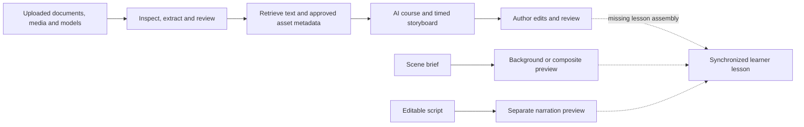

# Training videos: current approach and enhancement plan

Reviewed 2026-11-06 against the local source tree and expanded with generated-content improvements. This extends the existing training-scene and AI-authoring work in `tasks/plan.md`; proposed implementation tasks are TV-01 through TV-20 in `tasks/todo.md`. No runtime changes are included in this assessment.

## Recommendation

Build a source-backed lesson production pipeline around the existing course, media, model, review and job infrastructure. Produce both a synchronized video and an interactive learning experience. Make every instructional statement, demonstrated action and assessment rationale traceable to specific uploaded evidence.

Prioritize content fidelity, instructional clarity, synchronized delivery, and then visual polish. Prefer suitable original demonstrations; use reviewed 3D for explanation and practice; use generated environments for atmosphere while preserving approved device geometry and behavior.

The first milestone should be one complete 90–120 second lesson using the existing fictional Aurora/AIC-001 baseline: evidence, editable storyboard, actual narration, captions, rendered video, a checkpoint, independent review and learner delivery. This duration is a starting design choice, not a universal learning optimum. Split longer procedures at meaningful boundaries. The current schema supports 30–300 seconds.

## Current approach

| Stage | What the code does | What remains limited |
|---|---|---|
| Upload and inspect | Private versioned assets, hashes, asynchronous processing, review and approval. PDF text extraction plus bounded English OCR. Image/video decoding, metadata, previews and timestamped review frames. GLB import and separate reconstruction workflows. | Inspection does not transcribe or understand a demonstration. PDF extraction does not reliably reconstruct complex tables/diagrams or incomplete text layers. |
| Retrieve context | Up to 32 passages across selected documents, English lexical ranking and balanced interleaving; partial/unknown coverage warnings and input fingerprints. Drafts can use ready-for-review documents; publication requires approval. | Passage counts do not prove coverage of prerequisites, warnings, exceptions and procedure steps. The generator receives media/model metadata, not actual images, video frames, audio or geometry. |
| Generate a lesson | Optional `videoLesson` generation returns a course containing timed scenes, objectives, narration, on-screen text, visual references, citations and optional checkpoint links. | This is a storyboard, not a rendered video. The default output budget is 2,000 tokens for the request; richer outputs need staged generation and evaluated budgets. |
| Validate and edit | Structure/timeline checks, exact supplied citation matching, selected approved media IDs, same-course checkpoint links and publication review targets. Author edits title, duration, scope boundary, narration and callouts. | A valid citation does not prove a claim. Visual/citation references are displayed as JSON rather than a visual timeline with source comparison. Model scene/component/action validation needs strengthening. |
| Generate scenes | OpenMontage brief and durable job; locked interactive overlay or cinematic composite; provenance and review-required output. The browser can retain the approved model in the foreground. | An HTTP provider exists, but defaults use prerecorded fixtures. Requests transmit prompt, dimensions, duration and model IDs/hashes, not complete camera/light/safe-region evidence or reference assets. Provider-reported tracking PASS is not independent verification. |
| Generate speech | Editable script goes to Azure Speech when configured; otherwise a silent WAV fixture. Audio is stored separately for preview. | Duration is estimated from word count. This path has no word timing, pronunciation review, caption track or synchronized lesson assembly. |
| Deliver learning | Approved media activities support private learner playback, a transcript and explicit review acknowledgement. Assessments, simulations and story navigation exist separately. | No complete `videoLessons` storyboard-to-render-to-learner integration was found. Demo-local approval/publication is not evidence of a server-published release. |

The foreground-model strategy is a useful foundation: the video generator should not redraw controls or invent mechanics. Approval must still be specific to the teaching purpose. The checked-in NxStage interactive provenance marks its scale unmeasured and hidden surfaces unknown. Visual realism does not establish procedural accuracy, and synthetic reconstruction benchmarks do not establish real-device accuracy.

## Proposed workflow

### 1. Establish what the uploads actually support

Create a versioned source map: device/model/revision, document purpose and authority, page and figure regions, clip time ranges, component IDs and extraction uncertainty. Distinguish documented instructions, observed demonstrations and inference.

Start with author-selected evidence spans in the existing source reader and media gallery. Subsequently add timestamped transcription, OCR of visible labels, shot/event indexing and figure/table extraction. Retain original locators and confidence; uncertain observations require review. Recognition output should not become authoritative instructions automatically.

For each objective, identify required facts, prerequisites, steps, warnings, expected states and source-defined exceptions. Retrieve these explicitly through bounded per-objective passes. Show missing evidence and conflicting revisions. Ask for a specific missing view or clip when necessary; do not invent an unseen transition.

### 2. Make claims and actions reviewable

Give each instructional claim and demonstration an evidence record: supporting text/observation, exact locator, device revision and review disposition. Preserve exact numbers, units, UI labels, warnings and ordering.

The reviewer should see the statement beside its original page, crop or clip. A separate AI pass can flag contradictions, omissions and weak support, but cannot approve itself. Use clear supported/conflicting/unsupported states rather than concealing uncertainty in an average score.

Validate approved model identity, known components, permitted actions, source-backed motion, media types and clip boundaries. A model scene must not pass merely because it has a label. Current lesson checks can accept model visuals without a bound model, making this an immediate validation gap.

### 3. Author a lesson with a clear teaching purpose

Extend the existing scene schema. Each scene needs one objective, claim/evidence IDs, narration, callouts, a precise clip/crop or validated model view/action, an expected visible state, and timing derived from actual audio and action duration.

Provide a visual timeline with source comparison and learner preview. Support scene-level edits/regeneration and pronunciation controls. Editing content invalidates affected review/render artifacts while published releases remain immutable.

Use a useful problem, a worked demonstration, a pause to predict or identify, explanatory feedback, a second attempt and a concise recap. Novices get terminology and guided examples; experienced learners can use faster review and supported troubleshooting. Do not invent failures or treatment consequences for dramatic effect.

### 4. Select visuals by teaching purpose

| Teaching need | Preferred visual |
|---|---|
| Real hand movement, connection or device response | Approved original close-up footage with exact time range and intentional replay. |
| Identify a control or indicator | Original crop with restrained highlighting and exact labels. |
| Explain a relationship or diagram | Annotate the approved figure, retaining labels, direction and caveats. |
| Explore or practice a validated action | Approved 3D model and reviewed component/action mapping, with text/keyboard equivalent. |
| Establish setting | Short filmed/generated environment with controlled device foreground. |
| Missing visual evidence | Supported text/static explanation or request for the missing reference. |

Use operator-eye views for orientation and stable close-ups for detail. Match perspective, scale, materials, light and contact shadows. Hold the camera steady during fine actions. Render labels and screen text from exact strings. Prefer real footage for hands interacting with the device; animated contact requires separate pose, occlusion and sequence review.

Avoid long room fly-throughs, constant orbiting, decorative cuts and music competing with instructions or meaningful device sounds. Each effect should serve an instructional purpose. Photorealism is useful when relevant details remain legible and correct.

### 5. Assemble synchronized audio, visuals and captions

Use one versioned timeline for narration, actions, callouts, captions and checkpoints. Synthesize by scene, allow expert-recorded audio, measure decoded duration, capture word/sentence boundaries and maintain reviewed device-term pronunciations. Fit pacing to natural speech and necessary observation time.

Azure Speech SDK exposes word-boundary audio offsets; using them requires extending the current REST-only adapter or adding alignment. See [Microsoft speech synthesis events](https://learn.microsoft.com/en-us/azure/ai-services/speech-service/how-to-speech-synthesis).

Start with an application-controlled renderer using approved images/clips, deterministic callouts and reviewed audio. Reuse FFmpeg/rendering infrastructure after a narrow packaging check. Add validated 3D rendering next; external generation should be optional for core lesson completion.

Produce MP4, timed WebVTT captions, descriptive transcript, poster, scene/source manifest and review report. Independently decode/probe provider media. Hash the exact storyboard, evidence, narration, model and configuration. Regenerate affected scenes and invalidate final assembly/review when inputs change.

### 6. Connect watching to doing

Publish through the existing media workflow. Add chapters, replay, searchable transcript, visible source links, captions, speed controls and keyboard access. Include important visual information in narration where possible, with an equivalent path where needed. [W3C media planning](https://www.w3.org/WAI/media/av/planning/) distinguishes captions, transcripts and descriptions; a transcript alone is insufficient for all media needs.

Bind checkpoint cues to existing assessment/story/simulation activities. Pause at meaningful decisions, explain answers with source links, replay relevant scenes after errors and resume the same release. Watching or clicking reviewed remains separate from demonstrated competence. An MP4 export cannot carry scored interaction; keep that behavior in the application and represent accessible prompts in the transcript.

Two experiments found improved attention and learning when retrieval tests were inserted into online lectures. That supports evaluating checkpoints here, but does not establish medical-device skill transfer. [Szpunar, Khan and Schacter, PNAS](https://www.pnas.org/doi/10.1073/pnas.1221764110).

## Improvements to the generated training videos themselves

This extension defines the desired quality of the script, shots, demonstrations, voice and final edit. It complements the source-to-playback infrastructure above. These are proposed production requirements to evaluate with learners, not claims that the current generator already achieves them.

### A. Give generation an instructional brief and a consistent visual identity

Before drafting, capture the intended audience, prior knowledge, task, setting, learning objective, source revision, available visual evidence and desired format. Offer editable formats for orientation, guided procedure, troubleshooting and refresher. Select a format because it fits the evidence and task; a collection of photos may support identification but not a motion demonstration.

Build a reusable reference pack containing approved device views, component names, exact display/label text, permitted states/actions, palette, typography, lighting, camera conventions and narrator pronunciation. Reuse it across shots and lessons. Preserve equipment revision, accessories, orientation and relevant starting state across cuts. Record which content is original footage, controlled 3D or generated context in the production manifest; explain illustrative limitations to learners when they affect interpretation.

Use staged generation: **brief → evidence-linked script → shot plan → narrated rough cut → selected final shots → assembled lesson → independent review**. Each stage has a saved version and editable output. This permits corrections before expensive rendering and reduces unnecessary regeneration of already accepted content.

### B. Write scripts that explain what the learner should notice and do

Open with a concrete task or recognizable problem and a brief statement of the intended outcome. Use short, conversational sentences and consistent device terminology. Introduce unfamiliar terms where they first become relevant. Replace vague narration such as “check everything carefully” with the specific observable condition established by the source.

For each instructional beat, generate a coordinated sequence:

1. **Orient:** identify the relevant component or starting state.
2. **Observe:** show the exact cue the learner must notice.
3. **Act:** demonstrate only the supported action, including its prerequisites.
4. **Verify:** hold on the documented resulting state or confirmation.
5. **Explain:** connect the action and result using a source-supported rationale.

If the source gives an instruction but no rationale, retain the instruction and flag the missing explanation for the author. Do not invent a causal story. Place warnings before the affected action. Preserve conditions such as “only if” and “after”; shortening narration must not change their meaning.

Give each lesson a memorable question that is answered through observation and practice. End with a small number of useful cues and a source-linked recap. Use specific misconceptions from reviewed material or learner findings; avoid generic trivia and irrelevant facts.

### C. Generate shots that reveal the instructional detail

Require each shot to specify subject, framing, attention target, starting/ending state, action, source evidence, camera behavior, narration span and minimum observation hold. Add negative constraints for hidden controls, cropped warnings, occluding hands, unreadable displays and unsupported device movement.

Use a repeatable shot grammar: brief context view, operator-view orientation, detail close-up, action demonstration and result close-up. A change in shot should reveal new information. Hold the view while the important action occurs; do not cut away during a critical transition. Keep screen direction consistent, and never mirror labels or reverse handed instructions for composition.

Use highlights, arrows, outlines or magnification to direct attention precisely when the narration names the feature. Keep overlays attached to the correct component throughout motion. Reserve safe space for captions so they do not cover the demonstrated detail. Text should supplement the demonstration, while selectable captions remain available for the spoken content.

Cutaways, exploded views and slow motion are useful only when they explain supported details. Label schematic views and changed playback speed where relevant. Hidden internals require authoritative reference geometry; do not let a plausible generated interior become an instructional claim.

### D. Improve generated realism and continuity

Approve reference/key frames for device identity, pose, composition and visible states before rendering motion. Where a provider supports reference-conditioned generation, pass the approved reference pack and continuity constraints; otherwise retain application-controlled compositing. Stable seeds may aid reproducibility but do not prove visual fidelity.

Inspect the entire transition, not only attractive endpoints. Check for changing button counts, drifting labels, morphing connectors, floating tubing, impossible hand contact, object penetration, inconsistent accessories and state changes without the required action. Validate device response timing against evidence when timing matters.

Keep moving hands and device interaction in original footage or validated animation. For environments, use restrained depth of field, exposure, lighting and movement that keep the task visible. Avoid reflections or dramatic shadows that hide indicators. Generate alternative takes for uncertain scenes within a bounded budget, then compare them against the same source and shot specification.

### E. Make voice, sound and pacing feel intentional

Use a consistent narrator with a calm, direct delivery. Allow the author to adjust pauses, emphasis and pace around unfamiliar terms and decision points. Maintain a reviewed glossary for model names, abbreviations and units. Offer expert-recorded replacements for difficult sections, with the same transcript/timing checks.

Add explicit natural observation pauses after demonstrations and questions. Shorten repetitive wording before accelerating delivery. Do not time-compress an action whose real duration is itself instructional. Align narration to what is on screen so a control is visible when named and the result is held long enough to inspect.

Azure SSML supports phoneme and custom-lexicon pronunciation controls; evaluate them with the selected voice and listen to the actual output. [Microsoft pronunciation documentation](https://learn.microsoft.com/en-us/azure/ai-services/speech-service/speech-synthesis-markup-pronunciation).

Normalize loudness across scenes, prevent clipping and abrupt audio changes, and keep speech intelligible on ordinary laptop/tablet speakers. Use documented device sounds only when they convey a learning cue; invented beeps must not imply real device behavior. Background music should be optional and unobtrusive, with speech-only delivery available. These audio priorities are consistent with [W3C audio/video content guidance](https://www.w3.org/WAI/media/av/av-content/).

### F. Edit for understanding and purposeful engagement

Create a low-resolution narrated rough cut before the final render. Review pacing, source fidelity, visual clarity and the question/feedback sequence together. Remove dead time and repetition while preserving necessary prerequisites, observation holds and transitions. Use clean cuts and restrained transitions; avoid recurring decorative introductions between short lessons.

Build anticipation through relevant questions: “Which visible cue tells you this step is complete?” or “What must be confirmed before the next action?” The final answers must be source-backed. Show a documented mistake beside the correct state when it is useful and appropriately reviewed; keep the correct behavior clear, including when a learner seeks directly to the scene.

Create beginner, refresher and targeted-remediation variants from the same approved claims. A refresher may reduce introductory explanation but must retain necessary warnings and prerequisites. Each variant gets its own complete timeline, review and evaluation. Full translations remain a later extension requiring terminology review, regenerated timing and caption/layout checks.

### G. Review the final video, including sound and motion

Use a scene-by-scene review scorecard with distinct outcomes for factual accuracy, procedural fidelity, visual continuity, clarity, narration, timing, accessibility and engagement. Automated checks can flag corrupted frames, missing captions, audio clipping, text changes and continuity anomalies. Human reviewers still verify meaning, demonstrated behavior and whether the learner can follow the task. Sampled-frame checks alone cannot approve critical action intervals.

| Quality dimension | Proposed acceptance evidence |
|---|---|
| Content fidelity | Every claim/action matches reviewed evidence and the correct device revision; unresolved critical errors block release. |
| Demonstration | Required starting condition, action and resulting state are visible; the complete critical transition is reviewed. |
| Realism | Stable geometry, labels, accessories, lighting and physical contact; limitations are represented honestly. |
| Readability | Relevant labels, indicators, callouts and captions remain legible at intended playback sizes without occluding the task. |
| Audio and timing | Correct pronunciation; no clipped speech; clear sound; captions, callouts and actions align with the narration. |
| Learning design | Each shot serves an objective; questions and feedback test a meaningful source-supported decision. |
| Revision integrity | Review covers the exact final audiovisual artifact and variant; edits make affected approvals stale. |

Author feedback should identify a timestamp, defect and requested correction, such as “hold the result view longer” or “the highlight points to the wrong control.” Regenerate the affected scene, then recheck neighboring transitions and the complete final assembly. Establish numerical audio, legibility and synchronization thresholds with representative devices during TV-19; do not treat arbitrary default scores as proof of quality.

### Example: turn a vague generated scene into a teachable moment

The following uses placeholders for evidence-defined details. The generator must resolve them from approved material before rendering.

| Weak draft | Improved generated treatment |
|---|---|
| Wide rotating device shot while narration says “Inspect the display and continue.” | Begin with a stable operator view, cut to the relevant display, highlight the exact source-defined status, and hold until it is readable. |
| A voice lists several steps over an unrelated looping background. | Match each narrated instruction to its corresponding visible action and verified resulting state, preserving prerequisites. |
| “Did you understand?” appears after the video. | Pause at the actual decision: identify the required visible condition; explain the answer and replay that detail after an error. |
| Polished animation invents a hidden mechanism. | Use the supported external view or an approved schematic with its scope clearly explained. |

### How this extension fits the build sequence

TV-14 establishes the instructional brief after the evidence foundation. TV-15 adds script/shot direction alongside the storyboard editor. TV-16 previews the narrated rough cut before final rendering. TV-17 improves narration and audio finishing. TV-18 adds bounded alternative takes and targeted scene revision. TV-19 establishes finished-video quality review before pilot release. TV-20 creates evidence-preserving learning variants after the interactive/evidence-coverage work. TV-13 evaluates the resulting experience; add TV-20 to its inputs only when variants are included in that pilot.

## Example 110-second format

Use fictional AIC-001 for engineering acceptance. This is presentation design, not new device operating guidance: actions and answers must come from its reviewed manual and simulation.

| Time | Presentation | Purpose |
|---|---|---|
| 0–10 s | Relevant device state and one objective. | Establish a useful problem and simulation scope. |
| 10–28 s | Original image or validated model close-up. | Locate the control and indicator; retain exact terminology. |
| 28–58 s | Source-backed sequence with matched narration and visible expected state. | Demonstrate the task clearly. |
| At 58 s | Pause for a source-backed decision. | Retrieve and apply; response time is outside video duration. |
| 58–85 s | Explain the answer and replay the important detail. | Correct a misconception and connect action to evidence. |
| 85–100 s | Supported variation or linked simulation. | Check application beyond verbatim recall. |
| 100–110 s | Concise recap and source/chapter links. | Support retention and later reference. |

## Delivery order and acceptance

| Stage | Tasks | Completion evidence |
|---|---|---|
| Fidelity foundation | TV-01–03 | Reviewed baseline; every instructional claim/action has evidence; missing model, wrong revision, unsupported claims and conflicts block readiness. |
| Generated-content direction | TV-14–15 | Reviewed audience brief, consistent reference pack and evidence-linked script/shot specifications. |
| First playable lesson | TV-04–07 | Source to editable storyboard to synchronized video/captions to reviewed learner playback; real worker/browser evidence. |
| Generated-video finishing | TV-16–19 | Narrated rough cut, natural speech, bounded scene revisions and review of the exact final video. |
| Active learning | TV-08 | Decision, explanatory feedback, remediation and resume work through existing services without fabricated scores. |
| Source understanding | TV-09–10 | Reviewed multimodal evidence and objective coverage; sparse/conflicting inputs yield explicit gaps. |
| Learning variants | TV-20 | Beginner/refresher/remediation versions preserve required evidence and receive their own review. |
| Realism | TV-11–12 | Validated action/geometry, exact labels, correct contact/occlusion, temporal consistency and independent source comparison. |
| Pilot | TV-13 | Learning, fidelity, accessibility, cost and latency report before wider rollout. |

Critical failures must not disappear into an average quality score. Proposed release gates: no unresolved critical unsupported claims/actions; complete evidence for required procedure elements; correct device/revision and exact readable labels; no cut-off narration or timing mismatch that changes meaning; required review and accessibility checks complete. Establish numerical synchronization and visual tolerances on representative clips before broad automated checks.

Compare current content with the new format on immediate task accuracy, critical errors, delayed recall after approximately one week, and performance on a new supported scenario. Replay, checkpoint errors, abandonment, confidence and feedback are diagnostic signals. Watch time and completion alone do not establish learning. Small usability pilots find problems; they do not automatically demonstrate statistically reliable learning gains.

Track author correction time, unsupported-claim rate, coverage, render failures, cost per approved minute and time to approved lesson. Establish measured baselines before setting ROI or production performance promises.

## Boundaries and decisions

- Reuse existing database, jobs, private storage and reviews. No new orchestration platform or vector database is required initially.
- Keep Aurora/AIC-001 as the initial synthetic baseline. A real-device pilot requires a reviewed source set and intended-use decision; NxStage visual previews alone do not validate every mechanical action.
- Begin in English with web playback and MP4/caption/transcript output. Additional languages require terminology, speech and source-equivalence review.
- Audience, first real lesson, budget, supported device classes and final review owner need decisions before production rollout. They do not prevent the synthetic vertical slice.
- Generated cinematic scenes and avatar presenters are optional later work. First establish accurate teaching and reliable playback.

## Verification and references

`pnpm video-lesson:validate` passed on 2026-11-06: schema/AI builds, deterministic generation, source/media grounding, forged-citation rejection and publication review gating. This review did not perform live generation/deployment, a learner study or real-device fidelity acceptance.

Primary code: [lesson schema](../packages/simulation-schema/src/video-lesson.ts), [generation/retrieval](../packages/ai-gateway/src/index.ts), [grounding](../packages/ai-gateway/src/draft-grounding.ts), [author editor](../apps/web/src/job-status.ts), [publication checks](../packages/simulation-schema/src/index.ts), [learner media](../apps/web/src/learner-media.ts), [provider contract](../packages/contracts/src/openmontage-generation.ts), [generation worker](../apps/worker/src/openmontage-generation-job.ts), [provider](../apps/worker/src/openmontage-provider.ts), [speech](../apps/worker/src/speech-provider.ts).

Supporting project evidence: [OCR](scanned-pdf-ocr.md), [media inspection](media-inspection.md), [scene production](training-scene-production.md), [NxStage provenance](../fixtures/nxstage-system-one-interactive/provenance.json).

Older documents contain historical status followed by later updates. Code was used to distinguish current implementation from those earlier notes. Live deployment configuration was not inspected.
